# Legends

Legends identify the meaning of visual elements in a data visualization and can be used as an alternative to labeling data directly.

Legends are commonly used with data visualizations when more than one color, symbol, size, or line type is used—most commonly in maps. By moving labels outside a visualization, legends can help reduce clutter and make a data visualization more user-friendly.

Legends include a series of item markers with corresponding labels and can optionally include a title. Legend markers may represent colors, patterns, line styles, shapes, symbol sizes, or ranges. When using legends, follow the guidance below.

## Guidance

In addition to the guidance provided in this section, relevant guidance can also be found in the Agency Logo, Colors, Choropleth Maps, Grids, Labels, Map Layout, Scale Bars, Source, Titles, and Typography sections.

### How to interpret this guidance

This page combines three kinds of guidance. They are identified separately so that developers do not mistake general design recommendations for formal agency requirements.

- **Census Bureau standards:** Requirements and review procedures drawn from the U.S. Census Bureau's *Statistical Quality Standards*, revised September 29, 2026. These apply within the scope defined by the standards. The standards require data visualization review and identify review responsibilities; they do not prescribe every design recommendation on this page.
- **Additional visualization recommendations:** Established data visualization and cartographic practices intended to improve accuracy, usability, accessibility, and interpretation. These are recommendations for quality, not standalone official Census Bureau requirements.
- **Developer implementation suggestions:** Practical considerations for implementing and maintaining legends in Power BI, Tableau, Python, R, and web-based visualizations.

For Census Bureau products, consult the current [Statistical Quality Standards](https://www.census.gov/about/policies/quality/standards.html) and applicable internal guidance. In particular, [Standard E2: Reporting Results](https://www.census.gov/about/policies/quality/standards/standarde2.html) includes requirements for clear and understandable graphs, figures, and maps, including legends, consistent formats and scales, color use, and accessibility. [Standard E3: Reviewing Information Products](https://www.census.gov/about/policies/quality/standards/standarde3.html) includes the data visualization review requirement; the supervisory review determines whether the visualization may be used. The standard directs reviewers to use the visualization quick guide in E2-2.2 and the Data Visualization Guidance site.

## Best Practices

### Essential

The following points retain the original legend guidance and clarify how it should be applied.

- Legends should be placed in a prominent location near the visualization without detracting from the visualization itself. They are commonly placed below or parallel to a data visualization; however, depending on the type of data being displayed and the available space surrounding the data visualization, placement above the visualization is also acceptable.
- **Legend Placement Examples:**

  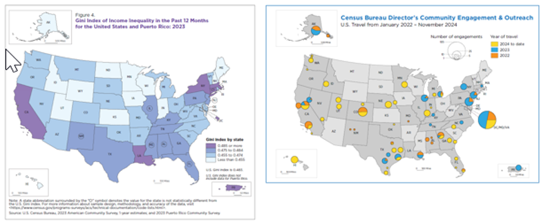

  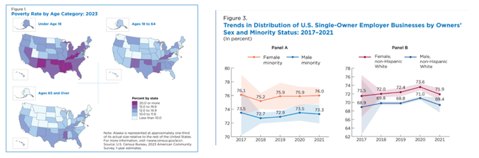

- A legend title is not always necessary. When it is included, however, it should be descriptive and provide additional information not presented in the main title. Instead of using a generic title like “Legend” or “Key,” use a title that captures the meaning of the data being labeled, such as “Population per square mile.”
- When using a vertical legend with sequential data, where values progress from low to high, ensure that the highest number appears first at the top of the legend and the lowest number appears last at the bottom of the legend. For diverging data, where values diverge away from a midpoint (e.g., increase, no change, decrease), a vertical legend is also recommended, with the most extreme values at the opposite ends of the legend.
- Always include a legend unless the data are only one class or all the data are clearly labeled within the visualization.
- For quantitative data in a vertical legend, display numeric values in descending order (highest to lowest). For a horizontal legend, display highest to lowest from left to right. Ensure the ordering is appropriate to the visual encoding and the direction in which readers interpret the visualization.
- Use a sequential or diverging color scheme for numeric (quantitative) data. Use a categorical color scheme for non-numeric (qualitative) data.
- Data values specified in the legend should match the precision of data used to create the visualization. For example, if the data are rounded to a tenth of a percent, the class descriptions in the legend should be rounded to a tenth of a percent.
- The fill color of the legend swatch should match the colors in the map or chart. This includes cases where transparency is applied to the symbols. Background colors or basemaps may also change a color's appearance. The legend swatch should be representative of how the color appears in the map or chart.
- For qualitative data, if the data are visualized in a specific order, such as in a bar chart, list the legend in the same order.
- The data unit of measure must be identified on the visualization. Include the measure (e.g., dollars, percent) in the legend title or within class descriptions for legends without a title.
- The unit of geography for which data are being mapped should be identified on the map. If it is not part of the main title, include the geographic unit in the legend title.
- Keep legend elements grouped together on the page so they appear as a single legend unit.

### Avoid

- For survey data, never incorporate the national average/value/median into the legend display with the data class breaks. This is only acceptable when using data without sampling error, such as decennial census data.
  - The national value can be included below the data classification section of the legend for additional context.

## Additional Recommendations

The recommendations below extend the original guidance with practical considerations for categorical, quantitative, geographic, static, and interactive visualizations. They are not presented as additional official Census Bureau requirements.

### Recommended

#### Placement, layout, and titles

- Place the legend close enough to the visualization that readers can quickly associate the two. Prefer a location that follows the reading order of the page and does not compete with the title, data marks, annotations, or source note.
- Position the legend in available space so it does not distract from the visualization or the title. Preferred placement is below or parallel to a data visualization.
- Organize the legend elements vertically, especially when showing quantitative data. If there are space considerations, horizontal legends may be acceptable.
- Include a legend title that describes the data when the meaning, unit, population, period, or encoding would otherwise be unclear.
- Keep the legend compact, but do not compress labels, swatches, or spacing to the point that the legend becomes difficult to read.
- For responsive layouts, allow long legends to wrap or move below the visualization rather than shrinking text excessively or allowing the legend to overlap the data. On small screens, consider a collapsible legend only when its presence and expanded state are clearly indicated and it remains easy to access.
- Keep legend elements grouped together. Avoid splitting a single legend across distant parts of a page or placing explanatory notes where readers may mistake them for unrelated content.

#### Legend types and color selection

- Match the legend type to the data and visual encoding.

  | Legend type | Appropriate use | Typical presentation |
  |---|---|---|
  | **Qualitative (categorical)** | Unordered groups such as language, industry, or region | Distinct colors, shapes, or line styles; categories are not implied to have a numeric order |
  | **Sequential** | Quantitative values that progress from low to high | One-hue or multi-hue progression with a clear light-to-dark or otherwise ordered change |
  | **Diverging** | Quantitative values that meaningfully depart in two directions from a meaningful midpoint | Two contrasting progressions that meet at a clearly identified midpoint |
  | **Size or graduated symbol** | Quantitative magnitude represented by symbol size | Clearly labeled reference sizes or values, with symbols scaled consistently |
  | **Line or symbol key** | Different series, boundaries, or feature types | Samples that accurately reproduce the line, pattern, shape, or symbol used in the visualization |

#### Visual examples: matching legend design to the data

The following illustration was created for this guide to show common legend structures. They are explanatory examples, not official Census Bureau sample products.

A categorical legend uses distinct markers for unordered groups. A sequential legend shows an ordered progression. A diverging legend identifies a meaningful midpoint. Size and line keys should reproduce the visual encoding used in the chart or map.

- Use sequential color scales for ordered quantitative data with a natural low-to-high progression. The legend should make the direction of the scale clear.
- Use diverging color scales only when a meaningful midpoint exists, such as zero change, a target, or a national reference value. Label the midpoint and both directions clearly. Do not use a diverging palette merely because it contains two colors.
- Use qualitative color scales for unordered categories. Choose colors that are distinguishable from one another and do not suggest an order, magnitude, or ranking that is not present in the data.
- Use a consistent color assignment for the same category across related visualizations, dashboards, and reporting periods. For example, if “Northeast” is represented by a particular color in one chart, retain that assignment in related charts unless there is a documented reason to change it.
- Avoid assigning similar colors to categories that readers must distinguish. Also avoid using a color with a strong conventional meaning (such as red for a negative status) in a way that conflicts with the data's meaning.
- Do not use a rainbow or spectral palette for ordered quantitative data when a perceptually ordered sequential or diverging scale is more appropriate. Uneven visual steps can make differences appear larger or smaller than they are.
- For maps and charts with a background, basemap, or transparency, evaluate the final rendered swatch and mark together. A swatch that matches a raw color value may still appear different when opacity, blending, outlines, or background layers are applied.
- Use a color palette that remains distinguishable in grayscale where practical, and do not rely on subtle hue differences alone to separate important categories.

#### Accessibility and readability

- Do not rely on color alone to communicate meaning. Where appropriate, combine color with direct labels, patterns, line styles, shapes, symbols, position, or text descriptions.

  **Illustrative accessibility example:** Different marker shapes and line styles supplement color so that series remain distinguishable when color differences are difficult to perceive or when the chart is reproduced in grayscale.

  
- Check text and symbol contrast against the legend background. Small text, thin lines, and small swatches can be difficult to distinguish even when the colors themselves are different.
- Consider common color vision deficiencies, including difficulty distinguishing red and green. Test palettes with a color-vision simulation or accessibility checker and revise combinations that become indistinguishable.
- Use sufficiently large swatches and line samples so readers can identify the visual encoding. The marker should be large enough to show relevant patterns, borders, transparency, or line styles.
- Use plain, specific category names. Avoid unexplained abbreviations, internal codes, and labels that require readers to infer the category meaning.
- Ensure keyboard and screen-reader users can access legend information in interactive and web-based visualizations. Provide meaningful text labels for legend controls and communicate whether an item is selected, hidden, or unavailable.
- If the visualization uses patterns, textures, or line styles, make sure those differences remain visible at the final display size and are not so similar that they are difficult to distinguish.

#### Ordering and labels

- Order qualitative categories to match the order used in the chart, map, narrative, or data hierarchy. If no meaningful order exists, use a consistent logical order, such as alphabetical or a recognized geographic or organizational sequence.
- For time-based series, use chronological order. For directional or diverging data, order categories so the legend reflects the visual direction and meaning of the scale.
- Use clear interval notation and avoid ambiguous class boundaries. State whether endpoints are included when that distinction affects which observations belong in a class.
- Use consistent precision, number formatting, symbols, and units across every legend class. For percentages, state whether values are percentages or percentage points where the distinction matters.
- Use labels that describe the measure and population, not just the data field name. For example, “Percent of households with broadband access” is more informative than “Broadband.”
- The legend title should be in initial caps. All categories of a legend should be in initial caps unless proper nouns or subject matter experts indicate otherwise.

#### Geographic and thematic maps

- For maps in a series (e.g., time series) that use a standard legend shown only once, include a note that specifies if a data class is not represented on a specific map.
- On individual maps, especially in interactive visualizations with multiple geographic levels (e.g., state, county, tract), make sure the correct classes are shown in the legend for what is shown on the map. Do not include classes not on the map.
  - If a user can zoom to a smaller geography (e.g., counties within a single state), the assumption is that the legend still applies to the entire country. If the legend is being recalculated for the smaller geography (i.e., the range and distribution are only for counties within the single state), add a note or descriptive text.
- For visualizations showing quantitative data, it is preferred that the ordinal legend swatches abut one another. However, if another category, such as “no data,” is included, it should not touch the rest of the swatches. For qualitative data sets, it is preferred that the legend swatches do not touch each other.
- Clearly distinguish data classes from map features such as state boundaries, county outlines, water, parks, and reference layers. Include separate legend entries only when those features are necessary to interpret the map.
- For choropleth maps, ensure the legend describes the same classification method and class breaks used to shade the map. State the measure and geographic unit, and make clear whether values are counts, rates, percentages, or normalized measures.

  **Illustrative map-legend example:** The legend below uses a descriptive measure title, explicit percentage classes, descending order, consistent class labels, and a separate patterned treatment for unavailable data. The values are fictional and are included only to demonstrate legend structure.

  

  **Supplementary choropleth layout example:** The following illustrative map shows a U.S. state choropleth with a centered quantitative color legend. It demonstrates map-and-legend placement; it is not an example of unavailable-data treatment.

  
- If class intervals are calculated dynamically, explain when and why the class breaks change. When comparing maps, use consistent class breaks if the goal is to compare values across places or time. If each map uses its own classification, disclose that the colors represent relative positions within each map rather than directly comparable values.
- Do not imply that areas without data have a value of zero. Use a separate, clearly labeled treatment for no data, suppressed, unavailable, or not applicable values, and explain the distinction when readers could confuse these conditions.
- If the map uses a national value as a reference, distinguish that reference from the data classes. Follow the survey-data restriction in **Best Practices > Avoid**.

#### Thresholds, ranges, and uncertainty

- Choose class breaks that are statistically and substantively defensible and meaningful for the analytical purpose. Avoid arbitrary thresholds that exaggerate or obscure differences.
- Make intervals mutually exclusive and collectively exhaustive for the range of valid values. Avoid gaps and overlaps, and ensure boundary values fall into exactly one class.
- Use consistent interval precision and notation. For example, use “10.0–19.9” and “20.0–29.9” rather than mixing whole numbers and decimals without explanation.
- Explain whether interval endpoints are inclusive or exclusive when the convention may not be obvious. Avoid relying on cartographic conventions that readers may not know.
- Do not use a diverging scale unless the midpoint is meaningful and labeled. A midpoint should not be selected solely to make the color distribution look balanced.
- When uncertainty, margins of error, or statistical significance affect interpretation, communicate that information in the visualization or accompanying notes using the applicable statistical guidance. Do not use a legend to imply certainty where estimates are uncertain.
- If significance symbols or asterisks are used, define them in a legend or note and identify the relevant confidence level or statistical criterion.

#### Missing, suppressed, unavailable, and undefined values

- Treat missing, suppressed, unavailable, not applicable, and undefined values as distinct conditions when they have different meanings. Do not combine them under “No data” if the distinction is important to interpretation.
- Use a neutral, visually distinct treatment for nonnumeric or unavailable conditions rather than assigning them a position on a quantitative color ramp.
- Explain the meaning of special categories in the legend or an adjacent note. For example, “Data suppressed to protect confidentiality” should not be represented as “0” or as the lowest value.
- Ensure that filters do not silently remove special-value categories when those categories remain present in the displayed data.
- If no observations fall within a class, do not imply that the class contains data. For a series of maps using a shared legend, identify classes that are not represented on an individual map when needed for interpretation.

#### Interactive visualizations and multiple measures

- Keep the legend synchronized with the data currently displayed. When filters, geographic level, date range, or user selections change the data, the legend should update when the underlying scale or categories also change.
- If the legend remains fixed across filters to support comparison, make that behavior clear and retain the same class breaks and color assignments.
- Do not allow a filter to change the meaning of a color without making the change apparent to the user. Dynamic recalculation can make a color represent different values in different states of the dashboard.
- If a legend item can be selected to filter, highlight, or hide data, indicate that it is interactive. Provide a clear way to reset selections and show the selected state.
- When a legend is filtered to show only categories currently present, make sure users can still understand that other categories exist if their absence is relevant. Consider a note such as “Showing categories available for the selected filters.”
- For multiple measures or data series, provide a separate, clearly titled legend for each distinct visual encoding. Do not combine unrelated measures into one ambiguous key.
- If two measures use color and size simultaneously, label both encodings and ensure the legend examples demonstrate the actual combination. Explain which visual variable represents each measure.
- Avoid duplicating identical legends across a dashboard when one shared legend can clearly apply to all related visualizations. If a shared legend is used, ensure all charts use the same encoding, categories, units, and scale.
- Keep interactive legend controls usable with a keyboard and assistive technology. Do not communicate hidden or selected series only through a color change.

### Not Recommended

- Do not use a qualitative palette for ordered quantitative values or a sequential palette for unordered categories.
- Do not use overlapping or ambiguous class ranges, inconsistent numeric precision, or unlabeled thresholds.
- Do not use a diverging scale without a meaningful midpoint.
- Do not use a single color to represent different categories across related visualizations unless the change is clearly explained.
- Do not use color combinations that are difficult to distinguish, especially when color is the only means of identifying categories.
- Do not make legend text, swatches, or line samples so small that they become unreadable on common screen sizes.
- Do not place the legend so far from the visualization that readers cannot determine which chart or map it describes.
- Do not allow an interactive legend to become inconsistent with the filtered data or to change class breaks without communicating that change.
- Do not use “No data,” zero, suppressed, and not applicable interchangeably.
- Do not use a note as a substitute for a clear graphical legend when the classes can be represented directly. A text note may be acceptable in limited cases when no better option exists and the legend cannot graphically describe the classes.
- Do not include unnecessary legend entries for map features or series that are not displayed.
- Do not use a legend to introduce a reference value into survey data class breaks in a way that conflicts with the Census-specific guidance above.

## Examples

The examples below use a consistent comparison format to make the design lesson easier to scan. Each comparison places a **Failed Example** beside a **Preferred Example**, followed by a short explanation of why the design fails or meets the guidance. The original Census Bureau illustrations and their explanations are retained. Where the original material provides only a not-recommended example, the preferred side identifies the design correction rather than presenting an invented Census Bureau illustration.

### Comparison 1: Keep unavailable data separate from the quantitative scale

<table style="width:100%; border-collapse:separate; border-spacing:12px; table-layout:fixed;">
  <tr>
    <td style="width:50%; vertical-align:top; border:1px solid #d8dee4; border-radius:6px; padding:16px;">
      <h3>⚠️ Failed Example</h3>
      
<strong>Problem:</strong> Showing a quantitative choropleth legend without a separate category for unavailable or missing data when some geographic areas do not have reported values.

      

      <h4>Why it Fails</h4>
      
The legend only identifies quantitative percentage ranges and does not provide a separate treatment for unavailable data. If any states lack reported values, readers cannot distinguish those areas from states assigned a quantitative class. Missing information should never be interpreted as zero or as the lowest measured value.

    </td>
    <td style="width:50%; vertical-align:top; border:1px solid #d8dee4; border-radius:6px; padding:16px;">
      <h3>✅ Preferred Example</h3>
      
<strong>Choropleth map with quantitative (sequential) data and a separate "no data" class.</strong>

      
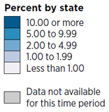

      <h4>Why it Meets the Requirements</h4>
      
The "no data" class is separate from the quantitative sequence and cannot be mistaken for the lowest value. Use a distinct neutral or patterned treatment and label it clearly.

    </td>
  </tr>
</table>

### Comparison 2: Make diverging scales and reference values clear

<table style="width:100%; border-collapse:separate; border-spacing:12px; table-layout:fixed;">
  <tr>
    <td style="width:50%; vertical-align:top; border:1px solid #d8dee4; border-radius:6px; padding:16px;">
      <h3>⚠️ Failed Example</h3>
      
<strong>Problem:</strong> Using a diverging scale without a meaningful midpoint, failing to identify the midpoint, or incorporating a national reference value into survey-data class breaks.

      

      <h4>Why it Fails</h4>
      
A diverging palette implies that values depart in two directions from a meaningful center. An arbitrary midpoint can mislead readers. For survey data, incorporating a national average, value, or median into the data class breaks conflicts with the specific guidance retained above.

    </td>
    <td style="width:50%; vertical-align:top; border:1px solid #d8dee4; border-radius:6px; padding:16px;">
      <h3>✅ Preferred Example</h3>
      
<strong>Choropleth maps with diverging data and clearly identified direction or reference value.</strong>

      
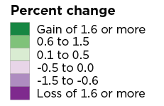

      
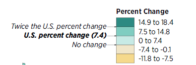

      <h4>Why it Meets the Requirements</h4>
      
The gain/loss labels clarify the direction of change. The national value example is specifically based on 2020 Census data; do not apply this treatment to survey data. Keep reference values distinct from class breaks.

    </td>
  </tr>
</table>

### Comparison 3: Represent quantitative and qualitative data with the right legend type

<table style="width:100%; border-collapse:separate; border-spacing:12px; table-layout:fixed;">
  <tr>
    <td style="width:50%; vertical-align:top; border:1px solid #d8dee4; border-radius:6px; padding:16px;">
      <h3>⚠️ Failed Example</h3>
      
<strong>Problem:</strong> Using a sequential quantitative color ramp for unordered categories, or using unrelated categorical colors for ordered numeric classes.

      

      
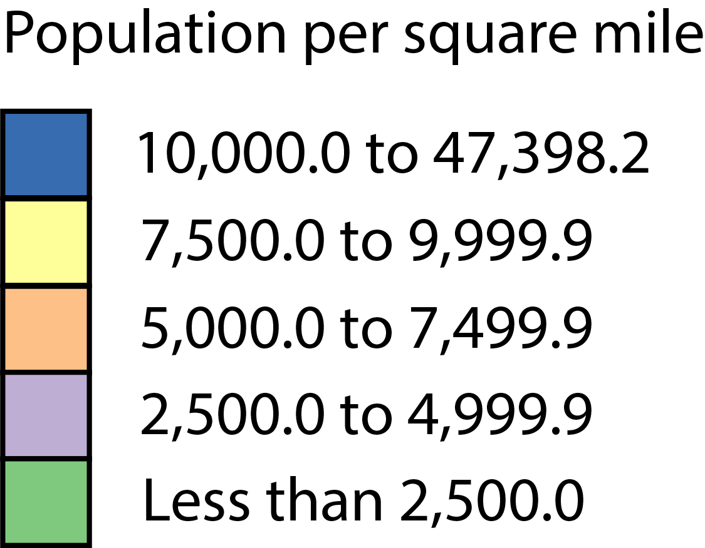

      <h4>Why it Fails</h4>
      
A sequential ramp implies an order that does not exist among language categories. Conversely, unrelated categorical colors hide the natural order of quantitative classes.

    </td>
    <td style="width:50%; vertical-align:top; border:1px solid #d8dee4; border-radius:6px; padding:16px;">
      <h3>✅ Preferred Example</h3>
      
<strong>Use qualitative colors for unordered categories and sequential colors for ordered values.</strong>

      
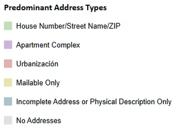

      

      <h4>Why it Meets the Requirements</h4>
      
Qualitative categories use distinct, non-touching swatches. Quantitative classes use an ordered color progression that communicates low-to-high magnitude. Match the palette to the meaning of the data.

    </td>
  </tr>
</table>

### Comparison 4: Use consistent precision and nonoverlapping class ranges

<table style="width:100%; border-collapse:separate; border-spacing:12px; table-layout:fixed;">
  <tr>
    <td style="width:50%; vertical-align:top; border:1px solid #d8dee4; border-radius:6px; padding:16px;">
      <h3>⚠️ Failed Example</h3>
      
<strong>Problem:</strong> Legend classes use inconsistent numeric precision and overlapping class ranges.

      
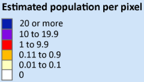

      
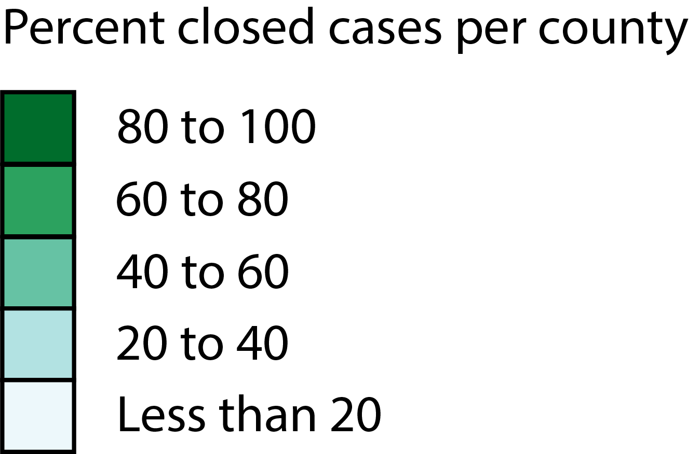

      <h4>Why it Fails</h4>
      
Inconsistent precision can leave values unclassified. Overlapping intervals make it unclear which class contains a boundary value. Do not expect readers to know or infer cartographic interval conventions.

    </td>
    <td style="width:50%; vertical-align:top; border:1px solid #d8dee4; border-radius:6px; padding:16px;">
      <h3>✅ Preferred Example</h3>
      
<strong>Use consistent precision and explicit, mutually exclusive intervals.</strong>

      

      <h4>Why it Meets the Requirements</h4>
      
Use the same precision throughout the legend, make class boundaries explicit, and ensure every valid value belongs to exactly one class. For example, use “10.0–19.9” and “20.0–29.9” rather than ambiguous overlapping ranges.

    </td>
  </tr>
</table>

### Additional preferred examples

The following examples are retained as standalone preferred-design references. They are shown separately because the source material did not include a corresponding failed-example visual for each topic.

#### Distinguish thematic data from geographic reference features

<h3>Example</h3>
      
<strong>Choropleth map with state data and Census Region boundaries.</strong>

      
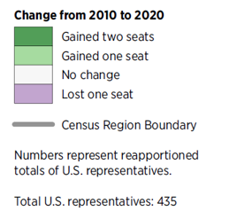

      <h4>Why this Example Works</h4>
      
The map includes the state in its main title and provides additional notes. The legend distinguishes the thematic data from geographic reference boundaries when both are needed to interpret the map.

#### Explain statistical significance and multiple visual encodings

<h3>Example</h3>
      
<strong>Map with significance notes and proportional symbols representing two variables.</strong>

      
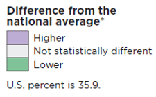

      
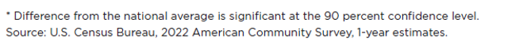

      
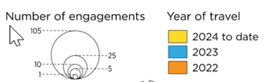

      <h4>Why this Example Works</h4>
      
The significance symbol is identified in the legend and supported by a note about the confidence level for survey data. The proportional-symbol example separates the size and color encodings so readers can identify the measure represented by each.

#### Make symbol, size, and dot legends interpretable

<h3>Example</h3>
      
<strong>Graduated symbols, proportional symbols, and dot distribution.</strong>

      
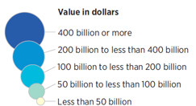

      

      <h4>Why this Example Works</h4>
      
Use a graphical key that reproduces the map's symbol sizes and fills. State what each dot represents and whether dots show individual observations or an aggregated quantity.

#### Order horizontal legends to match the visualization

<h3>Example</h3>
      
<strong>Horizontal legends arranged in the same order as the chart, time sequence, or visual direction.</strong>

      
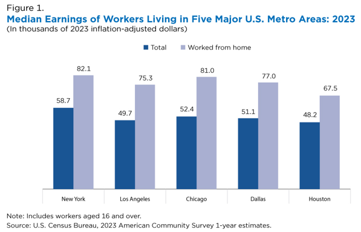

      
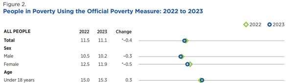

      
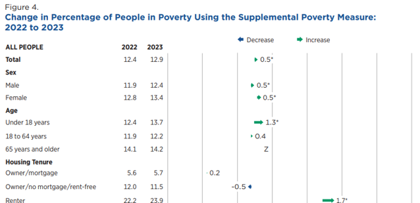

      <h4>Why this Example Works</h4>
      
The legend follows the way readers scan the visualization: left to right, in logical time order, or in the direction represented by the data.

#### Use text notes only when a graphical legend is not practical

<h3>Example</h3>
      
<strong>Use a graphical size key when possible; retain a text note only when needed.</strong>

      
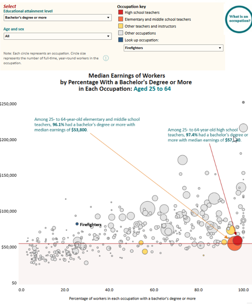

      <h4>Why this Example Works</h4>
      
The original example is identified as not recommended but acceptable in limited cases when no better option exists and the legend cannot graphically describe the classes. Prefer a clear symbol-size key whenever practical.

### Additional original examples and references

The following original examples are retained as additional references:

- **Proportional symbol map:** The statistical-significance and multiple-encoding examples above use circle size for the total number of events and color fill for the year. The legend should explain both encodings.
- **Horizontal legend examples:** The preferred horizontal-legend examples above demonstrate order that follows the chart, chronology, and direction of the visualization.
- **Original source material:** [Poverty in the United States: 2023](https://www2.census.gov/library/publications/2024/demo/p60-283.pdf) and [Demobase Angola and Namibia](https://www.census.gov/library/visualizations/time-series/demo/demobase-angola-and-namibia.html).

## Developer Quality Checklist

Use this checklist before publishing a visualization. Items marked “when applicable” are relevant to interactive, geographic, or statistical visualizations only.

### Accuracy and interpretation

- [ ] Every legend item corresponds to a visual element that appears in the visualization.
- [ ] Swatches, symbols, line styles, patterns, transparency, and sizes accurately match the rendered data marks.
- [ ] The legend describes the correct measure, population, unit, and geographic level.
- [ ] Category labels and numeric values are accurate and use consistent precision and formatting.
- [ ] Quantitative classes are ordered correctly and have clear, nonoverlapping boundaries.
- [ ] Sequential, diverging, or qualitative scales are appropriate for the data type.
- [ ] The midpoint of a diverging scale is meaningful and clearly identified.
- [ ] Missing, suppressed, unavailable, not applicable, and undefined values are represented accurately and are not confused with zero.
- [ ] Reference values, thresholds, ranges, and significance symbols are defined and statistically appropriate.

### Readability and layout

- [ ] The legend is close to the visualization and does not obscure data, titles, labels, or source notes.
- [ ] The legend title is descriptive and adds information rather than repeating the main title.
- [ ] Labels are concise, understandable, and free of unexplained abbreviations.
- [ ] Text, swatches, symbols, and line samples are legible at the intended display size.
- [ ] Legend categories follow the order used in the visualization or a clearly justified logical order.
- [ ] The legend remains usable on smaller screens and does not overlap or become excessively compressed.

### Accessibility and color

- [ ] Color is not the only means used to communicate important distinctions.
- [ ] Colors are distinguishable for users with common color vision deficiencies.
- [ ] Text and visual markers have sufficient contrast against the legend background.
- [ ] Patterns, shapes, line styles, and symbols remain distinguishable at the final display size.
- [ ] The legend can be accessed and understood with keyboard navigation and assistive technology, when applicable.

### Consistency and interactive behavior

- [ ] The same category uses the same color, symbol, or line style across related visualizations unless a change is explained.
- [ ] Multiple legends are clearly separated and titled when they describe different measures or encodings.
- [ ] Shared legends are used only when all associated visualizations use the same categories, units, and scale.
- [ ] Filters and selections update the legend appropriately, or the fixed-scale behavior is clearly explained.
- [ ] Interactive legend items communicate their selected, hidden, or unavailable state and can be reset.
- [ ] Dynamic class breaks or category changes are disclosed when they affect interpretation.
- [ ] The legend does not imply comparability across maps or charts when their scales or class breaks differ.

### Census-specific review and publication

- [ ] Applicable Census Bureau statistical quality requirements and data visualization guidance have been consulted.
- [ ] For Census Bureau information products, the required data visualization review has been completed and documented in accordance with Statistical Quality Standard E3-2.4.
- [ ] The visualization has been reviewed for accuracy, suitability, and consistency with the data and methodology.
- [ ] Any applicable source, uncertainty, disclosure avoidance, DMS, and DRB information is included in accordance with the relevant standards.
- [ ] The final visualization and its legend have been checked after export or publication to confirm that colors, labels, layout, and interactive behavior render as intended.

## Developer Implementation Considerations

These suggestions are implementation guidance, not platform-specific requirements. The same design rules should be applied regardless of the software used to create the visualization.

| Platform | Implementation considerations |
|---|---|
| **Power BI** | Use consistent category-to-color assignments across report pages. Check whether slicers change the categories or scale represented by the legend. For custom visuals, verify keyboard accessibility, tooltips, and responsive behavior. |
| **Tableau** | Review color legends and size legends independently when multiple encodings are used. Confirm that filters, parameter actions, and dashboard actions do not create misleading or stale legends. |
| **Python** | Set category order and color mappings explicitly rather than relying on automatic palette assignment. Keep legend labels and plotted categories tied to the same data definitions. |
| **R** | Define factor levels and scale mappings deliberately. Check that faceting, filtering, and scale limits do not unintentionally drop or reorder legend entries. |
| **Web visualizations** | Provide accessible text labels and keyboard-operable legend controls. Test responsive placement, contrast, focus states, and synchronization between legend interactions and displayed marks. |

Before release, inspect the visualization in its final environment. A legend that looks correct in a development notebook or desktop authoring tool may render differently when exported, embedded, resized, or viewed on a mobile device.

## References

- The three supplemental legend illustrations in this page are original explanatory graphics created for this guide; their example labels and values are fictional and are not Census Bureau data or official sample products.
- U.S. Census Bureau. *Statistical Quality Standards* (revised September 29, 2026), particularly Standard E2, Reporting Results, and Sub-Requirement E3-2.4, Data Visualization Review. [Census Bureau Statistical Quality Standards](https://www.census.gov/about/policies/quality/standards.html).
- U.S. Census Bureau. [Statistical Quality Standard E2: Reporting Results](https://www.census.gov/about/policies/quality/standards/standarde2.html).
- U.S. Census Bureau. [Statistical Quality Standard E3: Reviewing Information Products](https://www.census.gov/about/policies/quality/standards/standarde3.html).
- U.S. Census Bureau. *Data Visualization Guidance* (referenced by Statistical Quality Standard E3-2.4).
- [Poverty in the United States: 2023](https://www2.census.gov/library/publications/2024/demo/p60-283.pdf).
- [Demobase Angola and Namibia](https://www.census.gov/library/visualizations/time-series/demo/demobase-angola-and-namibia.html).
