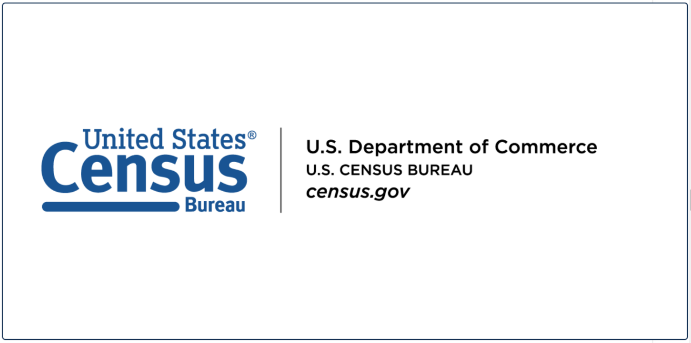
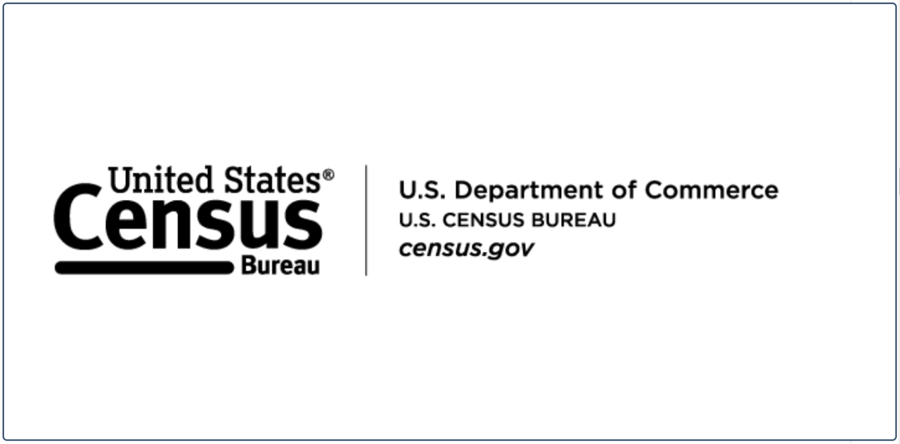
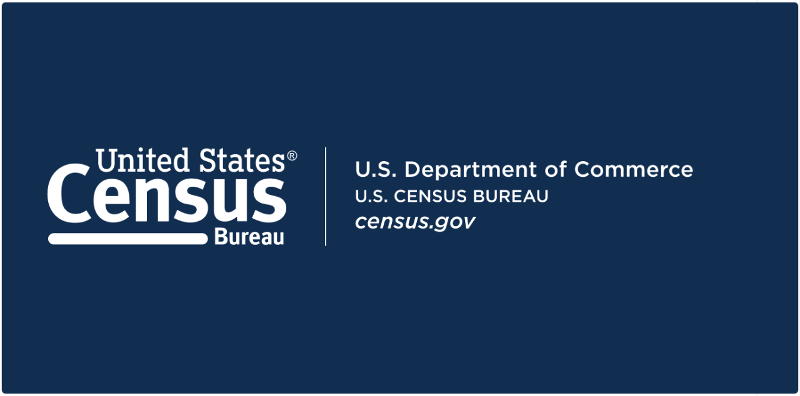
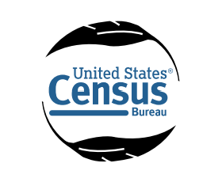
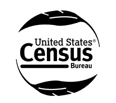
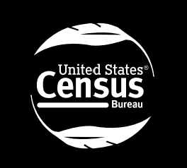

# Agency Logo

An agency logo helps readers recognize the organization responsible for a data product and understand the institutional context in which the information is being presented. In Census Bureau visualizations, logo use is part of a broader identity system: the official Census Bureau standard logo, approved color variations, and the Department of Commerce (DOC) endorsement lockup each serve a distinct purpose. They are not interchangeable, and the correct treatment depends on the audience, publication context, and applicable branding requirements.

This page applies general visualization guidance on logo placement and avoiding interference with chart content alongside the Census Bureau's Corporate Identity and Branding Standards. Developers should use approved artwork and consult the latest branding guidance before publication. A logo identifies an agency; it does not replace a data source statement, explain a dataset, or establish that the Census Bureau endorses an external analysis.

Related component guidance includes Agency Logo, Colors, Choropleth Maps, Grids, Labels, Map Layout, Scale Bars, Source, Titles, and Typography. Apply those pages for their respective component-specific recommendations rather than repeating their full standards here.

**Official Census branding references:** Use the [Corporate Identity and Branding Standards PDF](https://www2.census.gov/about/policies/cb-style-guide.pdf) for the detailed standards and the [current online Branding guidance](https://www.census.gov/aem-user-guide/foundations/branding.html) for current logo assets and file-format recommendations. The PDF links below use `#page=` to open the relevant PDF viewer page directly. These are PDF viewer page numbers, which may differ from the printed page numbers shown in the guide.

## 1. Purpose and Overview

An agency logo communicates institutional identity. It helps users recognize who is presenting a visualization, reinforces a consistent visual identity across products, and can help distinguish an official agency communication from an unrelated or unofficial product. The Census Bureau's branding guide describes the standard logo as a central element of its corporate identity and uses it on digital and print materials to support recognition (Corporate Identity and Branding Standards: [standard logo, PDF p. 11](https://www2.census.gov/about/policies/cb-style-guide.pdf#page=11), [clear space, PDF p. 12](https://www2.census.gov/about/policies/cb-style-guide.pdf#page=12), and [color options, PDF p. 13](https://www2.census.gov/about/policies/cb-style-guide.pdf#page=13); printed pp. 5–7).

Agency identification matters because visualizations are frequently copied, embedded, downloaded, or shared outside the page where they were first published. A clear and appropriate agency identity can help preserve context when a chart is viewed on its own. However, a logo is not a substitute for the information users need to interpret the data.

A logo is different from the other elements that identify a visualization:

- **Agency logo:** The approved visual mark identifying the organization or the applicable endorsement relationship.
- **Visualization title:** Describes the subject, population, measure, geography, and/or period being analyzed.
- **Source statement or citation:** Identifies the data used to create the visualization and provides enough information for users to locate it.
- **Attribution:** Names the organization that produced, supplied, or published the data. Attribution may be written text and may identify an organization other than the one presenting the visualization.

The [current Census Bureau Branding page](https://www.census.gov/aem-user-guide/foundations/branding.html) distinguishes the **standard Census Bureau logo** from the **DOC endorsement lockup**. Its [Census Bureau Logo section](https://www.census.gov/aem-user-guide/foundations/branding.html#:~:text=Census%20Bureau%20Logo) shows the standard blue, black, and white logo treatments, while its [DOC Endorsement (Lockup) section](https://www.census.gov/aem-user-guide/foundations/branding.html#:~:text=DOC%20Endorsement) explains when the lockup is used. The standard logo is the agency's standalone corporate identity mark. The lockup combines Census Bureau identification with the U.S. Department of Commerce endorsement. The lockup is specifically directed for public-facing materials associated with Census Bureau data; the guide says not to use it on promotional materials or materials intended only for internal audiences. Neither treatment should be confused with the **Census Bureau seal**, which the guide reserves for official and legal documents and other specifically authorized uses.

For Census Bureau-produced or authorized public-facing data products, apply the current branding guidance to determine the required logo treatment. Do not assume that an external organization may place the Census Bureau logo or lockup on its own product merely because it uses Census data. External publishers should follow their own identity rules, provide accurate data attribution, and obtain authorization before using Census Bureau marks.

The logo should support recognition without becoming a focal point that competes with the data. Use the official artwork rather than recreating it with text, fonts, shapes, or approximated graphics. A recreation can change letterforms, spacing, proportions, or other distinctive features and may no longer represent the approved identity.

## 2. When to Use

Select a logo treatment based on the product's publisher, intended audience, publication context, and the current Census Bureau branding guidance. The branding guide states that its corporate identity standards apply to communications materials including data visualizations, websites, publications, presentations, social media, and other digital and print products ([scope and corporate identity standards, PDF pp. 8–9](https://www2.census.gov/about/policies/cb-style-guide.pdf#page=8); printed pp. 2–3).

- **Standalone charts and maps:** A standalone visualization should carry the appropriate agency identity when it is an official or authorized Census Bureau product. Preserve enough surrounding space for the mark to remain distinct from titles, labels, legends, and data marks. Include a source statement even when the logo is present.
- **Data dashboards and interactive reports:** Use a consistent branding area in the dashboard shell or report header. If each visualization can be exported or viewed independently, ensure the exported view retains the necessary identity and source information.
- **Public-facing Census data products:** The branding guide directs use of the DOC endorsement lockup on public-facing materials associated with Census Bureau data. Apply this direction to covered Census Bureau communications and authorized products, while confirming any product-specific or program-specific requirements with the brand owner.
- **Downloadable reports and exported visualizations:** Include the applicable approved mark in the document or exported graphic. Check that the logo remains legible and that its placement survives PDF, PNG, and other export workflows.
- **Embedded visualizations on external websites:** Determine who is publishing the product and whether the external publisher is authorized to use Census Bureau branding. If not, use accurate written attribution and a link to the Census source rather than adding an official logo or lockup in a way that could imply sponsorship or endorsement.
- **Presentations and other data communication materials:** Follow the brand guide and the template or publication system for the material. The guide includes examples of standardized logo placement in report and factsheet templates; do not transfer those page-specific layouts to charts without considering the available space and context.
- **Internal-audience visualizations:** Do not use the DOC lockup on materials intended only for internal audiences. The guide does not say that every internal visualization must carry the standalone logo; use the internal product's approved template and local requirements.
- **Visualizations involving multiple government agencies or data providers:** Identify each source in the source statement or accompanying notes. Do not combine marks into a new composite logo or imply that every listed organization sponsored or endorsed the visualization. Obtain approval for any multi-agency branding arrangement.

**Choosing the Census treatment:**

1. Confirm that the visualization is a Census Bureau-produced or authorized communication and identify the organization responsible for publication.
2. For a covered public-facing product associated with Census Bureau data, use the DOC endorsement lockup as directed by the guide.
3. Do not use the lockup on promotional materials or internal-only materials.
4. Where the standalone standard logo is the appropriate approved treatment, select the blue, black, or white/reversed version according to the background and reproduction context.
5. If the publisher is an external organization, do not infer permission to use Census Bureau marks from the fact that Census data is included. Use written attribution unless logo use has been authorized.

## 3. When to Use an Alternative

A standard logo may not be the correct treatment in every context. Consider another approved approach when the intended audience, publisher, layout, or brand rules make a logo inappropriate.

- **The DOC lockup is required or more appropriate:** For Census Bureau public-facing materials associated with Census Bureau data, the branding guide directs use of the DOC endorsement lockup. Do not substitute the standalone logo simply because it is easier to fit. The lockup is not appropriate for promotional materials or internal-only materials.
- **The material is internal-only:** Do not use the DOC lockup. Use the internal template or a written agency identification if needed. The branding guide does not establish a universal requirement to place a standalone logo on every internal visualization.
- **The material is promotional:** The DOC lockup is expressly excluded from promotional materials. Promotional products may have additional campaign-specific rules; confirm the correct approved treatment with the brand owner rather than selecting a logo independently.
- **Multiple agencies or providers contribute data:** A single logo may incorrectly suggest that one organization produced all data. Use a source statement that distinguishes the data providers and the publisher. Any multi-agency marks or co-branding must be approved rather than assembled by developers.
- **The background does not support the available logo treatment:** Use the approved black or white/reversed version as appropriate. Do not recolor the logo, add outlines, apply filters, or create a new variant. If no approved treatment is legible, change the branding area's background or consult the brand owner.
- **Space is limited:** Use a designated report or dashboard header/footer, or place the logo in the surrounding publication rather than inside the plot. For a standalone export, retain the information needed to identify the publisher and data source. Do not shrink the mark until it becomes unreadable.
- **The logo would interfere with interpretation:** Move it outside the plotting region or use a surrounding report header/footer. Do not cover data, labels, legends, controls, or uncertainty indicators.
- **The publisher is an external data user:** Prefer written attribution and a link to the official data source unless the organization has permission to use Census Bureau branding. Attribution must not imply Census Bureau sponsorship or approval of the external analysis.

Alternatives may include a source statement, written agency attribution, text-based identification, or a linked agency/source reference. An approved monochrome or reversed logo variation is also an option when the background requires it. These are not ways to bypass a branding requirement: if an official product requires a particular treatment, confirm the correct option with the responsible brand authority.

The [online Branding guidance on U.S. Census Bureau designation](https://www.census.gov/aem-user-guide/foundations/branding.html#:~:text=U.S.%20Census%20Bureau%20Designation) also establishes naming conventions. In external communications, use **U.S. Census Bureau** for the first reference and **Census Bureau** for subsequent references. For internal communications, use **Census Bureau**. Do not refer to the agency or its programs as “the Bureau,” “Census,” or “BOC” alone. The Census Bureau seal is reserved for official and legal documents, not a substitute logo for routine charts or dashboards (branding guide: [agency naming conventions, PDF p. 10](https://www2.census.gov/about/policies/cb-style-guide.pdf#page=10), and [DOC/Census Bureau seals, PDF p. 19](https://www2.census.gov/about/policies/cb-style-guide.pdf#page=19); printed pp. 4 and 13).

## 4. Choosing Between Alternatives

| Analytical Goal | Alternative Visualization | Why It May Be Preferable |
|---|---|---|
| Identify a covered public-facing Census data product | DOC endorsement lockup instead of standalone standard logo | The branding guide directs the DOC lockup for public-facing materials associated with Census Bureau data. Do not use it for promotional or internal-only materials. |
| Identify the Census Bureau on a light background | Blue/full-color standard logo | The guide identifies blue on white or a light background as the preferred standard-logo treatment. |
| Identify the Census Bureau on a dark background | Approved white/reversed logo | The guide permits a reversed mark on a dark background when it has enough contrast to remain legible. Do not create a reversed version by editing the artwork yourself. |
| Use a neutral treatment where the blue mark is unsuitable | Approved black logo | The guide permits black as a color option. Select it only when it is supplied as an approved variation and remains legible. |
| Identify a data provider without implying agency sponsorship | Written agency attribution or source statement | Text can distinguish the data producer, publisher, sponsor, and other contributors more precisely than a single logo. |
| Keep the plot area clear | Logo in the report/dashboard header or footer | A reserved branding area preserves the chart's visual hierarchy and prevents the mark from covering data. Ensure standalone exports retain required context. |
| Preserve recognition at different output sizes | Proportionally scaled official asset | Correct scaling retains the original artwork. The branding guide gives print reproduction guidance; do not treat those print dimensions as universal pixel requirements for dashboards. |
| Identify multiple data sources | Multi-source citation and written attribution | A source statement can list multiple providers without inventing a composite mark or suggesting that one agency produced all data. |

## 5. Data Requirements and Statistical Considerations

Agency logos are branding components, not statistical evidence. Their use must not obscure who produced the data, where the data came from, or what the visualization represents.

- **Identify the data producer and publisher separately.** The organization presenting a visualization may differ from the organization that collected or published the underlying data. State those roles clearly.
- **Distinguish Census Bureau data from external data.** If the visualization combines Census Bureau estimates with data from another agency, identify each source and explain any relevant combination or transformation. Do not place a Census Bureau logo in a way that implies that all displayed data originated with the Census Bureau.
- **Identify multiple sources.** A single logo cannot communicate a multi-source methodology. Include a complete source statement or citation and, where needed, notes describing which measure came from which provider.
- **Avoid implied endorsement.** Use of a Census Bureau mark must not suggest that the Census Bureau endorses an external product, organization, analysis, or interpretation. External users should use accurate written attribution and obtain authorization before using marks.
- **Retain source statements and citations.** A logo never replaces a source statement. Statistical Quality Standard E2, Requirement E2-2, item 2, requires information products—including each data visualization and standalone tables—to provide a source citation or source statement for the data used. The citation/source statement includes author(s), title (including product and vintage), version if applicable, persistent identifier if available, and URL if available. The standard recommends an overall source citation at the front of a report or webpage (Statistical Quality Standards, p. 113).
- **Make standalone visualizations self-contained.** Standard E2-2.3 describes the information a visualization needs when separated from its originating source, including a clear title, universe definitions, legend or direct labels, information about statistical significance, and a full citation/source statement (Statistical Quality Standards, pp. 120–121). A logo alone does not satisfy these requirements.
- **Preserve statistical context.** Do not let a logo cover uncertainty information, footnotes, definitions, or other material needed to interpret estimates. Follow the relevant statistical guidance for margins of error, significance, and limitations.
- **Use the appropriate review process.** Statistical Quality Standard E3-2.4 requires data visualization review for information products and describes reviewer responsibilities and review documentation (pp. 132–133). Logo selection does not replace statistical, subject-matter, or supervisory review.

The Statistical Quality Standards do not establish logo dimensions, clear-space rules, color variants, or DOC lockup rules. Those are branding matters addressed by the Corporate Identity and Branding Standards. Do not present a branding recommendation as a statistical requirement.

## 6. Visualization-Specific Considerations

### Logo selection

- Use the official Census Bureau standard logo or DOC endorsement lockup supplied through an approved brand asset source. Confirm the correct treatment for the product and audience before adding it to a visualization.
- **Blue/full-color:** The branding guide identifies blue on a white or light background as the preferred standard-logo treatment.
- **Black:** The guide permits a black version. Use only the supplied approved black artwork.
- **White/reversed:** The guide permits a reversed version on a dark background of any color, provided the logo and lockup have enough contrast to remain clearly legible.
- **DOC endorsement lockup:** Use for covered public-facing materials associated with Census Bureau data. Do not use on promotional materials or materials intended only for internal audiences.
- **Seal:** Do not substitute the Census Bureau seal for the standard logo. The guide reserves the seal for official and legal documents and other specifically described authorized uses.

The branding guide's printed examples show the standard logo and DOC lockup in blue/black and reversed treatments (pp. 5–7). The following logo files are displayed as visual references. Confirm that each file is the current approved version before using it in a published Census Bureau product.

#### Standard Census Bureau logo

| Blue / full-color | Black | White / reversed |
|---|---|---|
|  |  |  |

#### DOC endorsement lockup

The DOC endorsement lockup is a distinct branded treatment, not simply another color variation of the standalone logo. Use it only in the publication contexts described in the Census Bureau branding guidance.

| Blue lockup | Black lockup | White / reversed lockup |
|---|---|---|
|  |  |  |

#### AIAN logo treatments

The AIAN logo is a separate identity treatment. The supplied files include a Pantone version, a black version, and a reversed version. Select the appropriate treatment for the background and confirm the current AIAN-specific branding requirements before publication.

| Pantone version | Black | Reversed |
|---|---|---|
|  |  |  |

### Logo placement

- Place the logo in a designated branding area such as a report header, dashboard masthead, or footer outside the plotting region. A corner just outside the visualization, such as the top-right or bottom-left, or a position below the source information may work depending on the layout. Treat these as layout suggestions, not a universal Census Bureau placement rule.
- Keep the mark away from chart titles, subtitles, legends, data labels, map keys, scale bars, interactive controls, and uncertainty notes.
- Use a consistent location across related dashboards or report pages, while allowing the layout to adapt when a chart is embedded or exported.
- Follow the branding guide's clear-space rule: the standard logo must have one “s” height (measured from the word “Census”) of unused space around it ([logo placement and clear space, PDF p. 12](https://www2.census.gov/about/policies/cb-style-guide.pdf#page=12); printed p. 6). The guide's diagram illustrates this space. Do not substitute an arbitrary pixel value for this measurement.
- For report templates, use the established endorsement panel or other prescribed layout. The branding guide describes a fixed grid and endorsement panel for report covers ([report layout examples, PDF pp. 33–34](https://www2.census.gov/about/policies/cb-style-guide.pdf#page=33); printed pp. 27–28); do not alter an existing approved template grid.

### Logo sizing and proportions

- Preserve the original aspect ratio. Scale width and height together; never stretch, squash, skew, crop, or selectively remove logo elements.
- Keep the logo large enough to remain recognizable at the final display and export size, but do not make it more prominent than the visualization's title or key information.
- The branding guide specifies a 1.5-inch logo width for a standard 8.5-by-11-inch page and says that, in general, the logo should not be smaller than 0.75 inch wide if readability or reproduction quality would be jeopardized ([reproduction size, PDF p. 14](https://www2.census.gov/about/policies/cb-style-guide.pdf#page=14); printed p. 8). This is print reproduction guidance, not a universal minimum for screen layouts. For other formats, verify the latest approved specifications rather than converting this value into an unsupported pixel threshold.

### Background and contrast

- Prefer the blue logo on white or light backgrounds.
- Use the approved black version where appropriate, or the white/reversed version on a dark background.
- Confirm sufficient contrast in the actual output, including when a dashboard theme, image, map, or report background changes.
- Do not create a new logo color, add a drop shadow, outline, glow, transparency effect, or background badge unless an approved asset or current brand specification explicitly provides it.

### Consistency

- Use the same approved treatment, relative scale, and branding location across related visualizations unless a publication template or product-specific requirement directs otherwise.
- Use the same approved logo treatment consistently across the dashboard and its exported report.
- Verify PDF and image exports; transparency, scaling, and rasterization can change how an asset appears.

### Responsive layouts

- Define a responsive branding area that can shrink or reposition without colliding with titles, filters, navigation, legends, or chart content.
- On small screens, move the logo to a dedicated row or footer rather than forcing it into a crowded chart header.
- If the logo cannot remain legible at the available size, use the approved page-level branding area or a permitted text attribution; do not distort the mark or silently omit a required treatment.
- Test dashboard resizing and embedded views at common viewport widths. Check both interactive and exported states.

### Accessibility

- Provide meaningful alternative text for an informative logo image, such as `U.S. Census Bureau logo` or `U.S. Census Bureau and Department of Commerce endorsement lockup`, according to the actual asset.
- If the logo is decorative because the agency is already identified in adjacent text, use the implementation's decorative-image pattern so assistive technology does not announce redundant information.
- Do not rely on the logo as the only means of identifying the data source or agency. Keep a readable source statement and, where appropriate, a text agency name.
- Confirm that the selected variation remains visually distinguishable against its background. Follow applicable accessibility and contrast guidance for general text and interface elements.

### Visual comparison examples

The following comparisons summarize common logo treatments to avoid and the preferred alternatives.

Examples shown:

1. **Distorted versus proportionally scaled:** Stretching the logo changes the approved artwork; scale both dimensions proportionally.
2. **Wrong versus appropriate dark-background treatment:** A blue mark on a dark background may be difficult to read; use an approved white/reversed version when appropriate.
3. **Inappropriate versus appropriate DOC lockup context:** Do not use the lockup on promotional or internal-only materials; use it on covered public-facing Census data materials.
4. **Logo-only versus logo plus source statement:** A logo does not identify a dataset, vintage, or URL; retain a complete citation/source statement.
5. **Overlay versus reserved branding area:** A logo must not cover plotted data; position it outside the data region.

#### Example 1: Static data visualization with a branded footer

This manufacturing pay chart demonstrates how agency identification and source information can be placed in a dedicated footer below the data-display area. The logo and Department of Commerce identification are visually separated from the chart, while the source statement appears on the opposite side of the footer. The chart also retains its title, measure, units, explanatory note, and data source information above the footer.

**What to apply:**
- Reserve a footer area for the agency identity rather than placing the logo over the chart.
- Keep the source statement visible and distinct from the logo.
- Preserve enough space for the chart's explanatory note and other context before the footer begins.
- Check the logo and source text at the final export size; small footer text can become difficult to read when the visualization is reduced.

#### Example 2: Interactive dashboard with a persistent branded footer

This income distribution dashboard demonstrates how agency identification can remain visible in an interactive product with filters and a larger visualization area. The filter panel is separated from the chart, and the footer places the Census Bureau identification on the left and source information on the right. The dark footer also provides a consistent visual boundary between the dashboard content and its attribution.

**What to apply:**
- Keep branding outside the interactive chart area so it does not compete with filters, category labels, or data marks.
- Maintain a consistent footer across dashboard states and filter selections.
- Include the source title, reference years, and a link or other locator that helps users find the underlying data.
- Verify that the footer remains readable at smaller viewport widths and in exported or embedded views.
- Ensure the logo has meaningful alternative text when it conveys agency identity not already provided in adjacent text.

These examples illustrate layout approaches, not blanket approval of every visual or branding detail shown. Confirm that the logo treatment, endorsement lockup, wording, and use are appropriate for the product's publisher and audience. The examples do not replace the current Census Bureau branding requirements or the source-citation requirements described above.

## 7. Census Data Example

- **Analytical question:** Which states had the largest total resident populations in 2023?
- **Dataset and table:** 2023 American Community Survey (ACS) 1-year estimates, table B01003, Total Population; estimate variable `B01003_001E`.
- **Source:** [2023 ACS 1-year API endpoint](https://api.census.gov/data/2023/acs/acs1?get=NAME%2CB01003_001E&for=state%3A%2A) and [2023 ACS 1-year API documentation](https://www.census.gov/data/developers/data-sets/acs-1year.html).
- **Geographic level:** State (50 states and the District of Columbia, as returned by the API).
- **Reference period:** 2023 ACS 1-year estimates.
- **Measure and units:** Total population estimate, persons.
- **Reason for selection:** The standard Census Bureau identity is relevant because the data are produced by the Census Bureau. For an official public-facing Census Bureau data product associated with these data, the branding guide directs use of the DOC endorsement lockup. The lockup belongs in a reserved header or footer area, not over the bars.
- **Limitations:** The example compares estimates, not exact population counts. Users should consult ACS documentation for survey design, estimate interpretation, and uncertainty. A third-party publisher should not use Census Bureau branding without authorization. The source statement must remain present regardless of the logo treatment.

For an official public-facing Census Bureau product, use the approved DOC lockup supplied by the brand owner. Place it in the lower-right or other designated endorsement area outside the plotting axes, while keeping the title at the top and the source statement in the footer. The DOC lockup is appropriate for the covered public-facing data product; it is not appropriate for a promotional item or internal-only material. The source statement should name the U.S. Census Bureau, the ACS product and vintage, table B01003, the estimate variable, and the API URL. Do not let the lockup replace the title, source citation, or any notes about the estimate.

## 8. Developer Implementation

### 8.1 Selecting and Preparing the Logo

Before adding a logo to a visualization, confirm that the publisher is authorized to use the mark and determine whether the standard Census Bureau logo or DOC endorsement lockup is appropriate. Obtain the current approved artwork through the official Census Bureau branding guidance or the designated brand contact.

- **Select the correct treatment.** Choose the approved blue, black, or white/reversed version based on the background and publication context. Do not recolor the artwork to create a new variation.
- **Choose a suitable format.** The [current online Census Bureau Branding guidance](https://www.census.gov/aem-user-guide/foundations/branding.html) specifies **SVG for web use** and **PNG for print or web use**. SVG is resolution-independent and useful for browser-based layouts when the target software supports it. PNG is widely supported and suitable for print or web placement when it has adequate resolution. Confirm current format recommendations before publication.
- **Preserve proportions and artwork.** Scale width and height together. Do not crop, stretch, rotate, redraw, or change typography. Maintain the guide's one-“s”-height clear space around the standard logo.
- **Use the correct background version.** Select the approved treatment intended for the actual background. Do not generate a reversed version by applying a filter or changing pixel colors.
- **Provide alternative text.** Use alt text that describes the actual mark. Avoid a generic description such as `logo` when the image is the DOC endorsement lockup.
- **Check the final output.** Review the logo in the published visualization and in exported PDF, PNG, and print versions. Confirm that it remains legible and is not clipped, blurred, displaced, or obscured.

**SVG versus PNG:** SVG stores vector paths and scales cleanly across screen sizes without the pixelation associated with enlarging a raster image. PNG stores pixels and is widely supported by reporting, office, and visualization tools; choose sufficient resolution for the final output size. Test the selected format in the actual publishing and export environment.

### 8.2 Logo Placement and Layout

Place the approved logo in a reserved branding area that is visually separate from the chart, map, or other data marks. A dedicated header or footer is usually preferable to positioning the logo inside the plotting region. The placement should support agency recognition while leaving the title, data, labels, legends, controls, and source statement easy to find and read.

- **Choose a consistent location.** Use the designated header, footer, or endorsement area specified by the applicable branding template. For standalone visualizations, a footer can keep the logo and source statement with the exported image. For dashboards and web pages, align the logo with the page's established identity area.
- **Preserve the original proportions.** Scale the logo uniformly. Do not stretch, compress, rotate, crop, redraw, or rearrange any part of the mark. Leave the required clear space around it.
- **Use the correct background treatment.** Select the approved blue, black, or white/reversed artwork for the actual background. The logo and its surrounding area should appear visually consistent; do not create an unapproved color treatment simply to make the image blend into a footer.
- **Keep the source statement separate.** The logo identifies the agency; the source statement identifies the data. Include the data producer, product, vintage, table or measure where relevant, and a URL or persistent identifier when available. Do not place the source text so close to the logo that the two appear to be one combined mark.
- **Allow for responsive layouts.** At narrow widths, move the logo and source statement to separate rows or stack them rather than shrinking them until they become difficult to read. Keep the logo clear of navigation, filters, legends, and interactive controls.
- **Support user customization carefully.** If a publishing tool allows users to move or resize a logo, constrain the logo to the designated branding area, preserve its aspect ratio, and prevent it from covering data or required source information. Do not offer controls that recolor, crop, distort, or otherwise alter the official artwork.
- **Check all output formats.** Review the logo in the live dashboard or page and in exported PNG, PDF, and print versions. Confirm that it is not clipped, blurred, displaced, or obscured and that the source statement remains legible.

The following layout is a general implementation pattern, not a prescribed Census Bureau template: reserve one region for the logo and agency identification, a separate region for the source statement, and keep both outside the data-display area. Follow the current brand template whenever it specifies a different arrangement.

### 8.4 Reproducibility and Adaptation

- **Power BI:** Add the approved asset to the report's designated header/footer or image visual. Check the behavior in Desktop, Power BI Service, mobile layout, and exported PDF or PowerPoint. Use a logo image only where permitted by the product's branding requirements. Do not place it over chart data or use a third-party URL that may become unavailable.
- **Tableau:** Add the logo through a dashboard image object or the approved workbook layout. Maintain the intended proportions and test tiled/floating placement at the final dashboard size. Check downloaded images and PDFs separately.
- **JavaScript and web visualizations:** Use an approved SVG for web placement when the target environment supports it, or a PNG as specified by the project branding guidance. Set image dimensions proportionally, provide meaningful alternative text, and avoid CSS filters or transforms that alter the artwork.
- **HTML and CSS:** Use an `` element with a stable relative path and descriptive `alt` text. Set `max-width: 100%; height: auto;` to preserve proportions. Reserve a responsive container so the logo does not overlap navigation, titles, filters, or chart content.
- **SVG and PNG:** Keep the approved original file and do not convert or overwrite it as part of a build step. If conversion is required for a target platform, retain the original and compare the output against the source.
- **PDF and image exports:** Verify that the logo is not clipped, pixelated, or displaced and that its background treatment remains legible. Confirm that the source statement and any required context are included in the exported file.
- **External embeds:** Confirm whether the publisher is authorized to use Census Bureau marks. If not, identify the source in text and link to the official Census data product without implying endorsement.

For reproducibility, document the logo file's origin, version/date obtained, intended treatment, placement, sizing, and any replacement history. Keep the approved asset, source information, layout specifications, and export settings together so another developer can reproduce the branding treatment consistently. Statistical Quality Standard E1-6 calls for documentation needed to replicate and evaluate analysis, including relevant files (p. 89); it does not prescribe logo asset management, but retaining the approved asset and layout specifications supports consistent reproduction.

## 9. Common Errors and Misinterpretations

| Issue | Why It Matters | Recommended Correction |
|---|---|---|
| Using an outdated or unofficial logo | The mark may not match the current corporate identity or approved treatment. | Obtain the current asset from the official brand source and verify its version before publication. |
| Recreating the logo with text, fonts, or shapes | Recreated artwork can alter typography, spacing, and proportions. | Use an approved original asset; never redraw the mark. |
| Using the wrong variation for the background | The logo may lose contrast or become difficult to recognize. | Use the approved blue, black, or white/reversed file appropriate to the background. |
| Using the DOC lockup on promotional materials | The branding guide expressly says not to use the lockup on promotional materials. | Use the approved promotional treatment confirmed by the brand owner. |
| Using the DOC lockup on internal-only materials | The branding guide expressly excludes internal-audience-only materials. | Do not use the lockup; follow the approved internal template. |
| Using the standard logo when the DOC lockup is required | Covered public-facing Census data materials are directed to use the DOC endorsement lockup. | Confirm the product context and use the lockup where the guide applies. |
| Stretching or distorting the logo | Distortion changes the approved artwork and reduces brand consistency. | Preserve the intrinsic aspect ratio when resizing. |
| Cropping or cutting off logo elements | Missing text or graphic elements can make the mark incomplete or misleading. | Use the complete approved artwork and provide adequate container space. |
| Making the logo too large or too small | An oversized mark competes with the data; an undersized mark may not reproduce clearly. | Follow the print guidance where applicable and test screen sizes in the target product. |
| Using insufficient contrast | The mark may be unreadable against the visualization background. | Use an approved color/reversed treatment and verify the final rendered output. |
| Placing the logo over data or controls | It can obscure values, labels, map features, or interactive functionality. | Move the logo to a reserved header or footer outside the visualization area. |
| Inconsistent treatment across related dashboards | Users may perceive related products as unrelated or unofficial. | Standardize approved assets, placement, and scaling across the product family. |
| Using an inappropriate file format | Some formats may not render consistently or may lose quality in export. | Follow the stated SVG-for-web and PNG-for-print-or-web recommendation, and test platform compatibility. |
| Losing image quality during export | Rasterization or low-resolution source files can make the logo blurry. | Use the approved production asset and validate output at final resolution. |
| Omitting alternative text where needed | Screen-reader users may miss the agency identity conveyed by an informative logo. | Supply meaningful alt text, or mark it decorative when adjacent text already conveys the same information. |
| Treating the logo as a source statement | A logo does not identify the dataset, vintage, table, variable, or URL. | Include the full source citation or source statement required by E2-2. |
| Implying Census Bureau endorsement of external analysis | The mark may suggest approval or sponsorship that has not been granted. | Use written attribution and obtain authorization before using Census Bureau marks. |
| Using the Census Bureau seal as a routine logo | The seal is reserved for official/legal documents and other authorized uses. | Use the standard logo or applicable lockup instead. |
| Using branding where it is not authorized | Correct use of Census data does not automatically grant permission to use agency marks. | Confirm permission with the brand owner; use text attribution when logo use is not authorized. |

The DOC lockup exclusions, naming conventions, logo clear space, approved color options, print reproduction guidance, and seal restrictions above are requirements or recommendations stated in the supplied branding guide. Relative paths, responsive layout checks, alt text, export validation, and consistent dashboard placement are developer implementation recommendations unless another applicable standard or product specification makes them mandatory.

## 10. Publication Quality Checklist

- [ ] The correct official Census Bureau logo or approved lockup has been selected.
- [ ] The publisher and intended audience have been identified.
- [ ] The appropriate blue, black, or white/reversed variation has been selected.
- [ ] The DOC endorsement lockup is used for covered public-facing Census data materials.
- [ ] The DOC lockup is not used on promotional materials or internal-only materials.
- [ ] The Census Bureau seal has not been substituted for the standard logo in routine visualizations.
- [ ] The current Census branding guidance has been checked.
- [ ] The original artwork and aspect ratio have been preserved.
- [ ] The logo has not been redrawn, distorted, cropped, or modified.
- [ ] Required clear space has been maintained.
- [ ] Logo sizing is appropriate for the output; print sizing guidance has not been misapplied as a universal screen requirement.
- [ ] The selected variation has sufficient contrast against its background.
- [ ] The logo is placed in a designated area and does not interfere with chart content, controls, or labels.
- [ ] Placement and treatment are consistent across related visualizations.
- [ ] Responsive behavior has been tested on smaller screens and embedded views.
- [ ] Meaningful alternative text is provided when the logo conveys information not already present in text.
- [ ] The logo is not the only agency identification or data attribution.
- [ ] Source statements identify the actual data producer(s), product, vintage, and URL or persistent identifier where available.
- [ ] The visualization does not imply unsupported Census Bureau endorsement of an external product or analysis.
- [ ] Exported PDF, PNG, and other publication formats retain the correct logo treatment and source information.
- [ ] The appropriate branding, data visualization, and supervisory reviews have been completed.

---

## References

- U.S. Census Bureau. *Corporate Identity and Branding Standards*. See [Census Bureau’s Brand Name, PDF p. 10](https://www2.census.gov/about/policies/cb-style-guide.pdf#page=10) (printed p. 4), [Census Bureau Logo, PDF p. 11](https://www2.census.gov/about/policies/cb-style-guide.pdf#page=11) (printed p. 5), [Logo Placement, PDF p. 12](https://www2.census.gov/about/policies/cb-style-guide.pdf#page=12) (printed p. 6), [Color Options, PDF p. 13](https://www2.census.gov/about/policies/cb-style-guide.pdf#page=13) (printed p. 7), [Reproduction Size, PDF p. 14](https://www2.census.gov/about/policies/cb-style-guide.pdf#page=14) (printed p. 8), [U.S. Department of Commerce and U.S. Census Bureau Seals, PDF p. 19](https://www2.census.gov/about/policies/cb-style-guide.pdf#page=19) (printed p. 13), and [report/factsheet layout examples, PDF pp. 33–39](https://www2.census.gov/about/policies/cb-style-guide.pdf#page=33) (printed pp. 27–33). The supplied PDF is a 54-page copy named `cb-style-guide(1).pdf`.
- U.S. Census Bureau. *Statistical Quality Standards*, revised September 29, 2026. See Requirement E2-2, item 2 (p. 113); visualization self-contained and presentation guidance under E2-2.3 (pp. 120–121); E3-2.4, Data Visualization Review (pp. 132–133); and E1-6, documentation for replication and evaluation (p. 89).
- U.S. Census Bureau. [Corporate Identity and Branding Standards PDF](https://www2.census.gov/about/policies/cb-style-guide.pdf). Relevant PDF viewer pages: [p. 10—agency naming](https://www2.census.gov/about/policies/cb-style-guide.pdf#page=10), [p. 11—standard logo](https://www2.census.gov/about/policies/cb-style-guide.pdf#page=11), [p. 12—placement and clear space](https://www2.census.gov/about/policies/cb-style-guide.pdf#page=12), [p. 13—color options](https://www2.census.gov/about/policies/cb-style-guide.pdf#page=13), [p. 14—reproduction size](https://www2.census.gov/about/policies/cb-style-guide.pdf#page=14), and [p. 19—DOC and Census Bureau seals](https://www2.census.gov/about/policies/cb-style-guide.pdf#page=19).
- U.S. Census Bureau. [Online Branding guidance](https://www.census.gov/aem-user-guide/foundations/branding.html), including [U.S. Census Bureau Designation](https://www.census.gov/aem-user-guide/foundations/branding.html#:~:text=U.S.%20Census%20Bureau%20Designation), [Census Bureau Logo](https://www.census.gov/aem-user-guide/foundations/branding.html#:~:text=Census%20Bureau%20Logo), and [DOC Endorsement (Lockup)](https://www.census.gov/aem-user-guide/foundations/branding.html#:~:text=DOC%20Endorsement). This page also states the SVG and PNG recommendations and provides the current logo images/request information.
- U.S. Census Bureau. [2023 ACS 1-year API documentation](https://www.census.gov/data/developers/data-sets/acs-1year.html).
