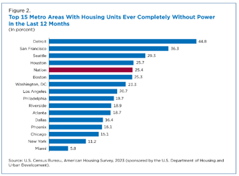

# Sources

Sources should be cited with all data visualizations so that users know
where the underlying data come from. When cited properly, sources help
expert users access the underlying data for replication or other
purposes. While many federal agencies have their own guidance for
formatting sources, there are components that any source statement
should include:

-   State the dataset name.
-   Indicate the agencies that provided and/or sponsored the data.
-   Indicate the vintage of the source data.
-   If publicly accessible online, provide links to the source data.

Source statements should provide enough information for readers to
identify, locate, and understand the original data used in a
visualization. Developers should consider the source statement part of
the visualization's documentation, not simply a citation added before
publication.

When preparing source statements, distinguish between the source data's
reference period, its publication or release date, and the date the data
were accessed or retrieved. These dates serve different purposes and
should not be treated as interchangeable.

Source documentation should also make it possible to determine whether
the visualization uses original source data, derived measures, or data
that have been combined or transformed during the development process.

## Guidance

A source statement identifies the origin of the data used in a
visualization. It should be concise enough to fit the publication format
while still giving users a clear path to the original data.

The source statement and any accompanying methodology note serve related
but different purposes:

-   The **source statement** identifies the dataset, data provider,
    sponsor when applicable, reference period, and location of the
    source data.
-   The **methodology note** explains relevant processing or analytical
    steps performed after the data were obtained, such as filtering,
    aggregation, calculation, normalization, or combining datasets.

Not every source statement requires every possible metadata element.
Follow the U.S. Census Bureau's citation guidance or the applicable
agency's requirements when they differ from the general recommendations
on this page.

## Best Practices

### Essential

-   Follow the U.S. Census Bureau's (or your agency's style, if
    different) citation styles.
-   Source statements need to include the following: dataset name,
    agencies that provided and/or sponsored the data, and the vintage of
    the source data.
-   Source statement should be the last or bottom element included in a
    data visualization. For standalone visualizations (e.g., interactive
    visualizations), source statements are on visualization itself. For
    visualizations embedded in a document (e.g., working paper), source
    statements should be included as the last element in the note. See
    {Component: Notes\[EF1.1\]}.
-   If multiple datasets are directly used, each should be listed in the
    source statement.
-   Include the specific dataset, table identifier, or API dataset
    identifier when available. Avoid relying exclusively on broad
    dataset names when multiple tables or data products exist.
-   Distinguish the data reference period (vintage) from the publication
    date and retrieval date. Include the relevant year, survey period,
    or estimate period associated with the displayed data.
-   When using Census API data, document the API dataset, relevant table
    or variable identifiers, and geographic level used to retrieve the
    data.
-   If data have been filtered, aggregated, normalized, calculated, or
    otherwise transformed, provide an accompanying note explaining the
    relevant methodology when those changes could affect interpretation
    or replication.
-   When derived statistics are displayed, identify the underlying
    measures and explain how the derived values were calculated when
    necessary for interpretation or replication.
-   Ensure that source statements accurately represent the data
    displayed. Do not attribute calculations, estimates, or conclusions
    produced by developers to the original data provider.
-   When multiple datasets are combined, identify the sources and
    explain how they contribute to the resulting visualization.
-   Ensure that source links direct users to the specific dataset,
    table, API endpoint, or downloadable data product whenever possible.
-   Verify that source links are accessible and that the referenced data
    correspond to the information presented in the visualization.

### Avoid

-   Using generic source descriptions such as "U.S. Census Bureau Data"
    without identifying the specific dataset or data product.
-   Providing links only to an agency's homepage when a direct dataset,
    table, or API link is available.
-   Confusing the date data were retrieved with the reference period
    represented by the data.
-   Combining multiple datasets without identifying which source
    supports each displayed measure.
-   Omitting documentation of significant data transformations,
    calculations, or aggregations.
-   Using outdated datasets or previously published estimates without
    identifying their reference period.
-   Presenting derived calculations as though they were directly
    published by the original data provider.
-   Using broken hyperlinks, inaccessible URLs, or links that no longer
    identify the original data product.
-   Including unnecessary technical details in the visible source
    statement when those details would be more appropriately documented
    in accompanying notes or technical documentation.
-   Assuming that an agency logo alone provides sufficient source
    information when the applicable agency guidance requires additional
    attribution.

## Additional Recommendations

### Recommended

-   If interactive, the source statement should include hyperlink to the
    source data.
-   If a standalone visualization where the sponsoring agencies and
    Census Bureau logo are included at the bottom, the names do not need
    to be included in the source statement.
-   Where multiple sources are used, it should be clear which data
    source is used for each particular component of the visualization.
    This can be done in multiple ways, e.g., title, popup window while
    hovering if interactive, or caption/notes section.
-   For data retrieved through APIs, consider including the API
    endpoint, query parameters, or a reproducible query link in
    accompanying technical documentation.
-   For frequently updated datasets, include the retrieval date or
    latest update date so users can understand when the data were
    obtained.
-   Where appropriate, provide a downloadable dataset or link to the
    underlying data used to generate the visualization.
-   For interactive visualizations, consider providing source
    information within tooltips, popups, expandable notes, or a
    dedicated methodology section when different components use
    different datasets.
-   When displaying calculated indicators, percentages, rates, or
    ratios, document the numerator, denominator, and calculation
    methodology when these details are not self-evident.
-   When geographic data are used, identify the geographic level and
    relevant geographic definitions or boundaries when they affect
    interpretation.
-   When comparing data across multiple years, document changes in
    dataset definitions, collection methodologies, geographic
    boundaries, or estimation methods that could affect comparability.
-   When source data contain sampling error, margins of error, or other
    relevant uncertainty measures, provide appropriate accompanying
    documentation or notes.
-   Maintain source documentation alongside the visualization's
    development files so that future updates can be traced to the
    original data.
-   Where practical, maintain version-controlled documentation of source
    data, API queries, and data preparation scripts.

### Not Recommended

-   Adding lengthy source descriptions directly inside a visualization
    when the information can be provided through accompanying notes or
    technical documentation.
-   Overloading interactive visualizations with repeated source
    information when a clearly accessible source or methodology section
    can provide the necessary details.
-   Using tooltips as the only location for essential source information
    that users need to understand the visualization.
-   Providing multiple source links without explaining which data each
    link supports.
-   Requiring users to reconstruct complicated API queries when a
    reproducible query or technical documentation can be provided.
-   Repeating identical source information across every chart when a
    shared source statement clearly identifies the data used throughout
    the visualization.

## Source Statement Format

Source statements should follow a consistent structure while allowing
flexibility for different visualization types and data providers.

A general source statement can follow this format:

**Source:** \[Dataset Name\], \[Data Provider/Agency\], \[Reference
Period/Vintage\]. \[Additional Sponsoring Agency, if applicable\].
\[Dataset URL\].

### Recommended Source Components

<table>
  <thead>
    <tr>
      <th style="width: 20%;">Component</th>
      <th style="width: 45%;">Description</th>
      <th style="width: 35%;">Example</th>
    </tr>
  </thead>
  <tbody>
    <tr>
      <td><strong>Dataset Name</strong></td>
      <td>Official name of the dataset or data product.</td>
      <td>American Community Survey</td>
    </tr>
    <tr>
      <td><strong>Data Provider</strong></td>
      <td>Agency responsible for producing or collecting the data.</td>
      <td>U.S. Census Bureau</td>
    </tr>
    <tr>
      <td><strong>Sponsoring Agency</strong></td>
      <td>Agency responsible for sponsoring or funding the data, when applicable.</td>
      <td>Department of Commerce</td>
    </tr>
    <tr>
      <td><strong>Reference Period</strong></td>
      <td>Year or period represented by the data.</td>
      <td>2024</td>
    </tr>
    <tr>
      <td><strong>Table/Variable</strong></td>
      <td>Specific table or variable identifiers, when applicable.</td>
      <td>B01003</td>
    </tr>
    <tr>
      <td><strong>Retrieval Date</strong></td>
      <td>Date the data were retrieved, when relevant.</td>
      <td>October 20, 2026</td>
    </tr>
    <tr>
      <td><strong>Source URL</strong></td>
      <td>Direct link to the dataset, table, or API.</td>
      <td>Census API endpoint</td>
    </tr>
  </tbody>
</table>

### Example Source Statements

**Example 1: Single Dataset**

Source: U.S. Census Bureau, American Community Survey, 2024 5-Year
Estimates, Table B01003. \[Dataset Link\]

**Example 2: API-Generated Visualization**

Source: U.S. Census Bureau, American Community Survey, 2024 5-Year
Estimates, Table B01003, retrieved October 20, 2026. \[API Query Link\]

**Example 3: Multiple Datasets**

Sources: U.S. Census Bureau, American Community Survey, 2024 5-Year
Estimates; U.S. Census Bureau, Population Estimates Program, 2024.
\[Dataset Links\]

### Important Considerations

-   These examples are illustrative formats and should be adapted to the
    applicable agency citation requirements.
-   Not every source statement requires every component.
-   Retrieval dates are particularly useful for dynamically updated
    datasets and API-based visualizations.
-   Additional methodological information should be included in
    accompanying notes when necessary.
-   Replace illustrative dataset names, identifiers, dates, and links
    with the actual information used in the visualization. Do not
    publish placeholder links as source citations.

## Data Transformation and Methodology Notes

Source statements identify the original data providers, while
methodology notes explain how the underlying data were prepared and
presented.

When data are modified or transformed during visualization development,
developers should provide additional documentation when those changes
could affect interpretation or reproducibility.

### Recommended Documentation

-   **Data filtering:** Identify relevant filters or excluded records.
-   **Aggregation:** Explain how observations were grouped or
    summarized.
-   **Calculations:** Document formulas used to generate derived
    measures.
-   **Normalization:** Explain adjustments made to support comparisons.
-   **Data integration:** Identify datasets that were joined or
    combined.
-   **Geographic transformations:** Document changes to geographic
    boundaries or geographic levels.
-   **Missing values:** Explain how missing, suppressed, or unavailable
    values were handled.
-   **Uncertainty:** Document relevant margins of error or other
    statistical limitations.

### Example

**Source:** U.S. Census Bureau, American Community Survey, 2024 5-Year
Estimates, Table B01003.

**Methodology Note:** Population totals were retrieved at the county
level and aggregated to the state level for comparison. The displayed
percentages were calculated by dividing each county's population by its
corresponding state population.

The calculations represent derived measures and are not directly
published estimates from the original dataset.

## Examples

***Example 1:*** In the example below, the source statement is at the
bottom of an interactive visualization. The agency logos replace the
provider names in the source statement.

***Example 2:*** In the
[example](https://www.census.gov/library/stories/2024/10/power-outages.html)
below, the source statement is at the bottom of the visualization in an
article. It includes the data producer and sponsor in the source
statement name itself.

## Source Documentation Quality Checklist

Before publishing a visualization, developers should verify the
following:

-   [ ] The dataset name is clearly identified.
-   [ ] The data provider and sponsoring agency are identified, when
    applicable.
-   [ ] The source data's reference period or vintage is documented.
-   [ ] Relevant table, variable, or API identifiers are included.
-   [ ] Source hyperlinks direct users to the underlying data.
-   [ ] Multiple datasets are individually identified.
-   [ ] Each data source can be associated with its corresponding
    visualization component.
-   [ ] Relevant data transformations and calculations are documented.
-   [ ] Geographic levels and reference periods are identified.
-   [ ] Relevant statistical uncertainty and limitations are addressed.
-   [ ] Source statements are positioned appropriately.
-   [ ] Interactive visualizations provide accessible source
    information.
-   [ ] Supporting documentation allows developers to reproduce the
    underlying data preparation when applicable.
