# Map Layout

Map layout establishes how geographic areas, map views, and supporting elements are arranged so readers can understand where a pattern occurs and how it relates to surrounding places. A map's layout is not only a matter of appearance: geographic placement, extent, projection, scale, labeling, and the relationship between the map and its legend can affect interpretation.

This guidance covers three common presentation formats. The amount of interaction differs, but the underlying cartographic principles should be applied whenever the platform allows.

1. **Formatted static maps** resemble printed or PDF maps. The information does not change and there are no built-in interactions.

   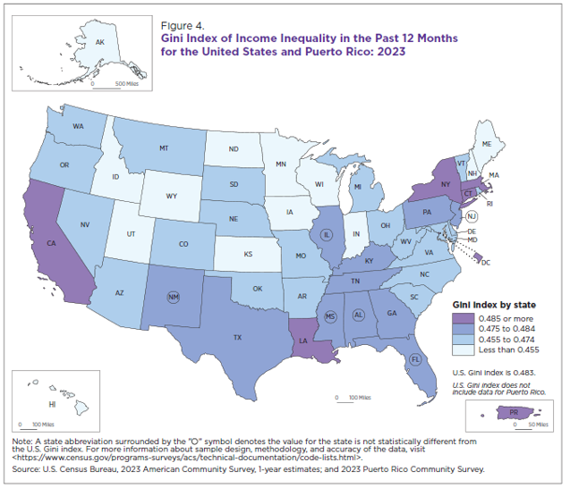

   [Household Income in States and Metropolitan Areas: 2023](https://www2.census.gov/library/publications/2024/demo/acsbr-023.pdf)

2. **Formatted interactive maps**, or “Visualizations,” provide limited interaction, such as pop-ups or hover details. Zooming is limited and may not reveal substantially more data.

   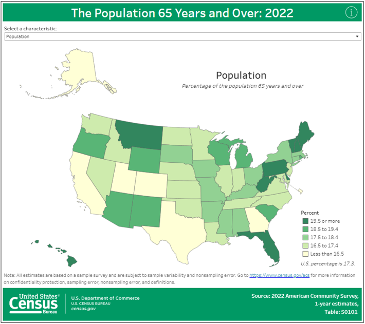

   [The Population 65 Years Old and Over: 2022](https://www.census.gov/library/visualizations/interactive/population-65-and-over-2022.html)

3. **Fully interactive maps** are generally designed for on-screen exploration rather than printing. They may offer zoom-dependent detail, pop-ups, filtering, and other interactions.

   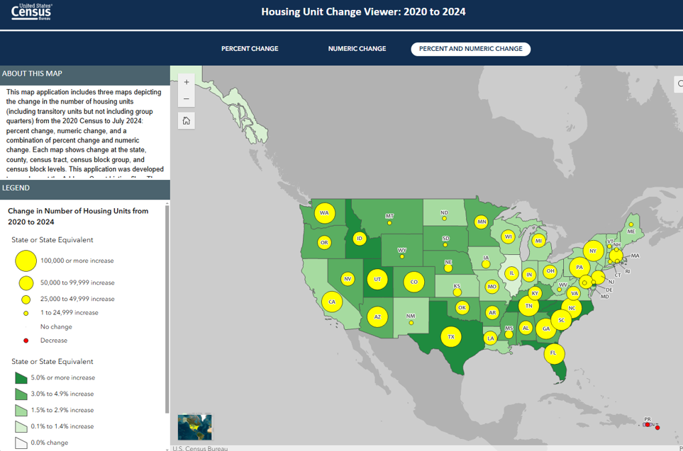

   [Housing Unit Change Viewer: 2020 to 2023](https://mtgis-portal.geo.census.gov/arcgis/apps/experiencebuilder/experience/?id=3a87e24a2ec54e01ab277a12d467e7d9)

## Guidance

In addition to this section, consult the repository guidance for **Agency Logo, Colors, Grids, Legends, Scale Bars, Source, Titles, and Typography**. Map layout decisions should be coordinated with those components rather than treated as independent design choices.

Much of the guidance below reflects traditional cartographic practice and the Census Bureau's map-specific conventions. Because interactive applications have different technical constraints and affordances, some recommendations are most directly applicable to formatted static maps. Apply the underlying cartographic principles to interactive maps whenever practical.

### How to interpret the guidance

- **Census Bureau map guidance** refers to the map conventions and requirements stated in this component's source material, including the original map-layout guidance reproduced here.
- **Official statistical quality requirements** are requirements stated in the *U.S. Census Bureau Statistical Quality Standards*, revised September 29, 2026. The standards establish requirements for information products and data visualizations; they do not prescribe every cartographic design choice in this page.
- **Additional best practices** are general cartographic, accessibility, and interaction recommendations intended to improve usability. They should not be represented as separate Census Bureau mandates.
- **Developer recommendations** describe ways to implement the guidance in common software. Platform-specific implementation advice is not itself a Census Bureau standard.

## Best Practices

### Essential

The following items retain the original map-layout guidance. Where the source uses “should” or “must,” the wording is preserved in meaning; developers should consult the applicable program review process when determining formal applicability.

- **Keep geographic areas in their relative positions.** For a U.S.-based map, Alaska belongs in the upper-left area, Hawaii in the lower-left area, and Puerto Rico in the lower-right area, as shown in the preferred layout. (See original examples 2, 3, 4, 5, and 6.)

  

- **Include geographic areas pertinent to the map topic.** Alaska and Hawaii must be included for maps of the United States. When Puerto Rico is not included in the dataset, it should not be included on the U.S.-based map.
- **Use a map projection for spatial files.**
  - For thematic, formatted maps (static or interactive), use the Albers equal-area projection.
  - Use projection parameters specific to the geographic area represented in each data frame. For the conterminous United States, Alaska, Hawaii, Puerto Rico, or another subset of states, each geographic area should use parameters appropriate to its own latitude and longitude extent. (See original examples 1, 8, and 9.)
  - For fully interactive maps, Web Mercator is acceptable under the original guidance.
- **Show the full extent of Alaska on thematic maps.** The farthest Aleutian Islands are populated and contain unique Census geographic areas, such as census-designated places, and should not be truncated.

  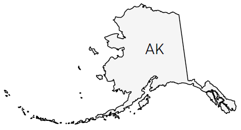

- **Hawaii's full western extent is not required on thematic maps under the original guidance.** The small islands west of Kauai County are part of Honolulu County, are uninhabited, and contain no unique Census geographic areas.

  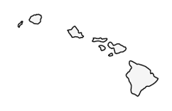

- **Check Section 508 compliance for colors and labels.** The 2026 Statistical Quality Standards also state that public information products must adhere to Section 508 and that data-visualization text and data elements must meet applicable contrast ratios.

### Avoid

- Do not place Alaska near or below Hawaii. See original example 7.
- Do not apply conterminous-U.S. Albers parameters indiscriminately to Alaska, Hawaii, and Puerto Rico data frames. Each independent frame should use parameters appropriate to its own geographic extent. See original examples 8 and 9.
- Avoid map arrangements that remove the geographic relationships needed to interpret the data. The original examples 7–9 demonstrate specific layout and projection problems.

## Additional Recommendations

### Recommended

These recommendations extend the original map conventions with general cartographic and developer practices. They are not all explicit Census Bureau requirements.

#### Titles, descriptions, and map context

- Give each map a concise, descriptive title that identifies the measure and geographic subject. Add a subtitle or short description for the reference period, population/universe, geographic level, and any important qualification.
- State what the reader is looking at before asking them to interpret color or symbols. For example: “Percent of households with broadband subscriptions by county, 2024.”
- Include a source statement and relevant caveats with the map, not only in a distant report section. The 2026 Statistical Quality Standards require source citations/statements for data visualizations (E2-2) and require stand-alone visualizations to contain the information needed to understand them when separated from the originating product (E2-2.3).
- Where a map does not portray statistical uncertainty, include a direct URL to the specific location where users can access uncertainty measures and related information, consistent with E2-2.2. Do not imply that a map removes uncertainty simply because it is spatially detailed.

#### Dimensions, aspect ratio, and placement

- Give the map enough space for the geographic level being shown. County and tract maps generally need more room for boundaries and labels than state-level maps.
- Choose an aspect ratio that accommodates the geography without excessive empty space or distortion. Do not stretch a map to fill a dashboard tile; preserve its geographic proportions.
- Place the map near the question, summary, or metric it supports. Keep the title, legend, source, and explanatory notes visually associated with the map.
- On dashboards, reserve sufficient width for the map and avoid allowing slicers, side panels, or legends to compress the map until small geographic units become unreadable.
- For responsive layouts, allow the map to reflow or resize while preserving geographic proportions. Reposition controls and legends rather than shrinking labels below readable sizes.

#### Geographic extent, boundaries, and scale

- Select an extent that includes the geography needed to answer the analytical question. Avoid cropping relevant areas or including so much surrounding geography that the subject becomes visually insignificant.
- Use administrative boundaries that match the data's geographic vintage and level. Verify geographic identifiers and boundary vintages before joining statistical data to TIGER/Line or other spatial files.
- Explain boundary changes when comparing geographies across years. A change in a county or tract boundary can affect comparability even when the label appears unchanged.
- Use consistent scales for maps intended for direct comparison. If separate frames require different scales, label or otherwise disclose that difference.
- A north arrow is usually unnecessary for familiar, small-scale maps such as the United States or individual states. Add orientation aids only when the map's orientation is not obvious or when they materially help navigation.
- Include a scale bar when distance interpretation matters, particularly on detailed or unfamiliar maps. A scale bar must update when the map scale changes in an interactive view.

#### Insets, locator maps, and multiple views

- Use inset maps when a small or geographically separated area cannot be read at the primary map scale. Clearly indicate the inset's location and ensure it does not imply a different geographic relationship.
- Use locator maps to orient readers when the primary map shows an unfamiliar region. Keep the locator subordinate to the main map.
- Group related maps within a common frame or aligned grid. Small multiples should use consistent geographic extents, projections, classification methods, and legends when the purpose is comparison.
- For time comparisons, keep the geographic units and boundary vintage consistent where possible. If they differ, explain the change and avoid presenting the panels as directly comparable without qualification.

#### Labels, annotations, and typography

- Label only the geographic features needed for orientation and interpretation. Too many labels can obscure small-area data.
- Use consistent labeling for states, territories, districts, and other geographic entity types.
- Use distinct but coordinated font treatments to differentiate geographic area types, such as water bodies and states. This retains the intent of the original recommendation, whose source includes the editorial note `[KF2.1]`.
- On small-scale maps, use two-character postal abbreviations for states when space is limited.
- For thematic maps showing small-area data, such as counties, do not add state labels if they obscure the data (original Not Recommended guidance; see example 3).
- Use callouts sparingly. For small-scale choropleth maps showing state-level data, the original guidance recommends an offset enlargement for the District of Columbia so its fill can be seen. Do not add a D.C. callout to county-level maps, where many counties may be too small to distinguish individually.

#### Map types and visual encoding

- **Choropleth maps:** Use color to encode a rate, percentage, density, or other appropriately normalized measure rather than raw counts when geographic areas differ greatly in population or size. State the classification method and class breaks when they materially affect interpretation. Avoid implying that differences between classes are exact when values within a class vary.
- **Point maps:** Prevent overlapping markers from hiding one another. Consider clustering, aggregation, transparency, or a different geographic level when points are dense. Do not expose sensitive or restricted locations.
- **Proportional symbol maps:** Scale symbol area (not radius or diameter) to the represented quantity when the intent is proportional area encoding. Provide a clear legend with example symbol sizes.
- **Dot density maps:** State what each dot represents and whether dot placement is randomized within geographic areas. Dots communicate spatial distribution at an aggregate level; they do not identify actual individual locations.
- Use sequential palettes for ordered magnitude and diverging palettes when there is a meaningful midpoint. Use qualitative palettes for categories, not numeric magnitude. Pair color with labels, patterns, outlines, or other cues where feasible so meaning is not conveyed by color alone.

#### Missing, suppressed, and unavailable geography

- Distinguish zero values from missing, suppressed, not applicable, and unavailable values. Do not assign them the same fill or symbol without an explicit explanation.
- Use a clear neutral treatment for unavailable or suppressed geography and explain it in the legend or a nearby note.
- Do not silently drop geographic units that lack a match in the spatial join. Validate unmatched GEOIDs and document exclusions.
- Follow applicable disclosure-avoidance rules. Do not use zooming, tooltips, or point-level detail to reveal information that the published data are intended to protect.

#### Interactive and accessible maps

- Make zoom, pan, reset, and filtering controls discoverable and usable with a keyboard. Provide visible focus indicators and meaningful accessible names for controls.
- Keep tooltips concise and include the geography name, measure, unit, reference period, and any relevant uncertainty or qualification. Do not make a tooltip the only place where essential context is available.
- Provide a way to reset filters and return to the initial extent. Ensure filters do not accidentally leave the user with an empty or misleading map state.
- Avoid relying on hover alone; touch users and keyboard users need equivalent access to information.
- Provide a text alternative or accompanying table/description for information that cannot be accessed through the map interface. Test contrast, text size, focus order, and keyboard interaction.

### Not Recommended

- Do not use a decorative north arrow, scale bar, inset, or boundary simply because the element is conventional. Include it only when it helps users interpret the map.
- Do not compare choropleth panels with different class breaks or color meanings unless the difference is clearly disclosed.
- Do not use a single scale for Alaska, Hawaii, Puerto Rico, and the conterminous United States when the projection or geographic extent makes that scale misleading; follow the specific-frame guidance above.
- Do not use detailed county or tract boundaries at a national scale when they create a dense, dark texture that overwhelms the thematic data.
- Do not use color alone to distinguish important categories or data states.
- Do not treat a missing spatial join, suppressed estimate, or unavailable geography as a zero.

## Examples

The comparisons below use the six image files stored in `component/assets/`. Each row pairs a failed layout example on the left with its preferred counterpart on the right. The examples are instructional illustrations; they are not official Census Bureau maps or authoritative geographic boundary data.

### Geographic arrangement and extent

<table style="width:100%; border-collapse:separate; border-spacing:12px; table-layout:fixed;">
  <tr>
    <td style="width:50%; vertical-align:top; border:1px solid #d8dee4; border-radius:6px; padding:16px;">
      <h3>⚠️ Failed Example</h3>
      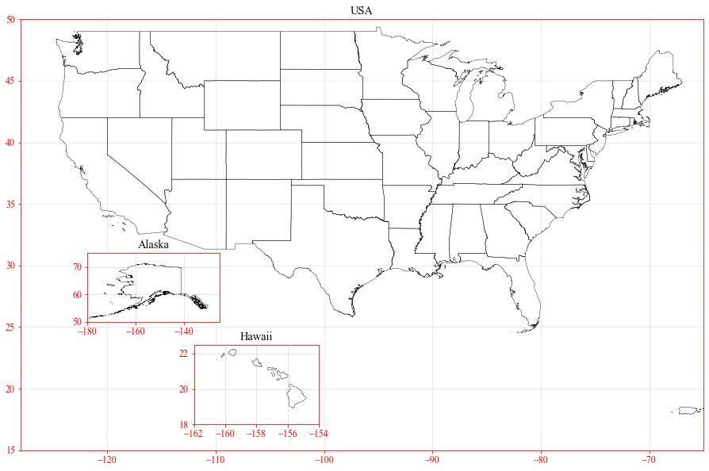
      
Geographic areas are not arranged in their familiar relative positions.

      <h4>Why it Fails</h4>
      
Placing separated areas in unexpected positions can weaken geographic context and make it harder for readers to relate the insets to the contiguous United States.

    </td>
    <td style="width:50%; vertical-align:top; border:1px solid #d8dee4; border-radius:6px; padding:16px;">
      <h3>✅ Preferred Example</h3>
      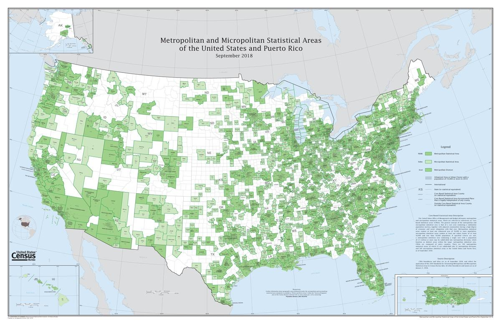
      
Alaska, Hawaii, and Puerto Rico are positioned consistently around the contiguous United States, when those areas are relevant to the map.

      <h4>Why it Meets the Guidance</h4>
      
The arrangement follows the original Census Bureau map-layout convention and preserves familiar geographic relationships.

    </td>
  </tr>
</table>

### Map frames, insets, and geographic context

<table style="width:100%; border-collapse:separate; border-spacing:12px; table-layout:fixed;">
  <tr>
    <td style="width:50%; vertical-align:top; border:1px solid #d8dee4; border-radius:6px; padding:16px;">
      <h3>⚠️ Failed Example</h3>
      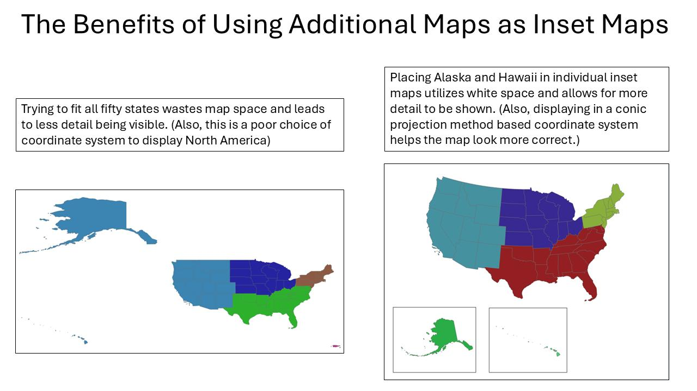
      
Separate geographic views are difficult to distinguish from the primary map and from one another.

      <h4>Why it Fails</h4>
      
Without clear frames, boundaries, or labels, readers may not understand which inset belongs to the map or what geographic area it represents.

    </td>
    <td style="width:50%; vertical-align:top; border:1px solid #d8dee4; border-radius:6px; padding:16px;">
      <h3>✅ Preferred Example</h3>
      
      
A common frame and clearly distinguished, labeled inset panels organize the separate geographic views.

      <h4>Why it Meets the Guidance</h4>
      
The layout groups related views and uses neat lines to distinguish independent data frames, consistent with the original map-layout recommendations.

    </td>
  </tr>
</table>

### Map comparison and scale consistency

<table style="width:100%; border-collapse:separate; border-spacing:12px; table-layout:fixed;">
  <tr>
    <td style="width:50%; vertical-align:top; border:1px solid #d8dee4; border-radius:6px; padding:16px;">
      <h3>⚠️ Failed Example</h3>
      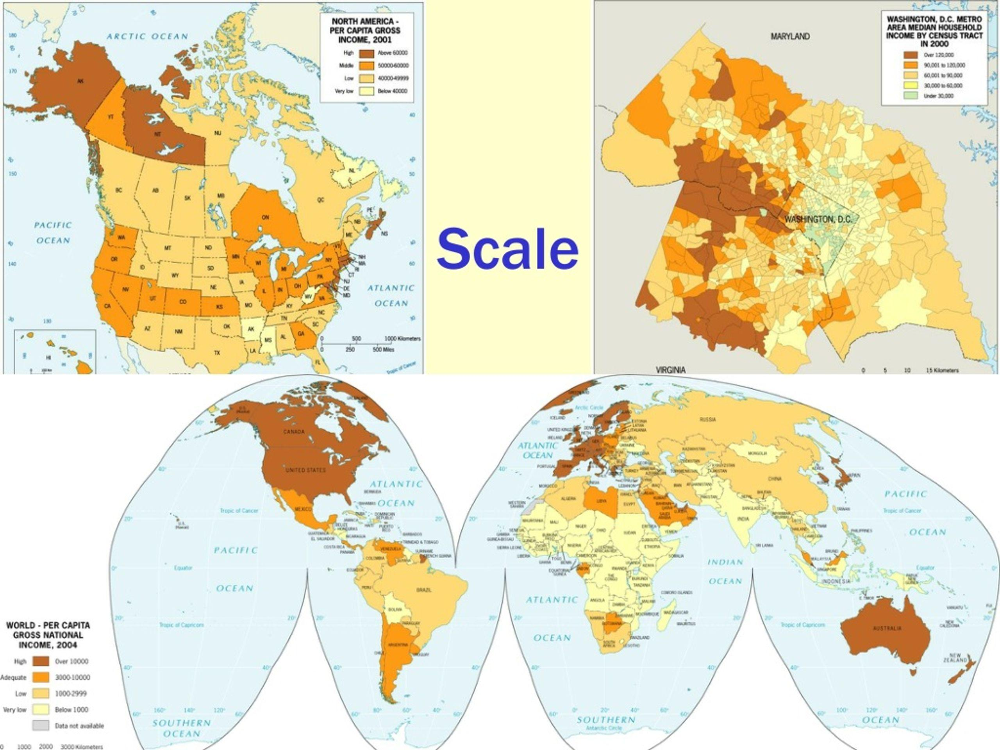
      
Map panels intended for comparison use inconsistent scales, geographic extents, or color classifications without explaining the differences.

      <h4>Why it Fails</h4>
      
Readers may attribute visual differences to the data when they are actually caused by different map scales, extents, or classification methods.

    </td>
    <td style="width:50%; vertical-align:top; border:1px solid #d8dee4; border-radius:6px; padding:16px;">
      <h3>✅ Preferred Example</h3>
      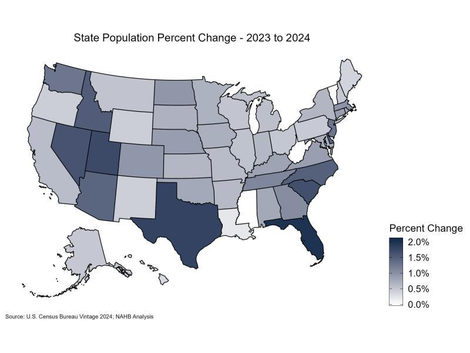
      
Comparable map panels use consistent geographic extents, visual encoding, and legends, with reference periods clearly identified.

      <h4>Why it Meets the Guidance</h4>
      
Consistent scales and classification make differences easier to interpret. Clear period labels and a shared legend help make the comparison understandable on its own.

    </td>
  </tr>
</table>

### Original Census Bureau examples

The examples below are retained from the original documentation. Their original filenames and numbering are preserved.

**Example 1:** Standard U.S.-based layout, with Puerto Rico, includes state-level geography and a D.C. callout.

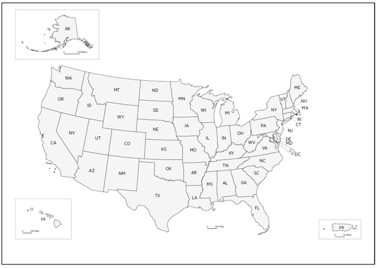

**Example 2:** Standard U.S.-based layout, without Puerto Rico, includes county-level geography.

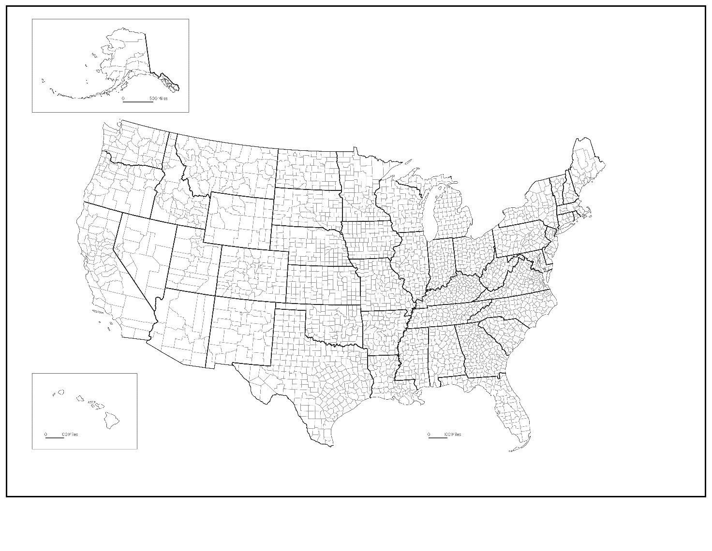

**Example 3:** U.S.-based layout without an outer frame line or data-frame neat lines for Alaska and Hawaii.

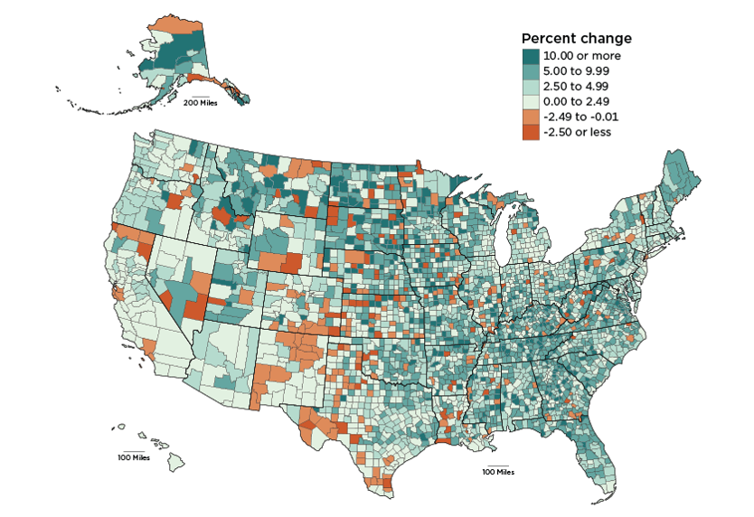

**Example 4:** U.S.-based ribbon layout (Alaska and Hawaii are placed upper and lower left, next to the conterminous United States). Formatted interactive map sample: [data.census.gov/profile](https://data.census.gov/profile).

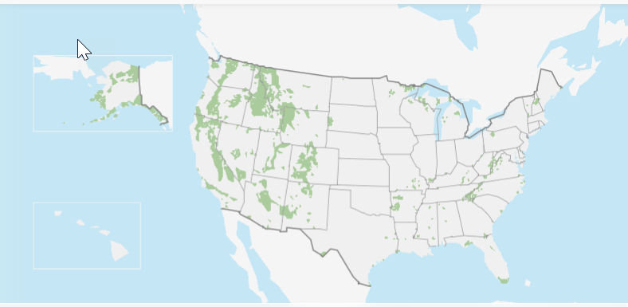

**Example 5:** U.S.-based layout. Formatted interactive map sample.

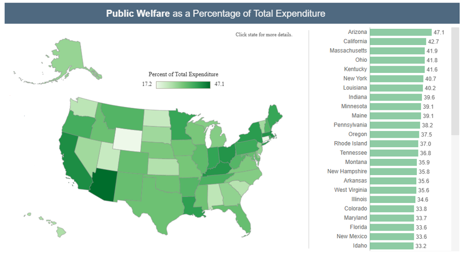

**Example 6:** Related maps (a primary map and small multiples) grouped together within a single frame line. Neat lines surround the Alaska and Hawaii data frames for each map.

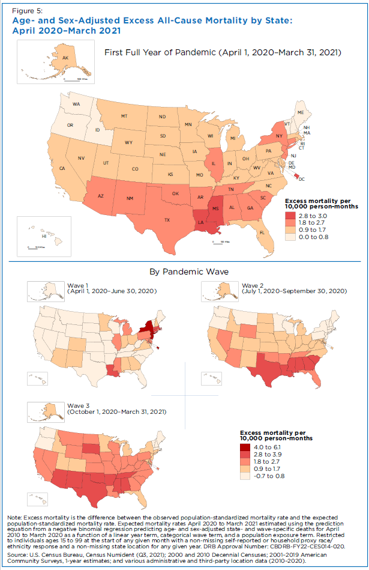

**Example 7 — Avoid:** Alaska should never be placed near or below Hawaii.

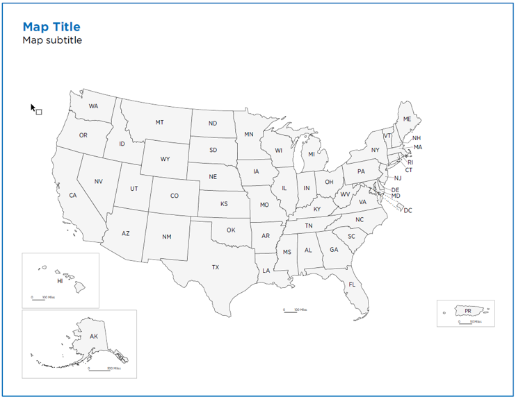

**Example 8 — Avoid:** Conterminous-U.S. Albers equal-area projection parameters are used for all data frames, including Alaska, Hawaii, and Puerto Rico. Independent frames should use state-specific projection parameters.

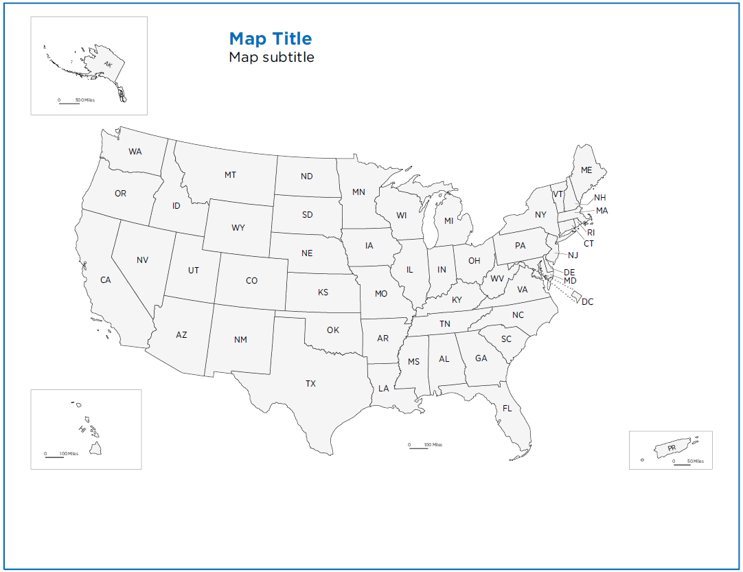

**Example 9:** A map of Washington State projected in the Albers equal-area projection. The left map uses state-based projection parameters (Essential); the right map uses conterminous-U.S. projection parameters (Avoid).

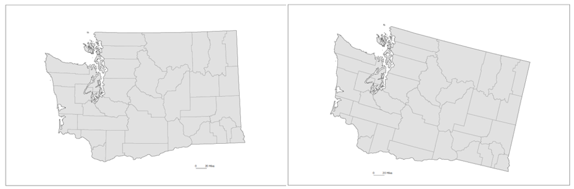

## Developer Quality Checklist

Use this checklist before publishing or handing off a map. Items marked “where applicable” depend on the map type and intended audience.

- [ ] The map answers a clearly stated analytical question.
- [ ] The title, subtitle, geographic level, reference period, measure, and universe are clear.
- [ ] The map includes the geographic areas relevant to the question; U.S.-based layouts follow the Alaska, Hawaii, and Puerto Rico conventions above.
- [ ] The geographic extent does not truncate relevant populated areas or important reference context.
- [ ] The coordinate reference system and projection are appropriate for the geography and purpose.
- [ ] Geographic identifiers, boundary vintage, and spatial joins have been validated.
- [ ] Insets and separate data frames are labeled and visually distinguished.
- [ ] Map scales, class breaks, and color meanings are consistent across comparison panels or differences are disclosed.
- [ ] The legend explains all data classes and special states, including missing, suppressed, or unavailable data.
- [ ] The map does not imply that missing or suppressed values are zero.
- [ ] The source statement and relevant limitations accompany the map.
- [ ] Statistical uncertainty is communicated or a direct URL to the uncertainty information is provided when required.
- [ ] Color contrast, labels, controls, and text alternatives have been checked for accessibility.
- [ ] Interactive maps support keyboard navigation, touch, reset, and non-hover access to essential information.
- [ ] The map has been tested at intended screen sizes and export dimensions.
- [ ] Review findings, corrections, and reproducibility materials are retained as appropriate to the product.

## Developer Implementation Considerations

### Geographic data preparation

- Use stable geographic identifiers (for example, GEOIDs) rather than names alone when joining tabular Census data to geographic files.
- Confirm the geographic level and vintage of both the statistical table and boundary file. Do not assume that similarly named geographies are spatially identical across vintages.
- Validate join cardinality, unmatched records, duplicate identifiers, geometry validity, and coordinate reference system metadata before rendering.
- Preserve the original source data and document transformations. Keep any suppression or missing-value codes distinct through the mapping pipeline.
- Use Census TIGER/Line or other authoritative boundary files appropriate to the use case. Check the source's geography and vintage documentation before selecting a file.

### Power BI

- Use the organization's approved mapping visual and verify its geographic-data handling, licensing, and privacy behavior before publication.
- Prefer explicit latitude/longitude or well-defined geographic fields over ambiguous place-name geocoding. Keep GEOIDs available for joins and drill-through.
- Configure the map's initial extent and zoom so the intended geography is immediately visible. Avoid a default zoom that opens to a blank ocean or an irrelevant global view.
- Keep legends, slicers, and tooltips close to the map without covering important geography. Test interactions between slicers and the map, including empty-result states.
- Confirm that the selected visual supports keyboard access, screen-reader descriptions, and the required contrast. Provide a table or textual summary when the map alone is not accessible.

### Tableau

- Assign geographic roles carefully and validate generated geocoding against authoritative identifiers.
- Set the map extent and background layers deliberately; remove unnecessary layers that compete with the thematic data.
- Use fixed ranges and shared legends for side-by-side comparisons where the analytical intent requires comparability.
- Configure tooltips with concise geography, measure, units, reference period, and caveats. Do not place essential definitions only in hover text.
- Test dashboards at their published device layouts and ensure map legends and controls remain readable.

### Python

- **GeoPandas:** Read vector boundaries, inspect the CRS, reproject to an appropriate CRS with `to_crs()`, and validate joins on GEOID. Do not assign a CRS with `set_crs()` merely to make coordinates appear correct; use it only when the coordinate reference system is known and the metadata need to be assigned.
- **Matplotlib:** Use a projection-aware plotting workflow (often with Cartopy for map projections), set consistent extents for comparison panels, and add labels/legends as separate layout elements so they do not cover the data.
- **Plotly:** Use an appropriate map projection and configure the initial center/zoom. Make hover labels informative but concise; include a non-interactive alternative for essential information.
- **Folium:** Use web mapping for interactive exploration, cluster dense point layers where appropriate, and configure layer controls and attribution. Verify that the basemap and tile provider are suitable for the deployment environment.
- Keep data preparation separate from rendering so the same validated geographic dataset can support static and interactive outputs.

### R

- **sf:** Read spatial data, inspect `st_crs()`, transform with `st_transform()`, and join using validated geographic identifiers.
- **ggplot2:** Use `coord_sf()` for spatial plotting, preserve aspect, and maintain consistent scales and extents across facets or separately arranged maps.
- **tmap:** Choose static or interactive mode intentionally. Set map extent, legend position, and layer order explicitly rather than relying on defaults.
- Test labels at final export dimensions and provide equivalent textual context for interactive maps.

### JavaScript and web mapping

- In libraries such as Leaflet, MapLibre GL JS, or OpenLayers, set the initial bounds/center/zoom based on the analytical geography and provide a clear reset-to-extent action.
- Use the projection supported by the data and map purpose. Reproject source geometries where necessary; do not treat a display projection as a substitute for spatially appropriate analysis.
- Keep controls keyboard accessible, provide visible focus states, and ensure touch targets are usable on mobile devices.
- Use vector tiles, generalized geometries, or level-of-detail strategies to keep detailed boundary layers performant. Generalization must not change the statistical meaning or conceal relevant geographic units.
- Provide accessible labels and a text/table alternative. Avoid hover-only interactions and ensure that color is not the only way to identify a feature.

### Performance, responsive behavior, and reproducibility

- Simplify geometry only to the level appropriate for the display scale. Retain source geometries and document any generalization process.
- Load detailed boundaries progressively for interactive maps rather than rendering every detailed feature at the national extent.
- Test desktop, tablet, and mobile layouts. On narrow screens, stack legends and controls or move them into accessible panels instead of squeezing the map.
- Record data source, vintage, projection/CRS, transformation steps, classification method, software/library versions, and code needed to reproduce the map.

## References

### Census Bureau source guidance and standards

- U.S. Census Bureau. (2026, September 29). *Statistical Quality Standards*. Relevant provisions include E2-2 (source statements, transparency, and uncertainty), E2-2.3 (data visualization requirements), E3-2.4 (data visualization review), and F1-11 (Section 508 for public information products). The standards are the authority for official statistical quality requirements; this page's additional cartographic advice is not a substitute for them.
- U.S. Census Bureau. *Household Income in States and Metropolitan Areas: 2023*. [PDF](https://www2.census.gov/library/publications/2024/demo/acsbr-023.pdf).
- U.S. Census Bureau. *The Population 65 Years Old and Over: 2022*. [Interactive visualization](https://www.census.gov/library/visualizations/interactive/population-65-and-over-2022.html).
- U.S. Census Bureau. *Housing Unit Change Viewer: 2020 to 2023*. [Interactive map](https://mtgis-portal.geo.census.gov/arcgis/apps/experiencebuilder/experience/?id=3a87e24a2ec54e01ab277a12d467e7d9).
- U.S. Census Bureau. [TIGER/Line Shapefiles](https://www.census.gov/geographies/mapping-files/time-series/geo/tiger-line-file.html).

### General cartographic and technical references

- U.S. Geological Survey. [Map Projections](https://www.usgs.gov/programs/national-geospatial-program/map-projections).
- ColorBrewer. [Color advice for cartography](https://colorbrewer2.org/).
- W3C. [Web Content Accessibility Guidelines (WCAG) 2.2](https://www.w3.org/TR/WCAG22/).
- GeoPandas. [Documentation](https://geopandas.org/en/stable/).
- R-spatial. [sf package](https://r-spatial.github.io/sf/).
- Leaflet. [Documentation](https://leafletjs.com/reference.html).
- MapLibre GL JS. [Documentation](https://maplibre.org/maplibre-gl-js/docs/).
