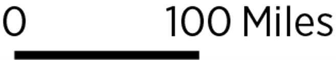
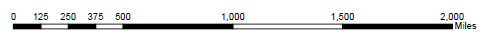
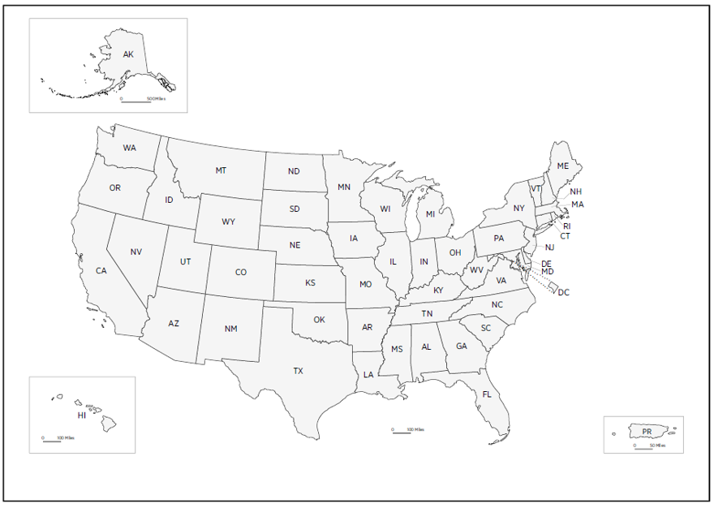
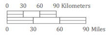
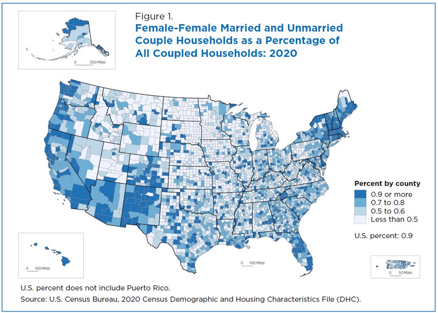
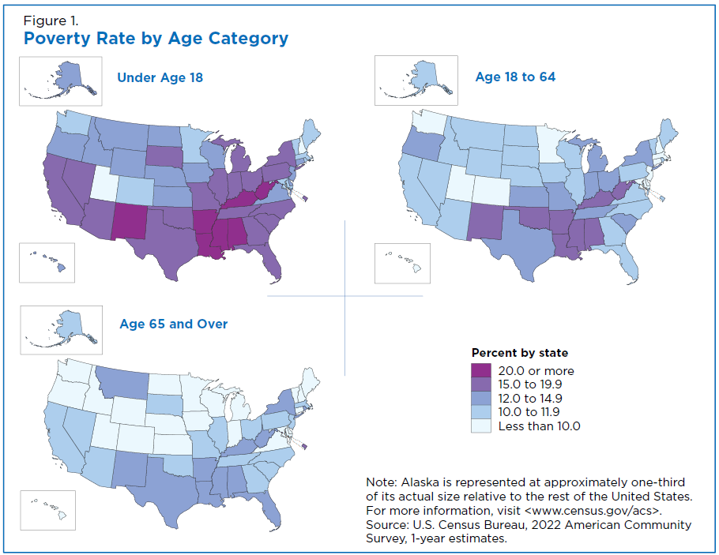
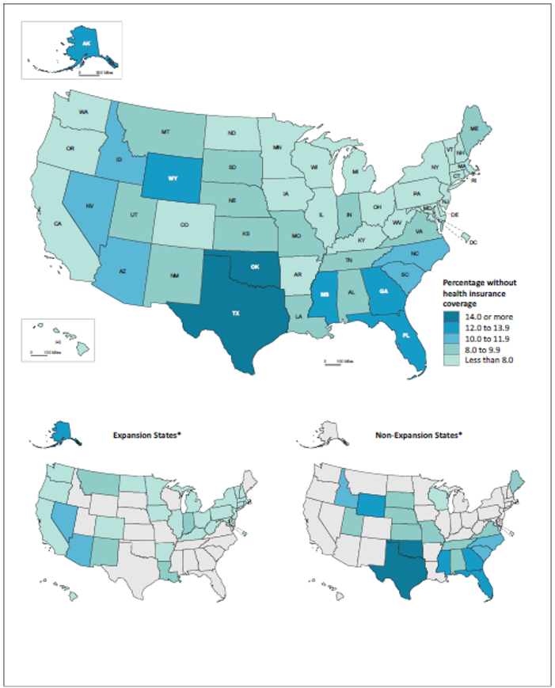

# Scale Bar

**Also known as:** Graphic scale; bar scale; linear scale

## 1. Purpose and Overview

A scale bar is a map element that communicates the relationship between a measured distance on the map and the corresponding distance on the Earth's surface. It gives readers a visual reference for estimating geographic distances without requiring them to interpret a representative fraction (such as 1:100,000).

Scale bars are useful in maps that may be resized, exported, embedded, or viewed on screens with different dimensions. Unlike a fixed ratio or verbal scale, a graphic scale bar remains visually connected to the map's displayed scale when the map and scale bar are resized together. For interactive maps, the scale bar should update as the user zooms or pans when the map's scale or location changes.

Common designs include:

- **Single-division scale bar:** A simple line or bar with a start value and an end value, such as 0–25 km. This is generally suitable for thematic maps where the scale bar should provide geographic context without drawing too much attention.
- **Alternating or segmented scale bar:** A bar divided into alternating light and dark sections, often with intermediate labels. This can be useful on detailed reference maps where readers need to estimate shorter distances.

A scale bar must reflect the map's projection, geographic location, display scale, and placement. A scale bar is not automatically accurate simply because its label contains a distance value.

This guidance focuses on the implementation of scale bars in static maps created with Python. The Census example uses a Maryland county choropleth to demonstrate how a scale bar can be calculated and displayed alongside a thematic map.

## 2. When to Use

Use a scale bar when readers need a practical visual reference for geographic distance.

- **Regional and local maps:** Useful for county, state, metropolitan, and neighborhood maps.
- **Thematic maps:** Provides geographic context on choropleth, dot-density, proportional-symbol, and other thematic maps.
- **Reference maps:** Helps readers estimate distances between geographic features.
- **Maps that may be resized:** A graphic scale bar is preferable to a fixed representative fraction when a map may be displayed at different sizes.
- **Multi-panel maps:** Useful when each panel has its own geographic extent or scale, provided each panel receives an appropriate scale bar.

For maps with multiple geographic extents—such as a national map with separate Alaska, Hawaii, or Puerto Rico insets—evaluate each frame independently. A single scale bar should not be applied to panels with different scales unless the map design and scale calculations make that relationship explicit.

## 3. When to Use an Alternative

A scale bar may be misleading or unnecessary in the following situations:

- **Non-geographic charts:** Do not add a scale bar to ordinary bar charts, line charts, or other visualizations that do not represent geographic space.
- **Maps with incompatible or changing scales:** A single static scale bar may be unsuitable for a map where scale varies substantially across the displayed area or changes as the user interacts with the map.
- **Small inset maps:** A scale bar may become unreadable or occupy space needed for geographic detail. Consider a clearly labeled inset or a separate map frame with its own scale bar.
- **Schematic or illustrative maps:** If geographic distances are intentionally distorted, a scale bar may imply a level of measurement accuracy the map does not support.
- **Global or large-area maps:** A single scale bar may not represent distances consistently across the map, particularly with projections that substantially distort scale by latitude.

For interactive maps, use a dynamic scale control that recalculates as the map's zoom level and geographic position change. Do not rely on a scale bar calculated once for a static screenshot if users can change the map extent.

## 4. Choosing Between Alternatives

| Mapping need | Alternative or approach | Why it may be preferable |
|---|---|---|
| Communicate map scale in a static layout | Graphic scale bar | Remains useful when the map image is resized, provided the bar and map are resized together. |
| Communicate an exact cartographic ratio in a fixed-size print product | Representative fraction (for example, 1:50,000) | Can be appropriate when the final physical print dimensions are controlled. |
| Communicate approximate distance in prose | Verbal scale (for example, 1 inch represents 1 mile) | May be appropriate for a fixed-size printed map, but becomes unreliable if the map is resized. |
| Support zooming and panning | Dynamic scale control | Recalculates based on the current map view rather than relying on a fixed value. |
| Show separate geographic insets | Individual scale bar for each inset | Prevents readers from applying one panel's scale to another panel with a different extent. |

## 5. Data Requirements and Statistical Considerations

A scale bar is based on geographic coordinates and map scale, not on the values being mapped. Developers should confirm the following before adding one:

- **Geographic data:** The map must have valid geographic features or coordinates and a correctly defined coordinate reference system (CRS).
- **Coordinate reference system:** Confirm the source CRS before transforming the data. Do not assign a CRS merely to make a map render; use the CRS that correctly describes the source coordinates.
- **Projection suitability:** Choose a projected CRS appropriate for the map's geographic extent when calculating distances in planar units. For a regional map, use a projection designed for that region. For a national or global map, assess distortion carefully and consider whether one scale bar is appropriate.
- **Distance units:** Ensure that the scale bar's numeric distance and the coordinate units are compatible. Convert units explicitly when necessary.
- **Location-dependent scale:** Map scale can vary across a projected map. In projections such as Web Mercator, distortion increases with latitude. A scale bar for a static map should be calculated for its placement location and described accordingly.
- **Dynamic maps:** Interactive scale bars should recalculate as the map's zoom and geographic position change.
- **Insets and map panels:** Calculate scale bars separately for each map frame when extents or scales differ.
- **Rounding and labeling:** Use a clear, readable distance value and a suitable unit (for example, km or mi). Avoid implying greater precision than the map supports.

For a static regional map, a geodesic calculation can be used to determine two geographic points separated by the intended ground distance. Those points can then be transformed into the map's projected CRS and used to draw the scale bar. This approach makes the intended ground distance explicit at the bar's placement location.

### Census example data considerations

The sample map retrieves ACS total population and margin of error, then derives population density using TIGER/Line land area. Keep these concepts distinct:

- `B01003_001E` is the ACS total population estimate.
- `B01003_001M` is the margin of error associated with that total population estimate.
- `ALAND` is the TIGER/Line land area in square meters.
- Population density is calculated as total population divided by land area in square miles.

The script retrieves the population margin of error but does not calculate or display a margin of error for the derived population-density measure. Do not interpret the density values as exact or error-free. A formal uncertainty estimate for a derived ratio requires appropriate statistical treatment; simply dividing the population margin of error by land area should not be presented as a complete uncertainty calculation without explaining the assumptions.

The ACS 5-year estimates summarize a five-year period and are not a single-year population count. Label the reference period accurately when publishing the map.

## 6. Visualization-Specific Considerations

### Scale Bar Design Examples

The following examples illustrate different scale bar treatments, placement choices, and considerations for maps with multiple geographic extents:

***Example 1:*** The primary map in this layout includes scale bars for the U.S., Alaska, and Hawaii, while subsequent smaller maps in the series do not.

***Example 2:*** The primary map in this layout includes scale bars for the U.S., Alaska, and Hawaii, while subsequent smaller maps in the series do not.

***Example 3:*** The primary map in this layout includes scale bars for the U.S., Alaska, and Hawaii, while subsequent smaller maps in the series do not.

***Example 4:*** The primary map in this layout includes scale bars for the U.S., Alaska, and Hawaii, while subsequent smaller maps in the series do not.

***Example 5:*** The primary map in this layout includes scale bars for the U.S., Alaska, and Hawaii, while subsequent smaller maps in the series do not.

***Example 6:*** The primary map in this layout includes scale bars for the U.S., Alaska, and Hawaii, while subsequent smaller maps in the series do not.

***Example 7:*** The primary map in this layout includes scale bars for the U.S., Alaska, and Hawaii, while subsequent smaller maps in the series do not.

These examples can help developers evaluate scale bar design choices across different map types. A single-division or alternating/segmented scale bar may be appropriate depending on the map’s purpose, layout, and level of geographic detail. Keep the image files in the repository at the paths shown above, and update the Markdown paths if the assets are moved or renamed.

A scale bar should be easy to locate without competing with the map's main analytical message.

- **Placement:** Position the scale bar where it does not obscure important geographic features, labels, or thematic patterns. Keep it within the map frame and provide enough contrast against the background.
- **Visual hierarchy:** Keep the scale bar subordinate to the map's primary message. A simple single-division design is usually sufficient for thematic maps.
- **Units:** Use consistent, familiar units. For U.S. maps, miles may be useful for general audiences; kilometers may be preferable for technical or international audiences. Do not mix units without a clear reason. Select miles or kilometers based on the map's audience and purpose, and label the unit explicitly.
- **Legibility:** Use readable labels, adequate line weight, and sufficient contrast. Avoid overly small scale bars or labels that disappear when the map is exported.
- **Multiple panels:** Give each differently scaled panel its own scale bar. Clearly associate each bar with its corresponding map frame.
- **Projection and latitude:** Do not assume that one scale bar is accurate everywhere on a map. In Web Mercator, for example, scale distortion varies with latitude. A scale bar can still be useful if it is dynamically or locally calculated and its scope is understood.
- **Interactive behavior:** In a web map, update the scale bar whenever zooming or panning changes the map scale or the location at which the scale is evaluated.
- **Export behavior:** Test the scale bar after saving or exporting the map. Ensure it remains visible and is not clipped by tight layout settings.
- **Source and method note:** When appropriate, document the CRS, distance unit, and whether the bar represents a local or dynamically recalculated distance.

### Color and accessibility considerations for the Census map

The scale bar itself should use a high-contrast neutral treatment so it remains legible over the map. The thematic colors belong to the choropleth, not to the scale bar.

The Python example uses the `cividis` sequential color map. It is designed to be perceptually uniform and more robust for viewers with common forms of color-vision deficiency than many red-green or rainbow palettes. A sequential palette is appropriate because population density is a quantitative measure that progresses from lower to higher values.

Additional design choices in the example include:

- White county boundaries to separate adjacent polygons without overpowering the fill colors.
- A restrained, neutral background and dark typography.
- A clearly labeled color bar with the measurement unit.
- A distinct title and subtitle that identify the measure, geography, and ACS vintage.
- A simple black scale bar with a light outline to preserve contrast over different map colors.
- A source note and a separate note explaining that ACS sampling error is not displayed.

Color accessibility does not rely on palette choice alone. Check text contrast, boundary visibility, legend readability, and the exported image at its intended display size. Do not use color as the only way to communicate a category or status. For a sequential choropleth, make sure the direction of the palette is intuitive and the legend clearly explains what darker or lighter colors mean.

### Normalization and legend interpretation

Population density can be highly skewed, so the example uses square-root normalization (`PowerNorm`) to make differences among lower-density counties more visible while retaining a continuous color scale. The underlying density values are not changed; only the mapping from data values to color intensity is transformed.

The color bar labels remain in people per square mile. Include a short note explaining the normalization so readers understand that the color progression is transformed rather than linearly spaced. Do not use a nonlinear normalization without identifying it in the map documentation or legend.

A different dataset may require a different normalization. Review the distribution before choosing linear, square-root, logarithmic, quantile, or classed mapping. Select a method that supports the analytical question and does not exaggerate or conceal meaningful differences.

## 7. Census Data Example

- **Analytical question:** How does population density vary among Maryland counties, and what geographic distance does the map represent?
- **Dataset and table:** 2024 American Community Survey (ACS) 5-Year Estimates, Table B01003 (Total Population), joined to 2024 TIGER/Line County geographic boundaries.
- **Source:** [2024 ACS 5-Year Data API](https://api.census.gov/data/2024/acs/acs5.html) and [2024 TIGER/Line Shapefiles](https://www.census.gov/geographies/mapping-files/time-series/geo/tiger-line-file.2024.html).
- **Geographic level:** Maryland counties and county-equivalent areas.
- **Reference period:** 2020–2024 ACS 5-year estimates; 2024 TIGER/Line boundaries.
- **Measure and units:** Total population estimate (persons), margin of error (persons), and derived population density (persons per square mile).
- **Reason for selection:** County-level population density provides a meaningful thematic variable for a Maryland map, while county boundaries provide the geographic features needed to demonstrate a scale bar.
- **Limitations:** ACS estimates are subject to sampling error. Population density is an area-based summary and does not show where people are located within each county. The 25 km scale bar represents a geodesic distance at its placement location; it should not be interpreted as a guarantee that the same map distance represents exactly 25 km everywhere in the map frame.

### Census variables and geographic fields

| Field | Source | Description | Use in the example |
|---|---|---|---|
| `B01003_001E` | 2024 ACS 5-Year API | Total population estimate | Numerator for population density |
| `B01003_001M` | 2024 ACS 5-Year API | Margin of error for total population estimate | Retrieved for uncertainty context; not displayed as a density margin of error |
| `state` | ACS API geography response | Two-digit state FIPS code | Used to construct county GEOID |
| `county` | ACS API geography response | Three-digit county FIPS code | Used to construct county GEOID |
| `GEOID` | ACS API and TIGER/Line | Five-character county identifier | Join key between tabular and geographic data |
| `ALAND` | TIGER/Line | Land area in square meters | Converted to square miles for density calculation |
| `geometry` | TIGER/Line | County polygon geometry | Used to draw the map and locate the scale bar |

The example matches the ACS and TIGER/Line data to the 2024 vintage. If a different ACS period or boundary vintage is used, document that choice and evaluate whether the geographies remain comparable.

## 8. Developer Implementation

The Python implementation is available as a standalone script and an interactive Jupyter Notebook. Download either file from the links below to review or run the implementation. This page describes the workflow, dependencies, data considerations, and expected outputs without embedding the source code.

### 8.1 Downloadable Python Implementations

<table>
  <thead>
    <tr>
      <th>File</th>
      <th>Purpose</th>
      <th>Recommended Use</th>
    </tr>
  </thead>
  <tbody>
    <tr>
      <td>
        <a href="https://melissakep.github.io/data_viz_guidance/Python%20Artifacts/scalebar_example.py"
           class="download-file"
           data-filename="scalebar_example.py">
          Download Scale Bar Python Script
        </a>
      </td>
      <td>Standalone Python implementation of the Maryland population-density choropleth, including Census data retrieval, geographic preparation, geodesic scale-bar calculation, and PNG export.</td>
      <td>Run from a Python environment or adapt the workflow for another geographic dataset.</td>
    </tr>
    <tr>
      <td>
        <a href="https://melissakep.github.io/data_viz_guidance/Python%20Artifacts/Scalebar_Example.ipynb"
           download="Scalebar_Example.ipynb"
           class="download-file"
           data-filename="Scalebar_Example.ipynb">
          Download Scale Bar Jupyter Notebook
        </a>
      </td>
      <td>Interactive notebook version of the implementation, with executable cells for reviewing the workflow.</td>
      <td>Run interactively in Google Colab or Jupyter Notebook.</td>
    </tr>
  </tbody>
</table>

### 8.2 Data Preparation

The downloadable implementation performs the following steps:

1. Checks for a Census API key in the `CENSUS_API_KEY` environment variable. If no environment variable is set, it prompts the user to enter the key using Python's `getpass` module. The key is not echoed in the terminal while being typed.
2. Retrieves Maryland county-level population estimates and margins of error from the ACS API.
3. Downloads the 2024 TIGER/Line county boundary file and filters it to Maryland using state FIPS code `24`.
4. Constructs a five-digit county GEOID from the state and county FIPS codes, then joins the ACS table to the geographic boundaries.
5. Calculates land area in square miles from the TIGER/Line `ALAND` field and derives population density.
6. Projects the county boundaries to EPSG:26918 (NAD83 / UTM Zone 18N).
7. Calculates a 25 km geodesic distance at the scale bar's placement location using the GRS80 ellipsoid, then draws and labels the scale bar.
8. Creates an accessible choropleth using the `cividis` palette and square-root color normalization.
9. Exports the map as a 300 DPI PNG image.

The scale bar is calculated after the map extent is set. The script converts its lower-left axes-relative anchor point into map coordinates, transforms that point to NAD83 geographic coordinates, calculates a geodesic endpoint 25,000 meters east, and transforms both endpoints back to the projected map CRS. The distance is therefore defined at the scale bar's placement location.

### 8.3 Python Packages

The example uses:

| Package | Purpose |
|---|---|
| `requests` | Sends the Census API request and downloads the TIGER/Line ZIP file |
| `pandas` | Structures and cleans ACS tabular data |
| `geopandas` | Reads, filters, joins, transforms, and plots geographic data |
| `matplotlib` | Creates the map, color bar, labels, scale bar, and PNG output |
| `pyproj` | Performs coordinate transformations and geodesic distance calculations |

Install the required packages from a terminal:

GeoPandas has geospatial dependencies. If installation fails in a particular Python environment, use the installation guidance for GeoPandas appropriate to that operating system and environment. Use a virtual environment where possible so project dependencies remain isolated.

### 8.4 Requesting and Entering a Census API Key

The example requires a Census API key to request the ACS data.

1. Open the [Census API Key Signup page](https://api.census.gov/data/key_signup.html).
2. Complete the Census Bureau's API key request form.
3. Follow the instructions provided by the Census Bureau to obtain the key.
4. Keep the key private. Do not paste it into a public GitHub repository, commit it in the Python file, or include it in screenshots or documentation.

**The Python script prompts for the key automatically.** When the script starts, it first checks whether `CENSUS_API_KEY` is already set as an environment variable. If it is not set, the script displays the Census key signup link and prompts:

The script uses `getpass`, so the key is not displayed as the user types. The key is held in memory for that script run; the script does not write it to the Python file.

Alternatively, developers can set the environment variable before running the script. For Windows PowerShell:

For Windows Command Prompt:

For macOS or Linux:

If the environment variable is set, the script uses it and does not prompt again. If neither an environment variable nor a key entered at the prompt is available, the script stops with an error rather than making an unauthenticated request.

**Execution environment note:** Run the script from a terminal or an IDE terminal that supports interactive input. Some notebook, scheduled, or automated execution environments do not support `getpass` prompts. In those environments, set `CENSUS_API_KEY` as an environment variable or use the environment's approved secret-management feature.

### 8.5 Running the Script

1. Save `scalebar_example.py` to your Python examples folder.
2. Open a terminal in that folder.
3. Install the required packages.
4. Run the script:

5. If `CENSUS_API_KEY` is not already set, enter the API key when prompted.
6. Allow the script to retrieve the ACS data and TIGER/Line boundaries and create the map.

**Expected output:** `maryland_population_density_scalebar.png` in the current working directory. The script saves the image at 300 DPI and then displays the map using Matplotlib.

### 8.6 Downloadable Example Output

The repository includes the rendered PNG output from the Python implementation. Developers can view or download the completed map without running the script first.

<table>
  <thead>
    <tr>
      <th>Output</th>
      <th>Description</th>
      <th>Download</th>
    </tr>
  </thead>
  <tbody>
    <tr>
      <td>Maryland population-density map (PNG)</td>
      <td>Rendered county-level choropleth with a 25 km geodesic scale bar, saved at 300 DPI.</td>
      <td>
        <a href="https://melissakep.github.io/data_viz_guidance/Python%20Artifacts/maryland_population_density_scalebar.png"
           class="download-file"
           data-filename="maryland_population_density_scalebar.png">
          View or Download Scale Bar Map
        </a>
      </td>
    </tr>
  </tbody>
</table>

The PNG is a static output from the example run. Running the script again generates a new image based on the data retrieved at that time and the output settings in the script.

The script needs an internet connection to retrieve the ACS API response and TIGER/Line boundary file. The first run may take longer because it downloads the county boundary ZIP file. If the script is run from a different working directory, the output image is saved in that working directory unless `OUTPUT_FILE` is changed to a specific path.

### 8.7 Reproducibility and Adaptation

To adapt this example to another Census geography or dataset:

- Change the ACS year, table variables, and geography parameters in the API request.
- Use a TIGER/Line geography file that matches the geographic level and, where practical, the ACS vintage.
- Join the ACS table and geographic file using the appropriate GEOID. Confirm the identifier length and leading zeros before joining.
- Select a projected CRS suited to the map's geographic extent. Do not reuse EPSG:26918 for locations outside its intended region.
- Recalculate the scale bar for the new map's placement location and intended distance. Update the label and source note together.
- Review whether the chosen distance unit matches the target CRS and the intended audience.
- For maps that support zooming or panning, implement the scale bar as a dynamic map control rather than reusing this static Matplotlib calculation.
- Review the ACS margin of error when interpreting estimates. This example retrieves the population margin of error but does not calculate or display a margin of error for population density.
- Reassess the color normalization when changing datasets. The square-root normalization is a design choice for this example, not a universal default.

The example is a starting point for developer implementation. Run it in the target environment and verify the API response, geographic join, projection, scale bar placement, color bar labels, and exported image before publishing it.

## 9. Common Errors and Misinterpretations

| Issue | Why It Matters | Recommended Correction |
|---|---|---|
| No Census API key is provided | The script cannot retrieve the ACS data. | Request a key from the Census API signup page and enter it at the script prompt, or set `CENSUS_API_KEY` as an environment variable. |
| The API key is hard-coded in the source file | A committed or shared script could expose the key. | Use the interactive `getpass` prompt or an environment variable; do not commit secrets. |
| Running in a non-interactive environment | `getpass` may not be able to prompt for input. | Set `CENSUS_API_KEY` through the environment or the platform's secret manager before execution. |
| API request fails or returns an error | The map cannot be created without the expected ACS data. | Check the internet connection, API key, endpoint year, variable names, and geography parameters. Review the response error before changing the code. |
| TIGER/Line download fails | Geographic boundaries are unavailable for the join and map. | Check network access and the TIGER/Line URL and vintage. |
| ACS and TIGER/Line GEOIDs do not match | County estimates may be joined to the wrong polygons or left unmatched. | Preserve leading zeros, construct five-character county GEOIDs, and validate the join. |
| Using a scale bar calculated for a different projection or location | The displayed distance may not match the intended ground distance. | Calculate the bar using the map's CRS and geographic placement; use a suitable regional projection or geodesic calculation. |
| Assuming Web Mercator has a constant scale | Scale distortion changes with latitude. | Use a locally or dynamically calculated scale bar and explain its scope. |
| Reusing one scale bar across differently scaled inset maps | Readers may apply the wrong distance relationship to an inset. | Calculate and label a separate scale bar for each map frame. |
| Hard-coding a scale bar in an interactive map | The bar becomes inaccurate when the map zoom or location changes. | Use a dynamic scale control that recalculates with the current map view. |
| Assigning a CRS instead of transforming to it | Coordinates may be interpreted in the wrong coordinate system, producing incorrect distances and locations. | Verify the source CRS and use a coordinate transformation such as `to_crs()` in GeoPandas. |
| Treating projected coordinate units as meters without checking | A scale bar can be mislabeled if the CRS uses feet or another unit. | Inspect the CRS and convert units explicitly. |
| Using raw population to compare counties of different sizes | Larger counties may appear more populous simply because they cover more land. | Use a suitable normalized measure, such as population density, when the analytical question concerns concentration. |
| Interpreting square-root color normalization as a linear color scale | Equal visual steps do not represent equal numeric increments. | Identify the normalization in the legend or accompanying note and review whether it fits the data distribution. |
| Assuming `cividis` alone guarantees accessibility | Poor contrast, tiny labels, or unclear legends can still make a map difficult to read. | Review the full map at its intended display size, including text, boundaries, scale bar, and legend. |
| Ignoring ACS margins of error | Estimates may be interpreted as exact counts. | Include relevant uncertainty in analysis and reporting; do not treat the point estimate as error-free. |
| Saving the output to an unexpected folder | Relative paths are resolved from the current working directory. | Check the printed output path or set `OUTPUT_FILE` to a known destination. |

## 10. Publication Quality Checklist

- [ ] The scale bar is appropriate for the map's purpose and geographic extent.
- [ ] The source CRS is known and correctly defined.
- [ ] The target projection is suitable for the mapped region.
- [ ] The scale bar distance and units have been calculated correctly.
- [ ] The scale bar's placement location and local accuracy are understood.
- [ ] Each differently scaled inset or panel has its own scale bar.
- [ ] Interactive maps recalculate the scale bar when the view changes.
- [ ] The Census data source, table, geography, reference period, and units are documented.
- [ ] ACS and TIGER/Line GEOIDs were matched and the join was validated.
- [ ] Population density uses an appropriate land-area denominator.
- [ ] ACS uncertainty is acknowledged and not misrepresented.
- [ ] The color palette is appropriate for quantitative sequential data and common color-vision deficiencies.
- [ ] Text, county boundaries, scale bar, and color bar have sufficient contrast and remain legible at the intended output size.
- [ ] Any nonlinear color normalization is clearly identified.
- [ ] The map title, subtitle, legend, source note, and scale bar support a clear visual hierarchy.
- [ ] The Census API key is entered securely and is not hard-coded or committed to source control.
- [ ] The script runs in the intended environment and its API and file-download steps have been verified.
- [ ] The exported image has been reviewed for clipping, readability, and scale bar placement.
- [ ] The visualization has undergone the appropriate technical and publication review.
