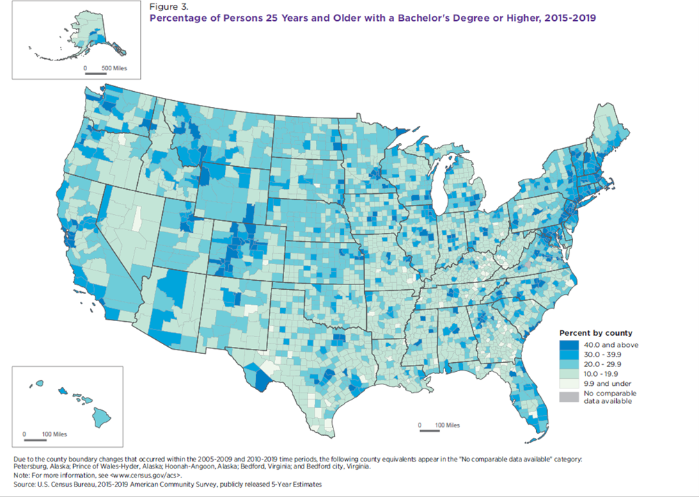

# Choropleth Map 

**Also known as:** Shaded-area map; thematic area map 

## 1. Purpose and Overview 

A choropleth map is a type of map in which geographic areas are assigned a color
in relation to a data variable. Choropleth maps are best used to display the
geographic distribution of data. They can also be used to compare geographic
areas, but the patterns shown depend in part on how the data are grouped.

The data in a choropleth map can be categorical or numeric. When mapping numeric
data, use a normalized measure—such as a percentage, density, ratio, median, or
average—rather than raw counts. For mapping counts, see the **Proportional Symbol
Map** guidance.

## When to Use

Use a choropleth map when the main question concerns how a comparable measure
varies across geographic areas, such as states, counties, or census tracts.

Appropriate examples include:

- Comparing the percentage of adults age 25 and older with a bachelor's degree
  or higher across counties.
- Showing poverty rates across states or counties.
- Mapping median household income across geographic areas.

Use another visualization when geographic distribution is not central to the
question, when precise ranking is the priority, or when the data cannot be
compared meaningfully across the mapped areas. A sorted bar chart or table may
make value comparisons easier; a proportional symbol map may be appropriate
when the intended message is about counts.

## Guidance

In addition to the guidance below, follow the repository's existing **Agency
Logo, Axes, Colors, Grids, Legends, Map Layout, Source, Titles, and Typography**
guidance. Those pages contain shared standards and should not be duplicated here.

### Essential

- **Choose an appropriate classification method for numeric data.** Common
  methods include:
  - **Natural Breaks:** Groups values based on gaps in the data.
  - **Equal Interval:** Divides the data range into equal intervals. This can
    work well when values are evenly distributed; with uneven distributions,
    many observations may fall into a small number of classes.
  - **Quantile:** Divides the data so each class contains an equal or nearly
    equal number of observations. This can create a balanced distribution of
    colors, but values within a class may be far apart.
  - **Subject-matter-defined classes:** Uses thresholds justified by subject
    matter expertise. Document the rationale for the thresholds.
- **Include a legend.** Refer to the Legends section for detailed guidance and
  examples.
- **Match legend precision to the tabular data.** For numeric data, use
  appropriate rounding (for example, one decimal place when supported by the
  source data).
- **Use a suitable color scheme.** Use sequential or diverging schemes for
  quantitative data and categorical schemes for qualitative data. Choose a
  diverging scheme only when a meaningful midpoint or reference value exists.
- **Normalize numeric data.** Use percentages, densities, ratios, medians, or
  averages when these are appropriate to the analytical question; do not map
  raw counts as if they were comparable rates.
- **Account for every geographic entity in the map layer.** If some areas do not
  have data, identify them separately (for example, “No comparable data
  available”). Do not treat missing data as zero or as the lowest class.
- **Ensure classes are mutually exclusive.** Each possible numeric value should
  belong to one and only one class. Explain class boundaries when needed for
  interpretation.
- **Consider survey estimates carefully.** Do not create a class break
  specifically to highlight a particular survey estimate, such as a national
  estimate, when mapping survey data such as the American Community Survey.

### Avoid

- Do not use a qualitative or categorical color scheme to represent quantitative
  values.
- Do not create classes with overlapping ranges or gaps that leave valid values
  unclassified.
- Do not use raw counts when the map is intended to compare relative levels
  across areas with different population sizes.
- Do not assign missing, suppressed, or unavailable values to the lowest class.
- Do not imply that a geographic-area estimate describes every person or
  household within that area.

## Additional Recommendations

### Recommended

- **Limit the number of classes to six or fewer** when this is appropriate for
  the data and intended audience. Fewer classes can make patterns easier to
  interpret.
- **Consider rounding class breaks** to values that are easier to read, while
  ensuring the boundaries remain meaningful and do not distort the data.
- **Limit boundary lines** to those needed for clear geographic interpretation.
- **Choose line weights appropriate to map scale and geographic complexity.**
  Thick boundaries can obscure the fill colors.
- **Use consistent class breaks and color scales** for maps intended for direct
  comparison, unless a different approach is justified and explained.

### Not Recommended

- Avoid dot, line, or hatching fill patterns in a choropleth map.
- Avoid class breaks that create an exaggerated impression of differences.
- Avoid using color alone to communicate information when the map interface
  provides no equivalent way to access the underlying values; follow the
  repository's separate accessibility guidance.

## Examples and Discussion
 
### Static Choropleth Map — Example 1

**Percentage of persons age 25 and older with a bachelor's degree or higher,
2015–2019**



This example provides a demonstration of the following requirements:
* The data is broken up into even, non-overlapping, intervals which are defined in a legend containing 6 categories. 
* The data values are provided as percentages, and the legend shows the precision of the data.
* Color is being used in a gradient with higher color intensity for higher percentages.
* Geographies which have no data are identified and defined within the map.

## Developer Implementation

The Python example retrieves county-level educational attainment estimates from the 2019 ACS Five-Year Estimates API, joins the estimates to county boundary polygons, and creates a static choropleth map.

The five-year estimates represent the 2015–2019 period. They should not be interpreted as estimates for 2019 alone.

The implementation uses public Census data and Census cartographic boundary files. It requires internet access to retrieve the data and geographic boundaries.

The example is intended as a starting point for developers. Before publishing a map, verify the source data, geographic join, classification thresholds, missing-data treatment, and visual output in the target environment.

### Data Preparation

The implementation uses the following data fields and geographic information:

- **Geographic identifier:** Five-character county GEOID, constructed from the state and county FIPS codes.
- **Population denominator:** ACS estimate for the population age 25 and older.
- **Educational attainment numerator:** Sum of the estimates for bachelor's, master's, professional school, and doctoral degrees.
- **Measure:** Percentage of the population age 25 and older with a bachelor's degree or higher.
- **Geographic boundaries:** 2019 Census county and county-equivalent cartographic boundary polygons.
- **Reference period:** 2015–2019 ACS Five-Year Estimates.

The percentage is calculated as:

`(Population with a bachelor's degree or higher / Total population age 25 and older) × 100`

The geographic join uses GEOID rather than county names alone. This helps avoid incorrect matches between similarly named places.

Missing or invalid estimates should remain missing. They should not be converted to zero or interpreted as evidence of low educational attainment.

### Python Implementation

The complete Python example is provided as separate downloadable files so developers can either run the script directly or work interactively in Jupyter Notebook or Google Colab.

<table>
  <thead>
    <tr>
      <th>File</th>
      <th>Purpose</th>
      <th>Recommended Use</th>
    </tr>
  </thead>
  <tbody>
    <tr>
      <td>
        <a href="https://melissakep.github.io/data_viz_guidance/Python%20Artifacts/choropleth_map_example.py"
           class="download-file"
           data-filename="choropleth_map_example.py">
          Download Choropleth Map Example Python Script
        </a>
      </td>
      <td>Standalone Python implementation of the choropleth map, including data retrieval, preparation, visualization, and export functionality.</td>
      <td>Run in a Python environment or adapt for another project.</td>
    </tr>
    <tr>
      <td>
        <a href="https://melissakep.github.io/data_viz_guidance/Python%20Artifacts/Choropleth_Map_Example.ipynb"
           download="Choropleth_Map_Example.ipynb"
           class="download-file"
           data-filename="Choropleth_Map_Example.ipynb">
          Download Choropleth Map Jupyter Notebook
        </a>
      </td>
      <td>Interactive notebook version of the implementation, with executable cells for reviewing the workflow.</td>
      <td>Run interactively in Google Colab or Jupyter Notebook.</td>
    </tr>
    <tr>
      <td>
        <a href="https://melissakep.github.io/data_viz_guidance/Python%20Artifacts/bachelors_degree_choropleth_2015_2019.png"
           download="bachelors_degree_choropleth_2015_2019.png"
           class="download-file"
           data-filename="bachelors_degree_choropleth_2015_2019.png">
          Download Bachelor's Degree Choropleth Map (PNG)
        </a>
      </td>
      <td>Exported county-level choropleth map showing the percentage of the population age 25 and older with a bachelor's degree or higher.</td>
      <td>View the completed visualization or include it in documentation, reports, and presentations.</td>
    </tr>
    <tr>
      <td>
        <a href="https://melissakep.github.io/data_viz_guidance/Python%20Artifacts/bachelors_degree_county_data_2015_2019.csv"
           download="bachelors_degree_county_data_2015_2019.csv"
           class="download-file"
           data-filename="bachelors_degree_county_data_2015_2019.csv">
          Download Bachelor's Degree County Data (CSV)
        </a>
      </td>
      <td>County-level output data containing geographic identifiers, county names, calculated percentages, and legend categories used in the map.</td>
      <td>Review mapped values, validate the output, or use the data for additional analysis and visualizations.</td>
    </tr>
  </tbody>
</table>

**Implementation details:**

- **Language:** Python
- **Libraries:** Pandas, GeoPandas, Matplotlib, Requests, Shapely, and Pyogrio
- **Data source:** U.S. Census Bureau, 2019 American Community Survey (ACS) Five-Year Estimates and 2019 TIGER/Line cartographic boundary files
- **Geographic level:** Counties and county equivalents
- **Measure:** Percentage of the population age 25 and older with a bachelor's degree or higher
- **Outputs:** Static choropleth map (PNG) and county-level data (CSV)

A U.S. Census API key is recommended. The script prompts for the key if the `CENSUS_API_KEY` environment variable is not set. Do not hardcode the key or commit it to a public repository.

Install the required packages using the command appropriate for your environment.

**Google Colab or Jupyter Notebook:**

```python
%pip install pandas geopandas matplotlib requests shapely pyogrio
```

**Local Python environment (terminal):**

```bash
pip install pandas geopandas matplotlib requests shapely pyogrio
```

The example retrieves ACS county estimates and Census geographic boundary files from public Census resources, so an internet connection is required. Review the source data, geographic join, classification thresholds, missing-data treatment, and visual output before publishing an adapted map.

### Output Files

Both downloadable Python implementations (the `.py` script and `.ipynb` notebook) generate the PNG map and CSV dataset listed in the download table above when run successfully. The output files are saved in the working directory. The repository also provides them as separate downloads so developers can review the finished map and reuse the county-level data without rerunning the code.

## Reproducibility and Adaptation of the Data and Chart

The example can be adapted to other ACS indicators, geographies, and reporting periods. Before adapting it, developers should:

- **Select an appropriate measure.** Percentages, rates, densities, medians, and ratios are often more suitable for choropleth maps than raw counts.
- **Match the data and geographic vintages.** Use compatible ACS estimates and geographic boundaries, and document changes that affect comparisons.
- **Review classification methods.** Fixed thresholds, quantiles, equal intervals, and natural breaks emphasize different patterns. Choose a method that supports the analytical purpose rather than selecting breaks solely to emphasize a particular result.
- **Validate the geographic join.** Confirm that GEOIDs are unique, expected counties are present, and missing estimates are handled correctly.
- **Preserve data uncertainty.** ACS estimates have margins of error. Consider uncertainty before interpreting small differences between counties.
- **Check accessibility and legibility.** Test color contrast, legend wording, line weights, typography, and missing-data symbols at the final display size.
- **Document the output.** Include the source, table identifier, reference period, measure definition, classification method, and any relevant exclusions.

The code uses fixed percentage classes to match the reference example. Its gray category identifies missing or invalid estimates in the retrieved data; it does **not** automatically reproduce the original map's complete set of county-equivalent boundary-change exclusions. The Alaska and Hawaii scale bars are illustrative and should be validated before publication.
</WritingBlock>


**Validation before publication**

Before publishing an adapted map:

- Verify the Census API response and variable definitions.
- Confirm that the county GEOIDs join correctly to the boundary data.
- Check for missing, invalid, or duplicate records.
- Review the class thresholds and legend labels.
- Confirm that the colors, boundaries, and text remain legible at the intended display size.
- Verify source wording and reference-period accuracy.
- Review relevant ACS uncertainty information before interpreting differences between counties.
- Inspect the exported image and CSV to ensure that they reflect the intended data and classification.

The goal is to preserve the analytical meaning of the data while adapting the map to the intended audience and use case.


Official starting points:

- Census developer guidance:
  https://www.census.gov/data/developers/guidance.html
- American Community Survey:
  https://www.census.gov/programs-surveys/acs
- Census TIGER/Line geographic files:
  https://www.census.gov/geographies/mapping-files/time-series/geo/tiger-line-file.html

## Common Errors and Misinterpretations

| Issue | Why It Matters | Recommended Correction |
|---|---|---|
| Mapping raw counts across areas of very different population sizes without context | The map may suggest a higher underlying rate where there are simply more people | Use a suitable rate or normalized measure when that matches the question, or clearly label counts |
| Treating missing values as zero | Areas with unavailable data appear to have the lowest value | Use a distinct missing-data style and explain it in the legend |
| Using incompatible geographic boundaries | Data may be assigned to the wrong area or omitted | Validate geographic identifiers and boundary vintage |
| Choosing arbitrary class breaks | The map can exaggerate or conceal apparent differences | Select and document a defensible classification method |
| Using different scales on maps intended for direct comparison | Similar colors can represent different values between maps | Use a common scale or clearly explain the difference |
| Ignoring margins of error | Small differences may be overinterpreted | Review uncertainty and applicable statistical guidance |
| Using a palette that is difficult to distinguish | Readers may not be able to interpret the pattern reliably | Test an appropriate accessible palette |
| Providing only hover-based values | Important information may be unavailable to keyboard or screen-reader users | Provide accessible labels, summaries, and/or a data table |

## Publication Quality Checklist

- [ ] The map answers a geographic question.
- [ ] The chosen measure is comparable across the mapped areas.
- [ ] Geographic identifiers and boundaries have been validated.
- [ ] The measure, units, geography, and reference period are documented.
- [ ] The color palette and classification method are appropriate.
- [ ] The legend explains ranges and missing or suppressed values.
- [ ] Relevant uncertainty and limitations are addressed.
- [ ] The map does not imply individual-level conclusions from area-level data.
- [ ] Existing accessibility guidance has been followed, including relevant
      requirements for interactive maps.
- [ ] Source data, boundary files, and transformations are documented.
- [ ] Python and R examples have been executed and verified.
- [ ] The visualization has undergone the appropriate review.
