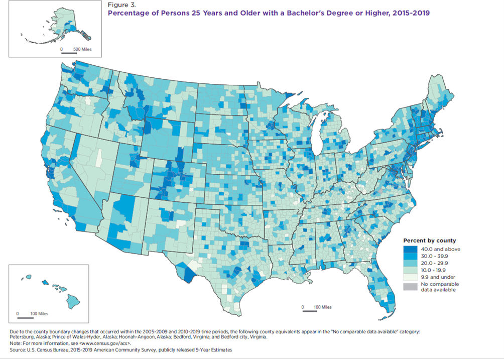

# Choropleth Map 

**Also known as:** Shaded-area map; thematic area map 

## 1. Purpose and Overview 

A choropleth map is a type of map in which geographic areas are assigned a color
in relation to a data variable. Choropleth maps are best used to display the
geographic distribution of data. They can also be used to compare geographic
areas, but the patterns shown depend in part on how the data are grouped.

The data in a choropleth map can be categorical or numeric. When mapping numeric
data, use a normalized measure—such as a percentage, density, ratio, median, or
average—rather than raw counts. For mapping counts, see the **Proportional Symbol
Map** guidance.

## When to Use

Use a choropleth map when the main question concerns how a comparable measure
varies across geographic areas, such as states, counties, or census tracts.

Appropriate examples include:

- Comparing the percentage of adults age 25 and older with a bachelor's degree
  or higher across counties.
- Showing poverty rates across states or counties.
- Mapping median household income across geographic areas.

Use another visualization when geographic distribution is not central to the
question, when precise ranking is the priority, or when the data cannot be
compared meaningfully across the mapped areas. A sorted bar chart or table may
make value comparisons easier; a proportional symbol map may be appropriate
when the intended message is about counts.

## Guidance

In addition to the guidance below, follow the repository's existing **Agency
Logo, Axes, Colors, Grids, Legends, Map Layout, Source, Titles, and Typography**
guidance. Those pages contain shared standards and should not be duplicated here.

### Essential

- **Choose an appropriate classification method for numeric data.** Common
  methods include:
  - **Natural Breaks:** Groups values based on gaps in the data.
  - **Equal Interval:** Divides the data range into equal intervals. This can
    work well when values are evenly distributed; with uneven distributions,
    many observations may fall into a small number of classes.
  - **Quantile:** Divides the data so each class contains an equal or nearly
    equal number of observations. This can create a balanced distribution of
    colors, but values within a class may be far apart.
  - **Subject-matter-defined classes:** Uses thresholds justified by subject
    matter expertise. Document the rationale for the thresholds.
- **Include a legend.** Refer to the Legends section for detailed guidance and
  examples.
- **Match legend precision to the tabular data.** For numeric data, use
  appropriate rounding (for example, one decimal place when supported by the
  source data).
- **Use a suitable color scheme.** Use sequential or diverging schemes for
  quantitative data and categorical schemes for qualitative data. Choose a
  diverging scheme only when a meaningful midpoint or reference value exists.
- **Normalize numeric data.** Use percentages, densities, ratios, medians, or
  averages when these are appropriate to the analytical question; do not map
  raw counts as if they were comparable rates.
- **Account for every geographic entity in the map layer.** If some areas do not
  have data, identify them separately (for example, “No comparable data
  available”). Do not treat missing data as zero or as the lowest class.
- **Ensure classes are mutually exclusive.** Each possible numeric value should
  belong to one and only one class. Explain class boundaries when needed for
  interpretation.
- **Consider survey estimates carefully.** Do not create a class break
  specifically to highlight a particular survey estimate, such as a national
  estimate, when mapping survey data such as the American Community Survey.

### Avoid

- Do not use a qualitative or categorical color scheme to represent quantitative
  values.
- Do not create classes with overlapping ranges or gaps that leave valid values
  unclassified.
- Do not use raw counts when the map is intended to compare relative levels
  across areas with different population sizes.
- Do not assign missing, suppressed, or unavailable values to the lowest class.
- Do not imply that a geographic-area estimate describes every person or
  household within that area.

## Additional Recommendations

### Recommended

- **Limit the number of classes to six or fewer** when this is appropriate for
  the data and intended audience. Fewer classes can make patterns easier to
  interpret.
- **Consider rounding class breaks** to values that are easier to read, while
  ensuring the boundaries remain meaningful and do not distort the data.
- **Limit boundary lines** to those needed for clear geographic interpretation.
- **Choose line weights appropriate to map scale and geographic complexity.**
  Thick boundaries can obscure the fill colors.
- **Use consistent class breaks and color scales** for maps intended for direct
  comparison, unless a different approach is justified and explained.

### Not Recommended

- Avoid dot, line, or hatching fill patterns in a choropleth map.
- Avoid class breaks that create an exaggerated impression of differences.
- Avoid using color alone to communicate information when the map interface
  provides no equivalent way to access the underlying values; follow the
  repository's separate accessibility guidance.

## Examples and Discussion
 
Static Choropleth Map 
***Example 1:*** Percentage of persons 25 and Older with a Bachelor’s Degree or Higher, 2015-2019

This example provides a demonstration of the following requirements:
* The data is broken up into even, non-overlapping, intervals which are defined in a legend containing 6 categories. 
* The data values are provided as percentages, and the legend shows the precision of the data.
* Color is being used in a gradient with higher color intensity for higher percentages.
* Geographies which have no data are identified and defined within the map.
