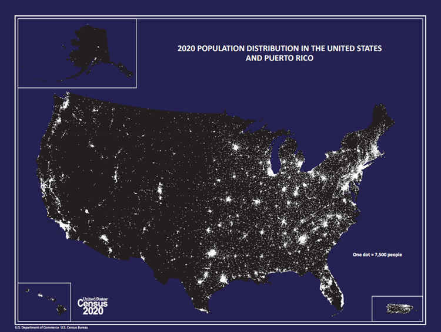
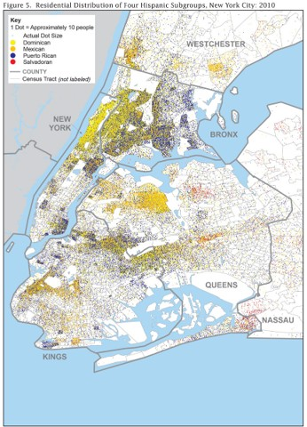

layout: default
title: Dot Distribution Map
permalink: dotdistributionmap.html
tags:
  - distribution
  - geospatial
description: "Guidance for designing, interpreting, and implementing dot distribution maps, including a Maryland Census example."
---

# Dot Distribution Map

**Also known as:** Dot density map; dot map

## 1. Purpose and Overview

A dot distribution map uses same-sized dot symbols to show the presence, location pattern, or relative concentration of a feature across a geographic area. Each dot represents a defined quantity of the phenomenon being mapped. The map author determines the value represented by each dot based on the dataset, geographic scale, and intended audience.

Dots are commonly placed within source polygons using aggregate counts. For example, a population dot map may use census tract or census block population estimates, then randomly place dots inside each polygon to represent the reported population. The resulting pattern communicates geographic concentration, but randomly placed dots do not identify actual households or individual residential locations.

Dot distribution maps can also represent multiple categories. A multivariate dot map uses different colors or symbols to distinguish groups, such as different population origins or types of facilities. A dot distribution map can be layered over another thematic map, although additional layers should not make the dots, legend, or geographic context difficult to interpret.

This page covers design guidance and a Python implementation using U.S. Census Bureau data to create a multivariate dot distribution map of selected Hispanic-origin populations in Maryland.

## 2. When to Use

Use a dot distribution map when the goal is to communicate where a phenomenon is concentrated or how its distribution varies geographically.

- **Population distribution:** Show the approximate distribution of people across census tracts, blocks, or other suitable geographies.
- **Multiple population groups:** Compare the geographic patterns of several categories using consistent dot sizes and distinct colors.
- **Facilities or events:** Represent counts of schools, service locations, incidents, or other phenomena when the source geography and dot value are appropriate.
- **Geographic concentration:** Make clusters and areas of relative concentration easier to see than they may be in a table of aggregate counts.
- **Thematic map overlays:** Add a dot layer to another map only when the additional information supports the analytical question and remains visually legible.

A dot map is most useful when the reader needs to understand the spatial pattern rather than retrieve an exact value for every polygon. Include a legend that explains the value represented by one dot.

## 3. When to Use an Alternative

A dot distribution map may not be the best choice in the following situations:

- **Exact geographic locations are required:** Use verified point locations when the dataset contains actual coordinates and it is appropriate to display them. Do not present randomly generated dot locations as observed locations.
- **The map is too crowded:** A large number of overlapping dots can obscure the underlying pattern. Consider a choropleth, hexbin map, proportional-symbol map, or a smaller set of categories.
- **Only polygon-level comparison is needed:** A choropleth may communicate differences between counties, tracts, or other areas more directly.
- **The geography is too coarse:** Large polygons can make randomly distributed dots appear more spatially precise than the source data supports. Consider a finer geography when suitable data are available.
- **The dot value would create too many or too few symbols:** Adjust the dot value or use another map type if the resulting map is difficult to read.
- **The data are not counts or count-like values:** A dot map generally requires a meaningful quantity that can be represented by repeated symbols. Do not convert unrelated percentages or rates into dots without a defensible method.

## 4. Choosing Between Alternatives

| Mapping need | Alternative or approach | Why it may be preferable |
|---|---|---|
| Show the approximate distribution of a count across geographic areas | Dot distribution map | Makes broad spatial concentration and clustering visible. |
| Compare a rate or percentage by polygon | Choropleth map | Encodes a normalized measure directly by area. |
| Compare totals for locations or areas | Proportional-symbol map | Uses symbol size to communicate magnitude without generating many dots. |
| Show actual known locations | Point map | Uses observed or verified coordinates rather than randomly allocated points. |
| Show concentration in a continuous point dataset | Heat map or kernel density map | Estimates areas of concentration from point locations, subject to method and bandwidth choices. |
| Show dense point patterns without overlap | Hexbin or grid aggregation | Summarizes points into regular cells and can reduce overplotting. |

The choice should reflect the data type, geographic precision, analytical question, and intended audience. Do not use a dot map simply because the source contains population counts; verify that the dot value and geographic level produce a useful and honest representation.

## 5. Data Requirements and Statistical Considerations

A dot distribution map requires a count or other quantity that can be represented as a number of dots, plus geographic features that define where those dots may be placed.

### Essential data considerations

- **Count or estimate:** Identify the measure represented by each dot. Document whether the source is a count, estimate, or derived value.
- **Dot value:** Define how many units each dot represents. For example, one dot may represent 100 people. Keep the value consistent across categories unless the map explicitly communicates otherwise.
- **Geographic boundaries:** Use polygons that match the geographic level of the tabular data. Census tract estimates should be joined to tract boundaries, not county boundaries, unless the data are first aggregated to counties.
- **Geographic identifiers:** Join tabular and spatial data using a stable geographic identifier such as a Census GEOID. Preserve leading zeros.
- **Coordinate reference system:** Confirm the source CRS and use a suitable projected CRS for map display and point placement. Transform data with a CRS-aware operation; do not simply relabel coordinates.
- **Placement method:** Explain whether dots represent actual locations, a deterministic allocation, or random placement within source polygons.
- **Sampling and uncertainty:** When using survey estimates such as ACS data, acknowledge margins of error and sampling variability. A dot map does not remove uncertainty in the source estimates.
- **Missing and suppressed values:** Distinguish unavailable values from zero. Do not create dots for missing or suppressed data.
- **Polygon constraints:** Where suitable ancillary data are available, constrain placement to plausible locations, such as land areas or populated areas, rather than water or inaccessible parts of a polygon.

### Dot value and rounding

The dot value affects the visual density and interpretability of the map. A smaller value produces more dots and can make local patterns easier to see, but it may also create clutter and long rendering times. A larger value reduces clutter but may hide differences between areas.

When a count is not an exact multiple of the dot value, the implementation must define how to handle the remainder. Common approaches include rounding to the nearest whole dot, always rounding down, or using stochastic rounding. Document the approach because it affects the number of displayed symbols.

### Random placement and interpretation

When only polygon-level totals are available, randomly placing dots within each polygon is a cartographic approximation. The resulting dots show the distribution of the aggregate estimate across the source geography, not the true location of individual people or events.

Use a fixed random seed when repeatable outputs are important. A fixed seed makes the random placement reproducible for the same input data and code, but it does not make the locations observed or more precise.

For population maps, use ancillary information to avoid placing dots in water or clearly uninhabited areas when the necessary data are available. The placement constraint should be documented, and developers should not imply that the constraint creates household-level accuracy.

## 6. Visualization-Specific Considerations

### Dot size, overlap, and density

- Use the same dot size for all observations represented by the same dot value.
- Select a dot size appropriate for the map's geographic extent and final display dimensions.
- Review dense areas for excessive overlap. Overlap can conceal clusters and make the apparent density difficult to compare.
- Do not change dot size by category if the legend implies that all dots represent the same quantity.
- Test the map at the size at which readers will view or print it. A map that looks clear when zoomed in may become crowded in a report or web page.
- Consider marker opacity and edge styling carefully. Excessive transparency can make dense areas appear lighter, while opaque markers can conceal other categories where points overlap.

### Multivariate categories and color

When mapping multiple categories, assign a distinct and consistent color to each group. The legend should identify both the category and the dot value. Avoid relying on color alone when categories can also be identified through clear labels.

For maps with many categories:

- Use a palette with distinguishable colors.
- Check the palette for common forms of color-vision deficiency.
- Avoid assigning colors that are too similar, especially for categories likely to overlap.
- Keep category colors consistent across the map, legend, notebook, and any related figures.
- Use a neutral background and restrained boundary styling so the dot pattern remains the primary visual element.
- If the map is intended for grayscale printing, provide an additional way to distinguish categories or explain that color is necessary to interpret the map.

### Legend and labels

The legend is essential to interpreting a dot distribution map. It should clearly state the number of units represented by one dot. For multivariate maps, it should also define each color or symbol category.

County, state, or other reference labels can help readers orient themselves, but labels should not obscure the dot pattern. Use restrained typography and sufficient contrast. Consider label halos or light background boxes where dots and labels overlap.

### Map layout and source information

Include a clear title, geographic area, reference period, and source note. For survey-based data, identify the estimate vintage and table or variables. Explain that dots are randomly placed if the underlying data are only available as polygon-level aggregates.

### Examples

***Static Dot Distribution Map***:This example demonstrates the use of a legend to explain the amount represented by each dot.




***Static Dot Distribution Map with Categories/Types***:This example uses color to distinguish categories and provides a legend explaining both the dot value and the category colors.




## 7. Census Data Example: Maryland Hispanic-Origin Population

- **Analytical question:** How are selected Hispanic-origin population groups distributed across Maryland census tracts?
- **Dataset and table:** 2024 American Community Survey (ACS) 5-Year Estimates, Table B03001, *Hispanic or Latino Origin by Specific Origin*.
- **Source:** U.S. Census Bureau, 2024 ACS 5-Year Estimates API and 2024 TIGER/Line census tract boundaries.
- **Geographic level:** Maryland census tracts.
- **Reference period:** 2020–2024 ACS 5-Year Estimates; 2024 TIGER/Line tract boundaries.
- **Measure and units:** ACS population estimates for selected Hispanic-origin groups. One dot represents approximately 100 people.
- **Reason for selection:** The selected groups provide an example of a multivariate dot distribution map in which color differentiates population categories while dot density communicates their approximate distribution across census tracts.
- **Limitations:** ACS values are estimates subject to sampling error. The source data are tract-level aggregates, so dots are randomly distributed within tract polygons and do not represent actual residences or individual locations. The map should be interpreted as an illustrative distribution of estimates, not a precise residential map.

### Selected ACS variables

The implementation retrieves estimate variables and their corresponding margins of error from ACS Table B03001.

| Hispanic-origin group | ACS estimate variable |
|---|---|
| Mexican | `B03001_004E` |
| Puerto Rican | `B03001_005E` |
| Cuban | `B03001_006E` |
| Dominican | `B03001_007E` |
| Guatemalan | `B03001_010E` |
| Honduran | `B03001_011E` |
| Nicaraguan | `B03001_012E` |
| Salvadoran | `B03001_014E` |
| Colombian | `B03001_020E` |
| Venezuelan | `B03001_025E` |

The corresponding margin-of-error variables use the same table sequence with the `M` suffix in place of `E`. The script retrieves these values for uncertainty context. Summing tract-level margins of error does not produce a valid statewide margin of error; a formal combined uncertainty estimate requires an appropriate statistical method.

### Geographic data and join

The example downloads the 2024 TIGER/Line Maryland census tract boundary file and retrieves tract-level ACS estimates through the Census API. The ACS and TIGER/Line records are joined using the 11-character tract GEOID, constructed from the state, county, and tract FIPS codes.

The map uses EPSG:26918 (NAD83 / UTM Zone 18N) for Maryland map display and point placement. Confirm that this projection is appropriate before adapting the example to another region.

### Dot placement method

The script uses a dot value of approximately 100 people per dot. It calculates the expected number of dots for each group in each tract and uses stochastic rounding to convert fractional dot counts into whole symbols. Points are then randomly sampled within each tract polygon.

A fixed random seed is used so the same input data and code produce repeatable random placements. This supports reproducibility, but the resulting locations remain simulated. They must not be described as actual household or individual locations.

## 8. Developer Implementation

The Python implementation is provided as a standalone script and a Jupyter Notebook. The Markdown page documents the workflow and expected outputs; the executable code is maintained in the separate implementation files.

### 8.1 Downloadable Python Implementations

The files are stored in the repository's `Python Artifacts` directory.

| File | Purpose | Recommended use |
|---|---|---|
| [Download Maryland Hispanic-Origin Dot Map Python Script](https://melissakep.github.io/data_viz_guidance/Python%20Artifacts/maryland_hispanic_origin_dot_map.py) | Standalone Python implementation that retrieves ACS estimates, downloads tract boundaries, generates dot locations, and exports the map. | Run from a local Python environment or adapt the workflow. |
| [Download Maryland Hispanic-Origin Dot Map Jupyter Notebook](https://melissakep.github.io/data_viz_guidance/Python%20Artifacts/maryland_hispanic_origin_dot_map.ipynb) | Notebook version of the workflow with executable cells. | Run interactively in Jupyter Notebook, JupyterLab, or Google Colab after installing dependencies. |

Keep the `.py` and `.ipynb` implementations synchronized when making changes. If one implementation is updated, review the other to ensure the data source, variables, dot value, colors, methodology, and output settings remain consistent.

### 8.2 Data Preparation and Processing Workflow

The implementation follows these general steps:

1. Requests the selected Hispanic-origin estimate and margin-of-error variables from the 2024 ACS 5-Year Estimates API.
2. Downloads the 2024 TIGER/Line census tract boundary file for Maryland using state FIPS code `24`.
3. Preserves geographic identifiers as strings and constructs an 11-character tract GEOID.
4. Joins the ACS tabular records to the tract polygons using GEOID.
5. Projects the tract geometries to EPSG:26918 (NAD83 / UTM Zone 18N).
6. Calculates the number of dots for each group and tract using the configured dot value and stochastic rounding.
7. Randomly places the generated points within the corresponding tract polygons using a fixed random seed.
8. Draws county boundaries and county labels for geographic context.
9. Applies a distinct color to each Hispanic-origin category and creates a legend that identifies the groups and dot value.
10. Adds the title, ACS source attribution, geographic level, reference period, and methodological caveat.
11. Exports a high-resolution PNG and a PDF version of the map.

### 8.3 Python Packages

The implementation uses the following Python packages:

| Package | Purpose |
|---|---|
| `requests` | Sends Census API requests and downloads the TIGER/Line ZIP file. |
| `pandas` | Structures, cleans, and processes ACS tabular data. |
| `geopandas` | Reads, joins, transforms, and plots geographic data. |
| `matplotlib` | Creates the map, legend, labels, and PNG/PDF exports. |
| `numpy` | Supports random number generation, stochastic rounding, and coordinate arrays. |
| `shapely` | Works with polygon and point geometries. |
| `pyproj` | Supports coordinate reference system transformations through GeoPandas. |

Install the required packages from a terminal:

```bash
pip install geopandas matplotlib numpy pandas requests shapely
```

GeoPandas has geospatial dependencies. If installation fails in a particular Python environment, use the GeoPandas installation guidance for that operating system and environment. A virtual environment is recommended so project dependencies remain isolated.

### 8.4 Census API Access

The example retrieves public ACS data through the Census API. A Census API key may be used to support higher request limits, but the API request in this example can be made without a key.

- [Census API Key Signup](https://api.census.gov/data/key_signup.html)
- [Census API Data Discovery Tool](https://api.census.gov/data.html)
- [Census Data API User Guide](https://www.census.gov/data/developers/guidance/api-user-guide.html)
- [American Community Survey](https://www.census.gov/programs-surveys/acs)

If a key is used, keep it private. Do not hard-code it into the Python file or commit it to a public GitHub repository. Use an environment variable or an approved secret-management approach.

### 8.5 Running the Script or Notebook

**Run the Python script locally:**

1. Download `maryland_hispanic_origin_dot_map.py` from the `Python Artifacts` directory.
2. Open a terminal in the folder containing the script.
3. Install the required packages.
4. Run the script:

```bash
python maryland_hispanic_origin_dot_map.py
```

5. Allow the script to retrieve the ACS data and TIGER/Line boundaries.
6. Review the map and the generated output files.

**Run the Jupyter Notebook:**

1. Download `maryland_hispanic_origin_dot_map.ipynb`.
2. Open it in Jupyter Notebook, JupyterLab, or Google Colab.
3. Install the required packages in the notebook environment if they are not already available.
4. Run the cells in order.
5. Review the map and confirm that the output files are saved to the expected location.

An internet connection is required to retrieve the Census API data and TIGER/Line boundaries. The first run downloads the tract boundary ZIP file. Subsequent runs can reuse the locally downloaded boundary data when it remains available in the configured data directory.

### 8.6 Downloadable Example Outputs

The repository's `Python Artifacts` directory includes the exported map files from the Maryland dot distribution example. These allow developers to review the visualization without first running the code.

| Output | Description | Download |
|---|---|---|
| Maryland Hispanic-origin dot distribution map (PNG) | High-resolution static map showing the selected Hispanic-origin groups across Maryland census tracts. | [View or Download PNG Map](https://melissakep.github.io/data_viz_guidance/Python%20Artifacts/maryland_hispanic_origin_dot_distribution.png) |
| Maryland Hispanic-origin dot distribution map (PDF) | PDF export of the multivariate dot distribution map for viewing, printing, or inclusion in documentation. | [View or Download PDF Map](https://melissakep.github.io/data_viz_guidance/Python%20Artifacts/maryland_hispanic_origin_dot_distribution.pdf) |
| Maryland population dot distribution map (PNG) | Additional Maryland population dot distribution output included in the repository. | [View or Download Population Dot Map](https://melissakep.github.io/data_viz_guidance/Python%20Artifacts/maryland_population_dot_distribution.png) |

The PNG and PDF files are static outputs. Running the Python script or notebook again may produce a new dot arrangement if the input data, random seed, dot value, or code changes. The output files in the repository should be regenerated and reviewed when the implementation is updated.

### 8.7 Reproducibility and Adaptation

Before adapting the example to another geography or dataset:

- Confirm that the selected ACS release, table, variables, and geographic level are available.
- Use geographic boundaries that match the tabular geography and document the boundary vintage.
- Preserve leading zeros in state, county, and tract identifiers.
- Validate the GEOID join and investigate unmatched or missing records.
- Confirm that the measure is a count or estimate that can reasonably be represented by dots.
- Select a dot value appropriate for the map scale and expected symbol density.
- Document the rounding method used to convert estimates into whole dots.
- Use a fixed random seed when repeatable point placement is required.
- Confirm that generated points fall within their assigned source polygons.
- Consider ancillary data to avoid implausible placement in water or unpopulated areas when appropriate data are available.
- Use a projected CRS appropriate to the geographic region.
- Keep category colors and legend definitions consistent across the map, notebook, script, and documentation.
- Review ACS margins of error and avoid treating survey estimates as exact counts.
- Keep the source attribution, reference period, dot value, and random-placement caveat with exported maps.
- Review the `.py` and `.ipynb` files together after code changes.

The example is a starting point for developer implementation. Run it in the target environment and verify the API response, geographic join, point placement, legend, source attribution, and exported files before publishing an adapted map.

## 9. Common Errors and Misinterpretations

| Issue | Why it matters | Recommended correction |
|---|---|---|
| The legend does not state the dot value | Readers cannot determine how much each dot represents. | Clearly state the number of units represented by one dot. |
| Different dot sizes are used for categories with the same dot value | The visual encoding becomes inconsistent. | Use the same marker size for all categories represented by the same dot value. |
| Too many dots overlap | Dense areas may become visually indistinguishable. | Adjust the dot value, marker size, map extent, or number of categories. |
| The dot value is too large | Smaller areas and differences may disappear. | Test a smaller dot value while monitoring clutter and rendering time. |
| The dot value is too small | The map may become crowded and difficult to render. | Increase the dot value or consider a different map type. |
| Randomly placed dots are interpreted as actual residences | The map implies a level of location precision that the source data does not support. | Clearly state that points are randomly allocated within source polygons. |
| Dots are placed outside their source polygons | The map no longer represents the intended geographic allocation. | Validate point-in-polygon placement and inspect the source geometries. |
| Dots are placed in water or unpopulated areas | The visual pattern may be implausible for population data. | Use suitable ancillary data to constrain placement when available, and document the method. |
| ACS estimates are treated as exact counts | Survey estimates have sampling error. | Identify the ACS source and acknowledge margins of error. |
| Margins of error are added across tracts and reported as a statewide MOE | A simple sum does not produce a valid combined margin of error. | Use an appropriate statistical aggregation method for combined uncertainty. |
| Missing values are treated as zero | Missing or unavailable data may be misrepresented as no population. | Preserve missing values and distinguish them from true zero estimates. |
| Census GEOIDs lose leading zeros | The ACS-to-boundary join may fail or match incorrectly. | Store FIPS codes and GEOIDs as strings and validate their lengths. |
| ACS data and boundary vintages are inconsistent | Geographic changes can affect joins and comparisons. | Document the data and boundary vintages and evaluate geographic comparability. |
| Colors are too similar | Readers may not be able to distinguish categories, especially where dots overlap. | Use a distinguishable, accessible palette and verify the legend. |
| County labels obscure dense dot patterns | Labels compete with the data and can hide clusters. | Reduce label size, reposition labels, or use restrained label backgrounds. |
| The map is exported at a size that makes dots unreadable | The visualization may not work in its intended report or web layout. | Review the exported image at its final display size and adjust the layout. |
| The random seed is not fixed when reproducibility is required | Dot positions may change between runs even when the data do not. | Set and document a fixed random seed. |
| The Python script and notebook contain different implementations | Developers may receive inconsistent outputs from the two files. | Keep both implementations synchronized and review them together after changes. |

## 10. Publication Quality Checklist

- [ ] The map title identifies the subject and geographic area.
- [ ] The data source, table, reference period, and geographic level are documented.
- [ ] The legend states the number of units represented by one dot.
- [ ] Each category is clearly identified in the legend.
- [ ] Dot size is consistent for categories that use the same dot value.
- [ ] The dot value is appropriate for the map scale and symbol density.
- [ ] Dense areas have been reviewed for excessive overlap.
- [ ] The placement method is documented.
- [ ] Randomly placed dots are not presented as actual household or individual locations.
- [ ] The geographic boundaries match the tabular data.
- [ ] GEOIDs retain leading zeros and the geographic join has been validated.
- [ ] The coordinate reference system is correctly defined and suitable for the map.
- [ ] Generated points fall within their assigned source polygons.
- [ ] Ancillary placement constraints are used only when supported by suitable data and documented.
- [ ] ACS estimates and margins of error are interpreted appropriately.
- [ ] Missing values are not silently converted to zero.
- [ ] The color palette is distinguishable and accessible.
- [ ] County boundaries and labels provide context without obscuring the data.
- [ ] Source attribution and methodological notes remain visible in the exported map.
- [ ] The PNG and PDF exports have been reviewed at their intended display sizes.
- [ ] The Python script and Jupyter Notebook are synchronized.
- [ ] The code has been run in the intended environment and the generated outputs have been verified.
