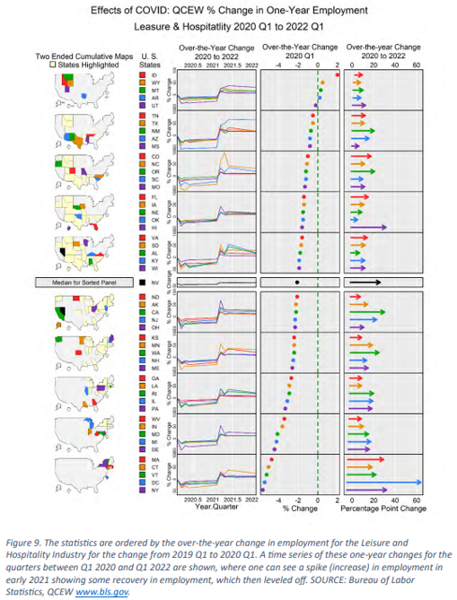
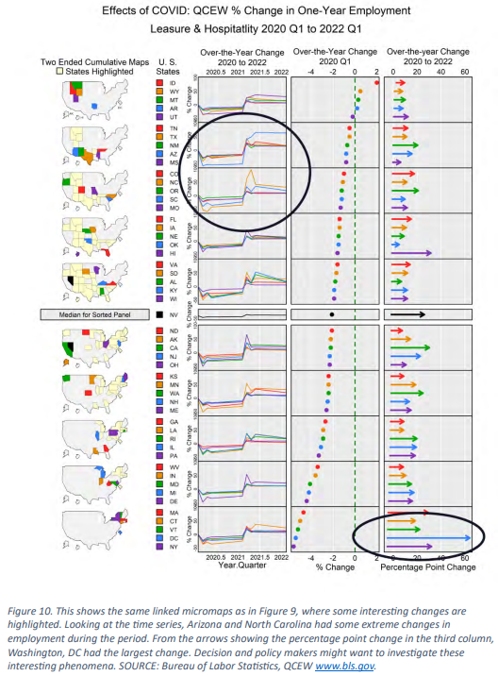

# Micromaps

**Also known as:** Linked Micromaps

## 1. Purpose and Overview

A micromap is a geospatial visualization technique that pairs small geographic maps with corresponding statistical graphics. Each row or panel highlights a subset of geographic units, such as states, regions, or counties, and displays associated data in an aligned plot.

By organizing geographic and statistical information into coordinated panels, micromaps help readers compare values across areas, identify spatial patterns or outliers, and follow a consistent sequence. They are especially useful when both geographic context and numeric comparison are important to the analysis.

Unlike a single choropleth map, a micromap can connect each geographic area directly to one or more statistical displays. The map provides spatial context, while the aligned charts make it easier to compare the values.

## 2. When to Use

Use a micromap when:

- The analytical question involves comparing a set of geographic areas.
- Both geographic location and precise statistical comparison are important.
- The data can be organized into consistent geographic units and corresponding measures.
- The number of geographic units makes a single map or chart difficult to interpret.
- Areas can be arranged into meaningful groups or an ordered sequence.
- The audience needs to identify geographic patterns while also comparing the underlying values.

**Potential Census use cases**

- Comparing state-level demographic or socioeconomic measures, such as income and poverty.
- Examining county-level differences in population, employment, or housing measures.
- Showing how a selected measure varies across Census regions or other meaningful geographic groups.
- Comparing geographic patterns alongside a reference value, such as a national average.

Choose the geographic level, measures, and grouping method based on the analytical question. Do not use a micromap simply because geographic data are available.

## 3. When to Use an Alternative

A micromap may not be the best choice when:

- **A single geographic pattern is the main message.** A choropleth or other thematic map may communicate the result more directly.
- **Precise ranking is the only objective.** A sorted bar chart or dot plot may make comparisons easier.
- **Geographic context is not important.** Use a statistical chart or table when the location of each observation does not contribute to the analysis.
- **There are too many geographic units for the available display space.** The maps, labels, and statistical panels may become too small to read.
- **The geographic areas are very small or have complex shapes.** Detailed boundaries may become crowded and difficult to distinguish.
- **Too many variables or time periods are being displayed.** The sequence can become visually overloaded and difficult to follow.
- **The measures are unrelated or not comparable.** Combining them in one sequence can imply a relationship that the data do not support.

## 4. Choosing Between Alternatives

| Analytical Goal | Alternative Visualization | Why It May Be Preferable |
|---|---|---|
| Show one geographic measure across areas | Choropleth map | Focuses attention on the overall spatial pattern |
| Rank geographic areas by one value | Sorted bar chart | Makes ordering and exact value comparisons easier |
| Compare values without geographic context | Dot plot or bar chart | Reduces visual complexity when location is not important |
| Show a geographic pattern with a small number of measures | Small-multiple maps | Allows side-by-side geographic comparisons |
| Show a trend over time | Line graph or time-series small multiples | Makes temporal changes easier to follow |
| Present exact values for a limited number of areas | Table | Supports direct lookup and precise comparison |

Choose an alternative when it communicates the analytical message more clearly than a linked map-and-chart display.

## 5. Data Requirements and Statistical Considerations

A micromap generally requires:

- A stable geographic identifier for each area, such as a state or county FIPS code.
- Geographic boundary data that match the identifiers and geographic level in the statistical dataset.
- One or more numeric measures associated with each geographic area.
- Clear definitions, units, denominators, and reference periods for each measure.
- A defined ordering or grouping method for the geographic units.
- Uncertainty information, such as margins of error or confidence intervals, when available and relevant.

Before creating the visualization:

- **Validate geographic identifiers.** Join statistical data to geographic boundaries using stable codes rather than names alone. Check for duplicate, missing, or unmatched records.
- **Confirm comparability.** Measures should use compatible definitions, units, universes, denominators, geographic coverage, and reference periods.
- **Document grouping and ordering.** Explain whether areas are ordered by a ranked measure, time, region, or another meaningful category.
- **Handle missing data explicitly.** Distinguish missing, suppressed, or unavailable values from actual zero values.
- **Review uncertainty.** Consider margins of error or confidence intervals where available. Do not imply that small differences are meaningful without considering uncertainty.
- **Avoid ecological inference.** Area-level patterns do not establish that individuals within an area share the same characteristics.
- **Limit the number of measures.** Include only measures that contribute to the analytical question and can be interpreted together.

## 6. Visualization-Specific Considerations

Use the repository's separate component guidance for general accessibility, scaling and axes, color, labels, legends, titles, and source practices. This section covers decisions specific to micromaps.

### Geographic and statistical alignment

- Keep the geographic map and its corresponding statistical display in the same order.
- Use the same geographic grouping and ordering across all linked measures.
- Make it clear which geographic areas correspond to each statistical row or panel.
- Use simplified geographic outlines when appropriate to emphasize the highlighted areas while retaining enough spatial context.

### Grouping and ordering

- Group geographic units into small, coherent subsets. Groups of approximately 3–6 areas can be a useful starting point, but the appropriate number depends on the available space, geography, and label readability.
- Use an ordering that supports the analytical message, such as ranked values, temporal sequence, or meaningful categories like Census regions.
- Add a reference value when it helps interpretation, such as a national average or benchmark.
- Avoid including too many geographic units, variables, or time periods in one micromap sequence.

### Consistent visual encoding

- Use consistent colors, symbols, and line treatments across the map and statistical panels.
- When a geographic area is highlighted in a map, use the same visual encoding for its corresponding statistical value.
- Ensure the display remains understandable when colors are difficult to distinguish; labels and other visual cues should support identification.
- Keep unrelated variables out of the same micromap sequence.

### Additional examples and references

The following examples are retained from the original micromap guidance. Place the image files in the repository's `assets/` directory so that the Markdown image links render correctly.

**Example 1: Effects of COVID: QCEW Percent Change in One-Year Employment**

**Example 2: Effects of COVID: QCEW Percent Change in One-Year Employment, Highlighting Arizona, North Carolina, and Washington DC**

**Additional references on micromap methods**

- Powers, R., Eltinge, J., Martinez, W., & Morris, D. S. (2024). *Using Linked Micromaps for Evidence-Based Policy*. https://arxiv.org/abs/2411.04211
- Pickle, L. W., Pearson, J. B., & Carr, D. B. (2015). *micromapST: Exploring and Communicating Geospatial Patterns in US State Data*. *Journal of Statistical Software, 63*(3), 1–25. https://doi.org/10.18637/jss.v063.i03
- Payton, Q. C., McManus, M. G., Weber, M. H., Olsen, A. R., & Kincaid, T. M. (2015). *micromap: A Package for Linked Micromaps*. *Journal of Statistical Software, 63*(2), 1–16. https://doi.org/10.18637/jss.v063.i02

## 7. Census Data Example

- **Analytical question:** How do median household income and poverty rates vary across U.S. states?
- **Dataset and table:** American Community Survey (ACS) 1-Year Estimates. Median household income is retrieved from table B19013; the poverty rate is retrieved from the ACS subject table S1701 when available.
- **Source:** U.S. Census Bureau, Census Data API.
- **Geographic level:** States and the District of Columbia, subject to availability in the selected ACS release.
- **Reference period:** The selected ACS 1-Year Estimates release. The accompanying Python example currently defaults to 2024.
- **Measure and units:** Median household income in dollars and poverty rate in percent. Margins of error are included when available.
- **Reason for selection:** The measures provide related socioeconomic context and allow readers to compare geographic patterns alongside aligned statistical values.
- **Limitations:** ACS estimates have sampling error. The High, Mid, and Low Poverty groups in this example are relative groupings based on the selected data, not official Census classifications. Income values from different years are not automatically adjusted for inflation. If a poverty rate is derived from counts because the published rate variable is unavailable, a valid margin of error is not automatically produced.

The example retrieves the selected ACS measures, prepares the state-level records, and groups states into High, Mid, and Low Poverty categories based on their relative poverty-rate rankings. Each group is displayed with a corresponding U.S. map and aligned statistical panels for median household income and poverty rate.

The map provides geographic context, while the statistical panels support comparison of the measures. State colors are coordinated across the map and bars, and states outside the current group are shown in a neutral gray. Group membership can change when the ACS year or set of available geographies changes.

Do not interpret the relative groups as official Census categories or infer that income causes poverty. Review the available margins of error before interpreting differences between estimates. The implementation's data source, release year, variable definitions, grouping approach, and limitations should remain documented with the output.

## 8. Developer Implementation

The Python implementation is provided as separate files rather than embedded in this Markdown page. Use the accompanying files for the executable workflow and refer to this section for the expected data structure, packages, and outputs.

### 8.1 Data Preparation

The example retrieves state-level ACS data and prepares the measures for the linked micromap. The prepared dataset includes:

- State FIPS code and Census geography name.
- State abbreviation for map and chart labels.
- Median household income estimate and margin of error, when available.
- Poverty-rate estimate and margin of error, when available.
- Derived poverty grouping (High, Mid, or Low).

The implementation checks variable availability for the selected ACS release, joins the measures using state FIPS codes, handles unavailable values, and records the source and methodology in metadata. If the poverty rate must be calculated from counts, the result is documented as a derived measure and is not assigned an unsupported margin of error.

### 8.2 Python

The repository includes two downloadable Python implementation files:

| File | Purpose | Recommended Use |
|---|---|---|
| [Download Micromap Example Python Script](https://github.com/MelissaKep/data_viz_guidance/raw/refs/heads/main/Python%20Artifacts/micromap_example.py) | Standalone Python implementation of the linked micromap. | Run in a Python environment or adapt for another project. |
| [Download Micromap Jupyter Notebook](https://github.com/MelissaKep/data_viz_guidance/raw/refs/heads/main/Python%20Artifacts/Micromap_Example.ipynb) | Interactive notebook version of the implementation. | Run in Google Colab or Jupyter Notebook. |
**Packages**

The examples use `pandas`, `requests`, and `plotly`. The implementation also retrieves geographic boundary data from the public GeoJSON source configured in the Python files.

**Expected inputs**

- An ACS 1-Year Estimates release year supported by the selected variables and endpoint.
- An optional Census API key. The basic public data request can be made without a key; if used, the key should be stored securely and not committed to GitHub.
- An internet connection to retrieve Census data and geographic boundaries.

**Expected outputs**

- An interactive linked micromap displayed in the notebook or supported Python environment.
- A CSV file containing the prepared state-level data and poverty group assignments.
- A JSON metadata file documenting the data source, release year, variables, grouping method, and relevant limitations.
- An optional HTML version of the interactive visualization when enabled in the Python script.

Run the `.ipynb` file in Google Colab or Jupyter Notebook. Run the `.py` file from a Python environment after installing its dependencies. The implementation files contain the executable code and the detailed run instructions; this Markdown page intentionally does not duplicate that code.

### 8.3 Reproducibility and Adaptation

Before using the example in another environment or adapting it:

- Confirm that the selected ACS release and variables are available.
- Keep the geographic identifiers and boundary data consistent.
- Review the data join and investigate missing or unmatched geographies.
- Confirm the measure definitions, units, denominators, and margins of error.
- Document whether groups are relative rankings or fixed categories.
- Keep the geographic ordering consistent across linked panels.
- Review the output at its intended display size and check that labels and statistical values remain readable.
- Keep the `.py` and `.ipynb` implementations synchronized when code changes are made.
- Record the source, data vintage, transformations, and package requirements.

**Official Census resources**

- [Census API Data Discovery Tool](https://api.census.gov/data.html) — find available Census datasets, years, variables, and geographic levels.
- [Census Bureau Developers page](https://www.census.gov/data/developers.html) — API information and optional API key registration.
- [Census Data API User Guide](https://www.census.gov/data/developers/guidance/api-user-guide.html) — additional information about Census API requests and responses.
- [Census API example queries](https://www.census.gov/data/developers/guidance/api-user-guide.Example_API_Queries.html) — examples of API query structures.
- [American Community Survey](https://www.census.gov/programs-surveys/acs) — ACS program information and documentation.

## 9. Common Errors and Misinterpretations

| Issue | Why It Matters | Recommended Correction |
|---|---|---|
| Geographic and statistical panels use different ordering | Readers may associate a value with the wrong geographic area | Apply the same geographic order to the map and every linked statistical panel |
| Too many areas are included in each group | Maps, labels, and bars can become crowded and difficult to read | Use smaller, coherent groups and test the layout at its intended size |
| Inconsistent colors across panels | Readers may have difficulty matching a geographic area to its statistical values | Reuse the same visual encoding across the linked map and charts |
| Missing values are treated as zero | Unavailable data may appear to be the lowest observed value | Preserve missing values and distinguish them visually from valid observations |
| Relative groups are described as official categories | Readers may misunderstand how the areas were classified | Explain the grouping method and identify the categories as relative |
| Unrelated measures are combined in one sequence | The display may imply a relationship that the measures do not support | Include only measures that contribute to the same analytical question |
| Margins of error are ignored | Small differences between estimates may be overinterpreted | Review and disclose available uncertainty information |
| Only color is used to identify areas | Some readers may not be able to distinguish the linked areas | Include labels, outlines, or other identifying cues |
| Only hover-based information is provided | Important values may not be available to all readers | Provide visible labels or a complementary data table or summary |

## 10. Publication Quality Checklist

- [ ] The micromap answers a clear geographic and statistical question.
- [ ] Relevant alternative visualizations were considered.
- [ ] The geographic level, identifiers, and boundaries are consistent.
- [ ] The data source, measures, units, and reference period are documented.
- [ ] Geographic and statistical panels use the same grouping and ordering.
- [ ] Group definitions and ordering methods are explained.
- [ ] Missing, suppressed, or unavailable values are addressed.
- [ ] Relevant margins of error and uncertainty are considered.
- [ ] Visual encoding is consistent across linked panels.
- [ ] The display remains readable at its intended size.
- [ ] Existing accessibility, scaling, axes, color, labels, and source guidance has been followed.
- [ ] Chart-specific limitations and interpretation cautions are explained.
- [ ] The Python implementation files are available and have been executed and reviewed.
- [ ] Source data, transformations, and output metadata are documented.
- [ ] The visualization has undergone the appropriate review.

