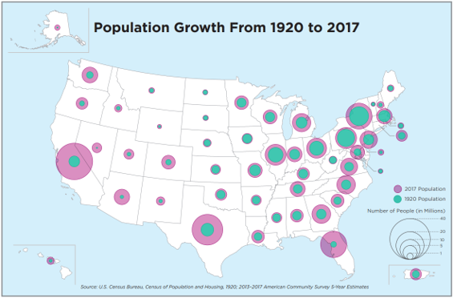
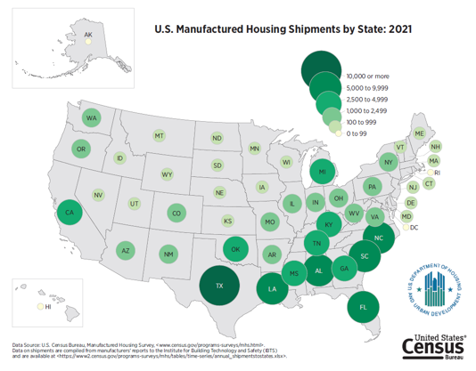
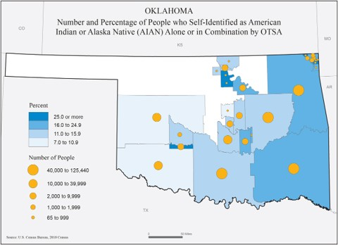
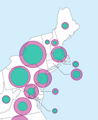
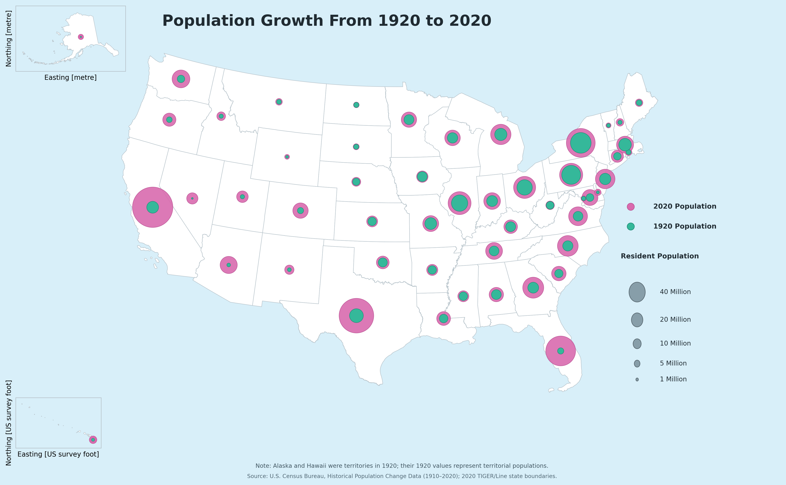

# Proportional Symbol Map

**Also known as:** Graduated Symbol Map, Graduated Circle Map (when circles are used)

**See also:** Bubble Chart, Choropleth Map, Micromap

## 1. Purpose and Overview

A proportional symbol map is a geospatial visualization that uses symbols placed at geographic locations, with symbol size representing the magnitude of a numeric value. It is typically used to display non-normalized data, such as counts or totals, and can be used with either classed or unclassed data. For normalized measures such as rates and percentages, a choropleth map may be more appropriate.

For a non-graduated proportional symbol map, symbol area is scaled in proportion to the data value using an absolute scale (also described as apparent magnitude scaling). A graduated symbol map groups values into classes and assigns a representative symbol size to each class using range grading. Proportional symbols preserve a more direct relationship between symbol area and the value; graduated symbols can be easier to interpret and compare when the data range is wide or the display would otherwise be difficult to read.

These maps help readers compare the relative magnitude of values across geographic areas while retaining geographic context. Consider the relative range of the values: if the largest value is many times greater than the smallest, large symbols may visually overwhelm the map.

The display medium also matters. Interactive maps can let users identify the actual values represented by symbols through hover or selection. Static maps do not provide that interaction, so their legends, labels, and source notes need to communicate the values clearly.

## 2. When to Use

Use a proportional or graduated symbol map when:

- The measure represents a count, total, or other non-normalized quantity.
- The geographic location of each value is important to the analysis.
- Comparing the relative magnitude of values across places is a primary objective.
- The data contain a meaningful range of values that can be represented by different symbol sizes.
- The map has enough space to display symbols without excessive overlap.
- The audience benefits from seeing both geographic distribution and relative magnitude.

**Potential Census use cases**

- Comparing state or county population counts.
- Showing the number of housing units, businesses, or establishments by geography.
- Mapping counts of people or households in selected demographic groups.
- Comparing counts across two Census years using distinct colors or symbol treatments.
- Displaying the number of events or records associated with geographic areas, when the counts are appropriate for direct comparison.

Choose the geographic level, symbol scale, and time periods based on the analytical question. Do not use proportional symbols simply because the data contain geographic identifiers.

## 3. When to Use an Alternative

A proportional symbol map may not be the best choice when:

- **The measure is a rate, percentage, or normalized value.** A choropleth map may communicate geographic variation in rates more directly.
- **Precise ranking is the main objective.** A sorted bar chart or dot plot may make small differences and exact ordering easier to interpret.
- **The geographic location is not important.** Use a bar chart, dot plot, or table when location does not contribute to the analytical question.
- **The values have an extremely wide range.** The largest symbols may overwhelm smaller symbols and obscure geographic detail.
- **Many locations are close together.** Symbol overlap can make the map difficult to read, especially in dense metropolitan or northeastern areas.
- **The map contains too many time periods or measures.** Multiple symbol layers can create a confusing legend and make comparisons difficult.
- **The audience needs exact values for many locations.** Provide a table or complementary data download rather than relying on symbol size alone.

## 4. Choosing Between Alternatives

| Analytical Goal | Alternative Visualization | Why It May Be Preferable |
|---|---|---|
| Show a rate or percentage across geographic areas | Choropleth map | Uses color to communicate normalized values across areas |
| Rank geographic areas by one count | Sorted bar chart | Makes ordering and exact value comparisons easier |
| Compare values without geographic context | Dot plot or bar chart | Reduces geographic and symbol-overlap complexity |
| Show multiple geographic measures side by side | Small-multiple maps | Separates measures into coordinated views |
| Show change over many time periods | Line graph or time-series chart | Makes temporal trends easier to follow |
| Present exact values for a limited number of areas | Table | Supports direct lookup and precise comparison |
| Show geographic context and aligned statistical comparisons | Micromap | Links small maps to corresponding statistical displays |

Choose the alternative that communicates the analytical message most clearly. A proportional symbol map is most appropriate when geographic location and relative magnitude are both important.

## 5. Data Requirements and Statistical Considerations

A proportional symbol map generally requires:

- A geographic identifier for each observation, such as a state or county FIPS code.
- Geographic coordinates or boundary data appropriate to the geographic level.
- A numeric measure that can be represented by symbol size.
- Clear definitions, units, reference periods, and population universes for the measure.
- A documented approach for handling zero, missing, suppressed, or unavailable values.
- For comparisons over time, measures with compatible definitions and geographic coverage.

Before creating the visualization:

- **Validate geographic identifiers.** Join data to geographic locations or boundaries using stable identifiers rather than names alone. Check for duplicate, missing, or unmatched records.
- **Confirm comparability.** Measures should use compatible definitions, units, universes, geographic coverage, and reference periods.
- **Choose the correct size scaling.** For a non-graduated proportional symbol map, scale symbol AREA—not radius or diameter—in proportion to the data value.
- **Review the distribution.** Identify extreme values that may cause large symbols to dominate the map. Consider whether a graduated approach would communicate the data more clearly.
- **Handle zero and missing values explicitly.** Do not display missing or suppressed values as zero. Explain how zero values are represented.
- **Review geographic coverage.** Confirm that boundary files and data refer to the same geographic entities and vintage.
- **Document time-series differences.** Geographic definitions and boundaries may change over time. Explain any historical comparability limitations.
- **Consider uncertainty.** If estimates include margins of error or confidence intervals, determine whether and how that uncertainty should be communicated.

For historical Census comparisons, do not assume that the same geographic units or definitions existed in every year. For example, Alaska and Hawaii were territories in 1920; their 1920 values represent territorial populations, while their 2020 values represent state populations.

## 6. Visualization-Specific Considerations

Use the repository's separate component guidance for general accessibility and for Agency Logo, Colors, Grids, Legends, Source, Titles, and Typography. This section covers decisions specific to proportional and graduated symbol maps.

### Symbol scaling

- For non-graduated proportional symbol maps, scale the **area** of each symbol in proportion to its data value. Scaling radius or diameter linearly can exaggerate differences.
- Include a size legend with several reference values that span the range of the data.
- Use reference values that are meaningful and easy to interpret. For graduated symbols, use rounded class breaks where appropriate so the values in the legend are easier to interpret.
- Make the difference between symbol sizes visually distinguishable without allowing the largest symbol to dominate the map.
- Consider whether a square-root or other transformation is being used. If so, document it and ensure the legend accurately represents the displayed values.

### Symbol choice and overlap

- Use circles unless there is a compelling reason to use another symbol. Circles are compact and have no orientation.
- Consider the relative size of symbols and the amount of overlap. Too much overlap can make the map illegible.
- Draw larger symbols first so smaller symbols remain visible on top.
- Use leader lines, callouts, or inset panels when locations are crowded.
- Consider slight offsets for multiple time periods at the same location, and explain the offset so readers do not interpret it as a different geographic location.
- Avoid offsets that make the geographic relationship misleading.

### Graduated symbols and classification

- Choose a grouping method carefully because different class breaks can change how readers interpret the distribution.
- Common classification methods include:
  - **Natural Breaks:** groups values based on gaps in the data.
  - **Equal Interval:** divides the data range into equal intervals; this works best when values are relatively evenly distributed.
  - **Quantile:** places an equal or nearly equal number of observations in each group.
  - **Subject-matter groupings:** uses thresholds selected with subject-matter expertise.
- For graduated symbol maps, limit the number of classes to six or fewer where practical. Fewer symbol sizes are generally easier to distinguish and can make patterns easier to see.
- Use sequential color schemes when color is used to distinguish graduated classes, and ensure the symbols remain distinguishable.

### Multiple years or measures

- Use clearly differentiated colors or symbol treatments for each time period or measure.
- Include a legend that explains both the meaning of the colors and the meaning of the symbol sizes.
- Keep the size scale consistent when comparing time periods.
- If symbols are offset to reduce overlap, make the offset consistent and explain it.
- Do not imply that a change in symbol size is meaningful if the underlying definitions or geographic coverage are not comparable.

### Additional examples and references

The following examples are retained from the original proportional symbol map guidance. Place the image files in the repository's `assets/` directory so that the Markdown image links render correctly.

**Example 1: Proportional Symbol Map Showing Population Growth: Population Growth from 1920 to 2017**

This map is a good example of the following:

- A legend is included showing the differences in meaning for the symbol values.
- There is no overlap of the symbols, and leader lines are used for the northeast.
- Circles are used, and the larger circles are behind the smaller circles.

**Example 2: Static Graduated Circle Map of Housing Shipments by State: U.S. Manufactured Housing Shipments by State 2021**

This map is a good example of the following:

- A circle is used as the symbol for this graduated circle map, and leader lines are used in the northeast to reduce crowding.
- There is some overlap in the southeast region, but all symbols are clear and legible.
- The legend includes six graduated classes using a sequential color scheme, with class breaks at rounded numbers.

**Example 3: Static Graduated Symbol and Choropleth Map: Oklahoma Number and Percentage of People who Self-Identified as American Indian or Alaska Native (AIAN) Alone or in Combination by OTSA**

This map is a good example of the following:

- The legend displays the graduated symbols and explains what the circles represent.
- Rounded numbers are used for the symbol breaks to help readers understand differences in values.
- Five symbol sizes are used.
- There is some crowding in the upper right-hand corner, but the symbols remain readable.

**Additional original guidance image**

## 7. Census Data Example

- **Analytical question:** How has the geographic distribution of the U.S. population changed between the 1920 and 2020 Decennial Censuses?
- **Dataset and table:** U.S. Census Bureau decennial Census resident population counts, using the historical population change data.
- **Source:** [U.S. Census Bureau, Historical Population Change Data (1910–2020)](https://www.census.gov/data/tables/time-series/dec/popchange-data-text.html).
- **Geographic level:** U.S. states, with Alaska and Hawaii shown in separate inset panels.
- **Reference periods:** 1920 and 2020.
- **Measure and units:** Resident population count, expressed as number of people.
- **Geographic boundaries:** 2020 TIGER/Line state boundaries.
- **Reason for selection:** Population counts are non-normalized totals, making symbol size an appropriate way to communicate relative magnitude while retaining geographic context.
- **Limitations:** Alaska and Hawaii were territories in 1920, not states. Their 1920 values represent territorial populations; their 2020 values represent state populations. The comparison should be interpreted with this historical distinction in mind. State boundaries are based on 2020 geography.

The example uses green symbols for 1920 and pink symbols for 2020. Symbols are horizontally offset so that both years can be seen at the same location. The symbol area is scaled linearly to population. Alaska and Hawaii are displayed in separate inset panels.

The static map provides a view of the population distribution and the relative change in symbol magnitude. The interactive HTML version allows users to explore the map and inspect population values using hover information.

## 8. Developer Implementation

The Python implementation is provided as separate files rather than embedded in this Markdown page. Use the accompanying Python script and Jupyter Notebook for the executable workflow; this page documents the data structure, inputs, outputs, and reproducibility considerations.

### 8.1 Data Preparation

The example combines historical state and territorial population counts with 2020 TIGER/Line state boundary data. The visualization workflow uses:

- Geographic identifier and state or territorial name.
- 1920 resident population count.
- 2020 resident population count.
- Geographic boundary geometry from the 2020 TIGER/Line state file.
- A geographic display position for each state or territory, including separate inset positions for Alaska and Hawaii.

The workflow should validate the population records and geographic joins, preserve the distinction between territorial and state populations for Alaska and Hawaii, and keep the source and reference years documented with the output.

### 8.2 Python

The repository includes a standalone Python script and a Jupyter Notebook version of the proportional symbol map example. The table below provides direct download links to the implementation and the supporting example outputs.

<table>
  <thead>
    <tr>
      <th>File</th>
      <th>Purpose</th>
      <th>Recommended Use</th>
    </tr>
  </thead>
  <tbody>
    <tr>
      <td>
        <a href="https://melissakep.github.io/data_viz_guidance/Python%20Artifacts/proportionalsymbolmap_example.py"
           class="download-file"
           data-filename="proportionalsymbolmap_example.py">
          Download Proportional Symbol Map Example Python Script
        </a>
      </td>
      <td>Standalone Python implementation of the proportional symbol map, including population data preparation, geographic mapping, visualization, and export functionality.</td>
      <td>Run in a Python environment or adapt for another project.</td>
    </tr>
    <tr>
      <td>
        <a href="https://melissakep.github.io/data_viz_guidance/Python%20Artifacts/ProportionalSymbolMap_Example.ipynb"
           download="ProportionalSymbolMap_Example.ipynb"
           class="download-file"
           data-filename="ProportionalSymbolMap_Example.ipynb">
          Download Proportional Symbol Map Jupyter Notebook
        </a>
      </td>
      <td>Notebook version of the implementation, with executable cells for reviewing the workflow.</td>
      <td>Run interactively in Google Colab or Jupyter Notebook.</td>
    </tr>
    <tr>
      <td>
        <a href="https://melissakep.github.io/data_viz_guidance/Python%20Artifacts/population_comparison_1920_2020.png"
           download="population_comparison_1920_2020.png"
           class="download-file"
           data-filename="population_comparison_1920_2020.png">
          Download Population Comparison Map (PNG)
        </a>
      </td>
      <td>Static map comparing state and territorial population counts in 1920 and 2020.</td>
      <td>View the completed visualization or include it in documentation, reports, and presentations.</td>
    </tr>
    <tr>
      <td>
        <a href="https://melissakep.github.io/data_viz_guidance/Python%20Artifacts/population_comparison_1920_2020.pdf"
           download="population_comparison_1920_2020.pdf"
           class="download-file"
           data-filename="population_comparison_1920_2020.pdf">
          Download Population Comparison Map (PDF)
        </a>
      </td>
      <td>PDF export of the 1920 and 2020 population comparison map.</td>
      <td>Use for printing, reports, or high-quality reference.</td>
    </tr>
    <tr>
      <td>
        <a href="https://melissakep.github.io/data_viz_guidance/Python%20Artifacts/population_comparison_1920_2020_data.csv"
           download="population_comparison_1920_2020_data.csv"
           class="download-file"
           data-filename="population_comparison_1920_2020_data.csv">
          Download Population Comparison Data (CSV)
        </a>
      </td>
      <td>Population data used in the visualization, including the values represented by the 1920 and 2020 symbols.</td>
      <td>Review mapped values, validate the output, or use the data for additional analysis and visualizations.</td>
    </tr>
    <tr>
      <td>
        <a href="https://melissakep.github.io/data_viz_guidance/Python%20Artifacts/population_comparison_1920_2020_interactive.html"
           download="population_comparison_1920_2020_interactive.html"
           class="download-file"
           data-filename="population_comparison_1920_2020_interactive.html">
          Download Interactive Population Comparison Map (HTML)
        </a>
      </td>
      <td>Interactive HTML version of the map, allowing users to explore the visualization and inspect population values through hover information.</td>
      <td>Open in a web browser to explore the completed map without running the Python code.</td>
    </tr>
  </tbody>
</table>

**Supporting input and run documentation**

- [Download run notes](https://melissakep.github.io/data_viz_guidance/Python%20Artifacts/run_notes.txt) — records the data story, sources, method, generated outputs, run date, and Python version.
- [Download 2020 TIGER/Line state boundary archive](https://melissakep.github.io/data_viz_guidance/Python%20Artifacts/tl_2020_us_state.zip) — geographic boundary input used by the mapping example.

**Required packages**

Install the packages required by the script in the Python environment used to run it. Refer to the imports in `proportionalsymbolmap_example.py` and the notebook setup cells for the authoritative dependency list. Do not assume that packages available in one notebook environment are installed in another.

**Expected inputs**

- Historical population data from the U.S. Census Bureau.
- 2020 TIGER/Line state boundary data (`tl_2020_us_state.zip`).
- An internet connection if the workflow retrieves source data at runtime.
- A Python environment with the dependencies used by the implementation.

**Expected outputs**

- A static PNG map.
- A PDF map.
- A CSV file containing the population data used in the visualization.
- An interactive HTML map.
- Run notes documenting the execution details.

### 8.3 Downloadable Example Outputs

The repository includes the following outputs from the completed 1920-versus-2020 population map example.

| Output | Description | Download |
|---|---|---|
| Static map (PNG) | Image preview of the population comparison map. | [Download population comparison PNG](https://raw.githubusercontent.com/melissakep/data_viz_guidance/main/Python%20Artifacts/population_comparison_1920_2020.png) |
| Map (PDF) | PDF version of the population comparison map. | [Download population comparison PDF](https://raw.githubusercontent.com/melissakep/data_viz_guidance/main/Python%20Artifacts/population_comparison_1920_2020.pdf) |
| Interactive map (HTML) | Browser-based interactive version of the map. | [Open interactive population comparison map](https://raw.githubusercontent.com/melissakep/data_viz_guidance/main/Python%20Artifacts/population_comparison_1920_2020_interactive.html) |
| Prepared data (CSV) | Population values used in the visualization. | [Download population comparison data](https://raw.githubusercontent.com/melissakep/data_viz_guidance/main/Python%20Artifacts/population_comparison_1920_2020_data.csv) |
| Run notes (TXT) | Records the data story, sources, method, outputs, run date, and Python version for the completed run. | [View run notes](https://raw.githubusercontent.com/melissakep/data_viz_guidance/main/Python%20Artifacts/run_notes.txt) |
| Geographic input (ZIP) | 2020 TIGER/Line state boundary archive used as a geographic input. | [Download 2020 state boundary archive](https://raw.githubusercontent.com/melissakep/data_viz_guidance/main/Python%20Artifacts/tl_2020_us_state.zip) |

The PNG and PDF are static outputs. The HTML file is the interactive output. The CSV is the prepared data output. The TIGER/Line ZIP is an input dataset rather than a generated output.

**Map preview**

### 8.4 Reproducibility and Adaptation

Before using or adapting the example:

- Confirm that the historical population values correspond to the intended Census years and geographic entities.
- Confirm that the TIGER/Line boundary vintage matches the geographic assumptions used in the map.
- Check for duplicate, missing, or unmatched geographic records.
- Verify that symbol **area**, not radius or diameter, is proportional to population for the non-graduated display.
- Keep the symbol size scale consistent across the 1920 and 2020 layers.
- Review symbol overlap, inset placement, and leader lines at the intended display size.
- Confirm that the legend explains both the year/color encoding and the population-size encoding.
- Document the Alaska and Hawaii territorial-population caveat.
- Record the data source, reference years, geographic boundary vintage, transformations, package requirements, and run environment.
- Keep the Python script and notebook synchronized when code changes are made.

**Official Census resources**

- [Historical Population Change Data (1910–2020)](https://www.census.gov/data/tables/time-series/dec/popchange-data-text.html) — historical population counts.
- [2020 TIGER/Line State Shapefile](https://www2.census.gov/geo/tiger/TIGER2020/STATE/tl_2020_us_state.zip) — state boundary input used in the example.
- [Census API Data Discovery Tool](https://api.census.gov/data.html) — find available Census datasets, years, variables, and geographic levels.
- [Census Bureau Developers page](https://www.census.gov/data/developers.html) — Census API information and optional API key registration.

[Browse all files in the Python Artifacts folder](https://github.com/melissakep/data_viz_guidance/tree/main/Python%20Artifacts)

## 9. Common Errors and Misinterpretations

| Issue | Why It Matters | Recommended Correction |
|---|---|---|
| Symbol radius or diameter is scaled linearly to the value | Symbol area then grows faster than the data value and exaggerates differences | Scale symbol area proportionally to the data value |
| No size legend is provided | Readers cannot estimate the values represented by the symbols | Include reference circles with clearly labeled values |
| The largest symbols are drawn last | Large symbols can hide smaller observations | Draw larger symbols first and smaller symbols on top |
| Symbols overlap heavily | Locations and values become difficult to distinguish | Use leader lines, offsets, insets, or a different visualization |
| Graduated classes are not explained | Readers may interpret arbitrary breaks as meaningful thresholds | Document the classification method and class boundaries |
| Too many graduated classes are used | Similar symbol sizes become difficult to distinguish | Limit the number of classes where practical and test readability |
| Multiple years use inconsistent size scales | Differences between years may be visually misleading | Use a consistent size scale across time periods |
| Missing values are treated as zero | Unavailable data may appear to be the smallest valid observation | Preserve missing values and distinguish them from zero |
| Historical geography is treated as directly comparable | Changes in geographic status or boundaries may be overlooked | Document the geographic vintage and historical comparability limitations |
| Color is the only way to distinguish time periods | Some readers may not be able to distinguish the symbol groups | Add labels, outlines, patterns, or other visual cues |
| Interactive hover is the only way to access values | Important information may not be available in static or assistive contexts | Provide visible legend values and a downloadable data table |

## 10. Publication Quality Checklist

- [ ] The map answers a clear geographic question about counts, totals, or other appropriate values.
- [ ] A proportional symbol map is more appropriate than a choropleth, chart, or table for the analytical objective.
- [ ] Geographic identifiers and boundary data are consistent.
- [ ] Data source, definitions, units, and reference periods are documented.
- [ ] Symbol area is proportional to the data value for a non-graduated proportional symbol map.
- [ ] The size legend includes understandable reference values spanning the data range.
- [ ] Graduated class breaks and classification methods are explained, when applicable.
- [ ] Symbol sizes remain distinguishable and do not overwhelm the map.
- [ ] Larger symbols are drawn before smaller symbols.
- [ ] Overlap, leader lines, insets, and offsets have been reviewed.
- [ ] Multiple time periods use consistent size scales and clearly explained colors or symbol treatments.
- [ ] Missing, suppressed, and zero values are handled distinctly.
- [ ] Historical geographic comparability limitations are explained.
- [ ] The map remains readable at its intended display size.
- [ ] Existing accessibility, color, labels, legends, titles, typography, and source guidance has been followed.
- [ ] Static and interactive outputs communicate the same underlying information.
- [ ] A complementary data file is available when exact values are important.
- [ ] The Python implementation has been executed and reviewed.
- [ ] Source data, transformations, dependencies, and output metadata are documented.
- [ ] The visualization has undergone the appropriate review.
